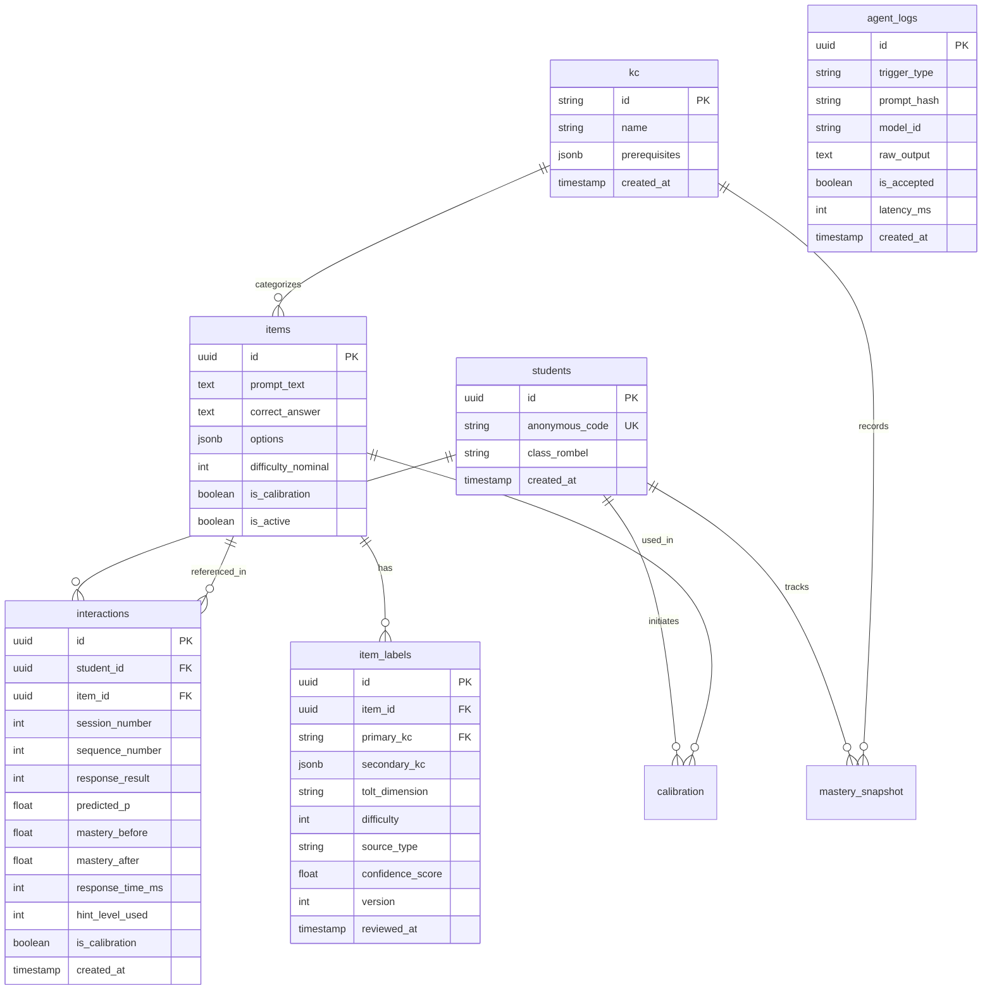
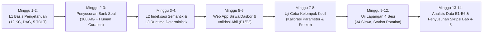

# Product Requirements Document (PRD)
# LogiTrace: Platform Web Evaluasi Formatif Adaptif Berbasis Knowledge Tracing dan RAG dalam Pembelajaran Station Rotation untuk SMK TKJ

**Status Dokumen:** Approved for Implementation (Baseline Final)  
**Versi:** 2.0.0 (Penyelarasan Review Akademik & Kurikulum Merdeka Fase F)  
**Target Pengguna:** 1 Rombongan Belajar SMK TKJ (34 Siswa Kelas XI TKJ 1) & Guru Konsentrasi Keahlian TKJ  
**Sekolah Mitra:** SMK Negeri 4 Bandung  
**Konteks Pengembangan:** Penelitian & Pengembangan (R&D) Model ADDIE 14 Minggu  
**Dokumen Sumber Rujukan:** `desain-final-rag-kt-logitrace.md` & `proposal_skripsi_bab_1_2_3.md`

---

## 1. Executive Summary

### 1.1 Problem Statement
1. **Keterbatasan Korpus Model Konvensional:** Model *Deep Knowledge Tracing* (DKT) konvensional mensyaratkan korpus data interaksi masif ($\ge 100.000$ baris) yang mustahil tersedia pada konteks sekolah kejuruan (SMK) dengan jumlah data kecil (*small data regime*) dan kendala *cold-start*.
2. **Keterbatasan Fasilitas Laboratorium Fisik:** Rasio unit PC laboratorium komputer di sekolah kejuruan mitra berada pada rasio 1 PC untuk 2 orang siswa (1:2), yang memicu dominasi siswa dominan dan menghambat unjuk kerja praktik mandiri.
3. **Kelemahan Asesmen Formatif Konvensional:** Evaluasi formatif berjalan statis, tidak adaptif terhadap zona perkembangan proksimal (*ZPD*) masing-masing siswa, serta lambat dalam mendiagnosis miskonsepsi penalaran teknis (*Logical Thinking*).

### 1.2 Proposed Solution: Ekosistem Sosio-Teknis Terpadu
LogiTrace diimplementasikan bukan sebagai perangkat lunak terisolasi di ruang hampa, melainkan sebagai **Satu Kesatuan Ekosistem Pembelajaran Sosio-Teknis (*Integrated Socio-Technical Instructional Ecosystem*)**:
* **Desain Pembelajaran:** Model *Station Rotation* satu ruangan laboratorium terpadu (*single-room lab zoning*) dengan strategi *Device-Purpose Split*. Kapasitas lab dibagi ke dalam:
  * **Zona A (Praktik Lab Mandiri):** 17 unit PC laboratorium (rasio ideal 1 PC : 1 Siswa) untuk unjuk kerja nyata kabel, konfigurasi nirkabel, dan simulasi jaringan fisik;
  * **Zona B (Evaluasi Adaptif Mandiri & Bimbingan Terarah):** Siswa mengerjakan kuis adaptif melalui telepon pintar (*smartphone*) pribadi via intranet tertutup, didampingi guru bergerak (*roving teacher*) berbasis dasbor seketika (*ambient dashboard*).
* **Arsitektur Perangkat Lunak Tiga Lapis (RAG-KT):**
  * **L1 (Basis Pengetahuan):** 12 KC resmi Kurikulum Merdeka Fase F TKJ (*Teknologi Jaringan Kabel dan Nirkabel*), graf prasyarat terarah (DAG), 5 dimensi TOLT, dan 24 contoh pengerjaan konteks kejuruan.
  * **L2 (Indeks Butir Semantik):** Bank 180 butir soal adaptif (dibangkitkan via AIG berbantuan LLM lalu dikurasi intensif secara *human-in-the-loop*) yang dilabeli secara otomatis oleh model bahasa dengan modul klien aman (`SecureLLMClient`).
  * **L3 (Runtime Deterministik):** Mesin inferensi penguasaan deterministik transparan (< 1 ms), algoritma seleksi adaptif ZPD (pita $0{,}60 \le \hat{p} \le 0{,}85$), protokol kalibrasi 6 butir, 3 pemicu agen RAG (*fixed triggers*), dan arsitektur keamanan bertingkat (*Defense-in-Depth* 5 lapis) dengan *graceful fallback* instan (< 50 ms).

### 1.3 Success Criteria & Key Performance Indicators (KPI)

| ID KPI | Dimensi Evaluasi | Indikator Kinerja Utama (Measurable Target KPI) | Metode Verifikasi |
|:---|:---|:---|:---|
| **KPI-1** | **Validitas Isi & Pemetaan (E1)** | Pelabelan semantik otomatis LLM pada 180 butir soal mencapai kesepakatan **Cohen's $\kappa \ge 0{,}60$** (substansial) terhadap konsensus 2 pakar (dosen ilmu komputer & guru senior), serta koefisien validitas isi **Aiken's $V \ge 0{,}70$**. | Matriks konfusi L2 & kalkulasi formula Aiken / Kappa. |
| **KPI-2** | **Mutu Petunjuk Sokratik (E2)** | Bantuan *scaffolding* agen T2 mengadopsi prinsip *Guiding, Not Solving* dengan **100% bebas kebocoran kunci jawaban (*zero answer leakage*)** dan indeks konsistensi pakar **ICC(2,1) $\ge 0{,}70$** pada rubrik 4 dimensi. | Uji otomatis *leakage guard* & penilaian 3 pakar pada 30 sampel. |
| **KPI-3** | **Akurasi Prediksi Pasca-Kalibrasi (E3)** | Pada butir ke-7 hingga 20 ($476$ observasi), akurasi prediksi performa siswa mencapai **minimal 5 poin persentase di atas *baseline* tanpa-latih terbaik** (*base rate*, *running accuracy*, *difficulty-only*), signifikan via **Uji McNemar ($p < 0{,}05$)** dan bootstrap 95% CI. | Komparasi log prediksi vs aktual pada butir 7–20 (butir 1–6 kalibrasi dieksklusi). |
| **KPI-4** | **Reliabilitas Sistem LLM Multi-Provider (E4)** | Konsistensi pelabelan dalam 3 kali pengulangan mencapai **$\ge 95\%$ identik** pada parameter deterministik (`temperature = 0`), format JSON valid $\ge 98\%$, serta stabilitas inferensi teruji pada variasi *prompt* dan multi-provider. | *Automated script audit* pada 3 kali *batch run*. |
| **KPI-5** | **Kelayakan Teknis & UX (E5)** | Latensi aturan L3 $\le 10$ ms ($p95$); latensi pemanggilan agen RAG $\le 0{,}8$ detik ($p95$ via Cloud API Groq/DeepSeek) / $\le 3{,}0$ detik ($p95$ via Ollama lokal) dengan **Graceful Fallback instan (< 50 ms)** ke bank petunjuk statis jika terjadi *timeout*; serta skor **System Usability Scale (SUS) $\ge 68{,}0$** (*Good/Acceptable*) dari 34 siswa. | *Benchmark log* PostgreSQL/Redis & kuesioner baku SUS 10 butir. |
| **KPI-6** | **Dampak Belajar & Keseimbangan TOLT (E6)** | (a) Peningkatan signifikan pada skor tes TOLT-Jaringan (**$N\text{-Gain} \ge 0{,}30$** kategori sedang, ukuran efek berpasangan **Cohen's $d_z$ signifikan $p < 0{,}05$**);<br/>(b) Keseimbangan profil peningkatan terpetakan melalui **One-Way Repeated Measures ANOVA (RM-ANOVA)** dengan uji sferisitas Mauchly dan koreksi Greenhouse-Geisser/Huynh-Feldt (atau Uji Friedman) serta diagram radar $d_z$ per dimensi;<br/>(c) Kontribusi spesifik software adaptif terbukti via **Analisis Hubungan Dosis-Respons** ($r \ge 0{,}35, p < 0{,}05$) antara log transaksi digital ($h, m$, volume soal) dengan $N\text{-Gain}$; serta<br/>(d) Validitas internal terkonfirmasi melalui **6 butir kontrol NEDV** (TP 2.3 VoIP & TP 2.4/2.5 Fiber Optik) yang **tidak mengalami peningkatan signifikan ($p > 0{,}05$)**. | *Paired t-test*, One-Way RM-ANOVA / Friedman, korelasi Pearson/Spearman, dan uji beda NEDV. |

---

## 2. User Experience & Functionality

### 2.1 User Personas

| Persona | Profil & Karakteristik | Kebutuhan Utama | Peran dalam Ekosistem Pembelajaran |
|:---|:---|:---|:---|
| **Siswa SMK TKJ** *(Ahmad, 16 th)* | Siswa kelas XI TKJ 1; memiliki ponsel cerdas; menempuh mata pelajaran Teknologi Jaringan Kabel dan Nirkabel (Fase F). | Kuis formatif adaptif yang menantang sesuai ZPD tanpa membuatnya frustrasi; bantuan petunjuk Sokratik saat mengalami kebuntuan; hak mandiri memakai PC lab 1:1. | Mengerjakan kuis adaptif mandiri di Zona B melalui smartphone via intranet; unjuk kerja praktikum kabel/nirkabel mandiri di Zona A (PC 1:1). |
| **Guru Produktif TKJ** *(Pak Budi, 38 th)* | Guru kejuruan senior pengampu rombel 34 siswa; memandu pembelajaran *Station Rotation* di laboratorium. | Dasbor orkestrasi seketika (*ambient dashboard*) yang tidak membebani konsentrasi (*no teacher overload*); informasi cepat siswa yang macet; panduan bimbingan kelompok kecil. | Berperan sebagai guru bergerak (*roving teacher*) di Zona B: mendatangi meja siswa secara privat berbasis kartu prioritas **Top-3 Stuck Students** tanpa menimbulkan stigma sosial pemisahan remedial. |
| **Dosen / Peneliti / Penguji** | Dosen pendidikan ilmu komputer dan penguji skripsi; berorientasi pada integritas ilmiah dan kausalitas data. | Bukti pemisahan efek software dari efek lab 1:1; transparansi audit log *append-only*; parameter matematis yang dapat diverifikasi tanpa *black-box*. | Menilai keabsahan validitas isi E1, mutu petunjuk E2, keunggulan prediksi E3, analisis dosis-respons, serta keterisolasian efek tes via NEDV. |

---

### 2.2 User Stories & Acceptance Criteria

#### US-01: Protokol Kalibrasi Cold-Start (Sesi 1 Siswa Baru)
- **Sebagai** siswa baru di sesi pertama,
- **Saya ingin** mengerjakan 6 butir soal awal yang terstandar,
- **Agar** sistem dapat memetakan status penguasaan awal saya tanpa memerlukan korpus data perilaku masa lalu.
- **Acceptance Criteria**:
  - Sistem menginisialisasi nilai prioritas rendah $m_k = 0{,}25$ untuk seluruh 12 KC kurikulum.
  - Tepat 6 butir kalibrasi terstandar disajikan (2 mudah, 2 sedang, 2 sulit) yang mengukur konsep akar DAG (`WLAN_STANDARDS`, `WLAN_TOPOLOGY_BSS`, `IP_PEER_CONFIG`).
  - Sistem secara ketat menandai baris interaksi dengan flag `is_calibration = TRUE`.
  - Butir 1–6 secara otomatis **dikecualikan** dari perhitungan metrik akurasi prediksi pasca-kalibrasi Jalur E3.
  - KC yang belum terukur diestimasi dari rata-rata klaster prasyarat dan ditampilkan dengan motif arsir khusus (`confidence: low`) pada dasbor guru.

#### US-02: Pengerjaan Kuis Formatif Adaptif Real-Time (Zona B)
- **Sebagai** siswa yang belajar di Zona B,
- **Saya ingin** menerima butir soal yang sesuai dengan kapasitas penalaran dan zona perkembangan proksimal saya,
- **Agar** saya tertantang secara optimal tanpa merasa jenuh atau putus asa.
- **Acceptance Criteria**:
  - Mesin runtime L3 menyeleksi butir pada **pita peluang sasaran optimal $0{,}60 \le \hat{p} \le 0{,}85$** (meminimalkan jarak ke target tengah $0{,}72$).
  - Butir soal hanya dapat disajikan jika **seluruh simpul prasyarat langsungnya** pada DAG telah mencapai status penguasaan $m \ge 0{,}60$.
  - Setiap jawaban siswa langsung memperbarui nilai status penguasaan $m$ secara deterministik (< 1 ms).
  - Soal yang sudah diselesaikan pada sesi berjalan tidak akan diulang kecuali terjadi kondisi habis bank soal (*fallback relaxation*).

#### US-03: Bantuan Petunjuk Sokratik Bertingkat (Agen RAG T2)
- **Sebagai** siswa yang mengalami kebuntuan kognitif,
- **Saya ingin** meminta petunjuk bantuan bertahap,
- **Agar** saya dipandu berpikir langkah demi langkah tanpa membocorkan kunci jawaban akhir (*Guiding, Not Solving*).
- **Acceptance Criteria**:
  - Tombol "Minta Petunjuk" aktif di antarmuka ponsel cerdas, atau terpicu otomatis jika siswa menjawab salah 2 kali berturut-turut pada KC yang sama.
  - Bantuan tersaji dalam 3 tingkatan terstruktur: Level 1 (mengarahkan perhatian), Level 2 (memberikan langkah antara), dan Level 3 (memberikan kerangka penalaran).
  - Panjang teks petunjuk dibatasi maksimal 60 kata dan **100% wajib lolos *leakage guard*** (tidak memuat string kunci jawaban atau frasa pembocor).
  - Jika siswa menjawab benar setelah membuka petunjuk, pembaruan penguasaan dikalikan faktor bobot $h = 0{,}5$.
  - **Graceful Fallback:** Jika respons LLM lokal melewati batas waktu 3,0 detik (*timeout*), sistem menyajikan petunjuk dari **Bank Petunjuk Statis Terkurasi (< 50 ms)** di Redis/PostgreSQL.

#### US-04: Dasbor Orkestrasi Ambient Guru & Kartu Prioritas Top-3 Stuck Students
- **Sebagai** guru pengampu yang berkeliling (*roving teacher*) di Zona B,
- **Saya ingin** melihat visualisasi minimalis mengenai siswa yang paling membutuhkan bantuan seketika,
- **Agar** perhatian saya tidak terpecah oleh beban kognitif berlebih (*teacher overload*) dan saya dapat mendatangi meja siswa yang tepat secara privat.
- **Acceptance Criteria**:
  - Mengadopsi prinsip *Ambient Awareness*: menyajikan kartu prioritas **3 Siswa Teratas yang Paling Mendesak Membutuhkan Bimbingan (*Top-3 Stuck Students*)** beserta konsep KC titik kebuntuan.
  - Menampilkan matriks peta panas (*heatmap*) 34 siswa $\times$ 12 KC dengan kode warna status penguasaan kontinu $m \in [0{,}02;\ 0{,}98]$.
  - Data diperbarui secara seketika (*real-time*) melalui protokol WebSocket.
  - **Larangan Etis:** Dasbor dilarang keras menampilkan pelabelan psikologis yang menghakimi siswa (dilarang memuat label seperti "siswa bodoh" atau "siswa lamban").

#### US-05: Pelabelan Semantik Otomatis Bank Soal Baru (Agen RAG T1)
- **Sebagai** pengembang kurikulum / guru,
- **Saya ingin** mengunggah butir soal baru dan memperoleh pelabelan otomatis KC, TOLT, dan tingkat kesulitan dari sistem,
- **Agar** proses pengindeksan bank soal berjalan cepat dan konsisten dengan basis pengetahuan.
- **Acceptance Criteria**:
  - Agen T1 membaca teks butir soal, mengambil 5 butir termirip melalui *vector similarity*, lalu mengeluarkan struktur JSON: `kc_utama`, `kc_sekunder[]`, `dimensi_tolt`, `kesulitan` (1–3), dan `keyakinan` (0.0–1.0).
  - Butir dengan nilai `keyakinan < 0{,}60` otomatis dialihkan ke **Antrean Tinjauan Guru (*Teacher Review Queue*)**.
  - Setiap perubahan label oleh guru tercatat riwayatnya dalam tabel `item_labels_history`.

#### US-06: Ringkasan Sesi Pembelajaran & Analisis Kelas (Agen RAG T3)
- **Sebagai** guru kelas di akhir jam pelajaran (menit ke-80),
- **Saya ingin** menerima ringkasan naratif otomatis mengenai dinamika pemahaman kelas,
- **Agar** saya dapat memberikan ulasan penutup yang tepat sasaran dan merencanakan rotasi sesi berikutnya.
- **Acceptance Criteria**:
  - Agen T3 menyusun ringkasan naratif terstruktur berbasis data agregat penguasaan 12 KC kelas.
  - Menyajikan rekomendasi pembentukan kelompok diskusi sebaya (*peer-tutoring*) untuk sesi berikutnya.

#### US-07: Integritas Audit Trail & Ekspor Data Analisis Dosis-Respons
- **Sebagai** peneliti skripsi,
- **Saya ingin** mengekspor seluruh log transaksi interaksi siswa yang bersifat *append-only*,
- **Agar** seluruh pengujian statistik (E1–E6), analisis korelasi dosis-respons, dan uji kontrol NEDV dapat diaudit secara transparan di hadapan penguji sidang.
- **Acceptance Criteria**:
  - Tabel `interactions` bersifat murni *append-only* (perintah SQL `UPDATE` dan `DELETE` dinonaktifkan).
  - Berkas ekspor menggunakan kode anonim siswa unik (`std_01` s.d. `std_34`) tanpa mencantumkan identitas nama asli.

---

### 2.3 Non-Goals (Batasan Ruang Lingkup Sistem)
1. **Tidak Melatih Model Neural dari Nol (*Training-Free*):** Sistem tidak melakukan pelatihan jaringan saraf tiruan berulang (seperti RNN/LSTM pada DKT konvensional) atau *gradient descent updates*. LLM lokal dijalankan secara beku (*frozen*).
2. **Tidak Melacak Praktik Fisik Lab PC Secara Digital:** Aktivitas motorik siswa di Zona A (mencolokkan kabel LAN, crimping RJ-45, atau menekan tombol saklar) tidak direkam ke dalam basis data DKT LogiTrace. Rekaman kognitif berasal murni dari Zona B.
3. **Tidak Memodelkan Variabel Afektif / Psikologis:** Sistem tidak menyimpulkan suasana hati, ekspresi wajah, atau kondisi emosional siswa.
4. **Tidak Mengklaim Keunggulan DKT pada Big Data:** LogiTrace dirancang khusus untuk memecahkan masalah evaluasi adaptif pada skala kelas kejuruan (*small data regime*), bukan bersaing pada dataset publik masif 100.000 data.
5. **Kedaulatan & Perlindungan Data Pribadi (Zero-PII Isolation):** Seluruh identitas pribadi siswa (nama, NISN, NIK, dsb.) disensor 100% oleh modul `PIIScrubber` sebelum kueri konsep dikirim ke cloud AI, dan basis data analitik disimpan eksklusif pada server/laptop lokal peneliti.

---

## 3. AI & Knowledge Tracing System Requirements

### 3.1 Spesifikasi Arsitektur Multi-Provider & Klien Aman (SecureLLMClient)
- **Modul Klien:** `SecureLLMClient` (`logitrace/backend/app/rag/secure_client.py`) yang mengimplementasikan arsitektur keamanan bertingkat (*Defense-in-Depth*).
- **Pilihan Provider & Model:**
  - *Local OpenAI-Compatible Proxy (Default)*: **9router** (`ag/gemini-3.8-flash` via `http://localhost:20128/v1/chat/completions`, ringan tanpa membebani GPU/RAM lokal).
  - *Direct Cloud Inference Engine*: **Groq** (`llama-3.1-8b-instant`, latensi ultra-cepat < 0,4s) atau **DeepSeek** (`deepseek-chat` / DeepSeek-V3, biaya ultra-rendah < Rp 2.000 per rombel).
  - *Local Offline Fallback Engine*: **Ollama** lokal pada CPU server (`Qwen2.5-3B-Instruct-Q4_K_M` / `qwen2.5:3b` via `http://localhost:11434/api/generate`).
- **Parameter Inferensi Deterministik:**
  - `temperature = 0.0` (deterministik mutlak)
  - `seed = 42`
  - `stream = False` (mencegah fragmentasi payload SSE)
  - `max_tokens = 120–150` (agen T2) / `280–400` (agen T1 & T3)
  - `model_id` wajib dicatat secara dinamis pada setiap transaksi tabel `agent_logs`.

---

### 3.2 Arsitektur Alur Keamanan Bertingkat (Defense-in-Depth)

```mermaid
flowchart TD
    subgraph LocalDevice ["Perangkat Guru / Laptop Peneliti (Local Edge)"]
        Siswa["Siswa di Zona B<br/>(Klik 'Minta Petunjuk')"] --> Service["HintService (Backend FastAPI)"]
        
        subgraph Layer1 ["Layer 1: Pre-Flight Zero-PII Sanitizer"]
            Service --> PIIScrub["PIIScrubber<br/>(Sensor NISN, Nama, ID Siswa, No HP, Sekolah)"]
            DBLocal[("Database Lokal<br/>(Nama & NISN Asli Tersimpan)") ]
        end

        subgraph Layer2 ["Layer 2: Credential & Transport Security"]
            PIIScrub --> Client["SecureLLMClient<br/>(Enkapsulasi Secret Key & TLS 1.3)"]
        end
    end

    subgraph ExternalCloud ["External Cloud AI (DeepSeek / Groq)"]
        Client -- "HTTPS Encrypted (Hanya Teks Soal & Konsep)" --> CloudLLM["Cloud Inference Engine<br/>(DeepSeek-V3 / Groq Llama-3.1)"]
    end

    subgraph GuardrailAndFallback ["Layer 4 & 5: Verifikasi Output & Fallback"]
        CloudLLM -- "Respon Petunjuk Mentah" --> Guard["AnswerLeakageGuard<br/>(Regex Anti-Bocor Kunci)"]
        Guard -- "Lolos (< 60 kata & Zero Leakage)" --> XSSClean["Anti-XSS Sanitizer<br/>(Escape HTML Entities)"]
        Guard -- "Bocor / Timeout > 3,0s / HTTP 429" --> Fallback["Instant Static Bank (< 50 ms)<br/>(logitrace/data/fallback_hints)"]
    end

    XSSClean --> UI["Tampil di Layar Smartphone Siswa<br/>(Petunjuk Sokratik Terpandu)"]
    Fallback --> UI
```

#### Spesifikasi Lima Lapisan Pertahanan:
1. **Lapisan 1 (Pre-Flight Zero-PII Sanitization):** Menyensor NISN, NIK, nomor telepon, email, ID siswa, dan nama sekolah menjadi token `[REDACTED_*]` sebelum transmisi keluar.
2. **Lapisan 2 (Credential & Transport Hardening):** Kunci API diisolasi pada `.env` server backend (tidak pernah dikirim ke browser siswa) dengan HTTPS (TLS 1.2+).
3. **Lapisan 3 (Strict SLA Timeout):** Batas waktu tunggu cloud dipatok maksimal 3,0 detik.
4. **Lapisan 4 (Post-Flight Leakage Guard & Anti-XSS):** Memverifikasi panjang $\le 60$ kata, memindai string kunci jawaban dan kata terlarang, serta sanitasi `html.escape()`.
5. **Lapisan 5 (Graceful Fallback Instan < 50 ms):** Mengalihkan otomatis ke bank petunjuk statis jika terjadi error jaringan, limit kuota, latensi $> 3$s, atau kunci bocor.

#### Spesifikasi Pemicu & Batasan Guardrail:
1. **Pemicu T1 (Pelabelan Otomatis):**
   * Konteks: 12 dokumen KC + 5 dokumen TOLT + 5 butir termirip via vektor embedding.
   * Format JSON: `kc_utama`, `kc_sekunder[]`, `dimensi_tolt`, `kesulitan` (1–3), `alasan`, `keyakinan` (0.0–1.0).
   * Butir dengan keyakinan $< 0{,}60$ otomatis ditahan di antrean verifikasi guru.
2. **Pemicu T2 (Bantuan Sokratik Scaffolding):**
   * Konteks: Dokumen KC terkait + daftar miskonsepsi umum + contoh pengerjaan + riwayat kesalahan siswa.
   * Format JSON: `petunjuk` (maks 60 kata), `level` (1, 2, atau 3), `kc_id`.
   * **Pemeriksa Kebocoran Jawaban (*Answer Leakage Checker*):** Backend menjalankan filter regex otomatis terhadap teks kunci jawaban dan frasa terlarang (`"jawabannya adalah"`, `"pilihan yang benar"`). Jika terdeteksi, output dibuang dan diganti petunjuk statis.
3. **Pemicu T3 (Dasbor Guru Real-Time):**
   * Konteks: Matriks penguasaan 12 KC kelas dan log waktu respons.
   * **Ambient Awareness:** Menghasilkan kartu prioritas **Top-3 Stuck Students** agar guru langsung mengetahui titik kebuntuan siswa yang paling mendesak dibimbing.

---

## 4. Technical Specifications

### 4.1 Formulasi Matematis Mesin Deterministik (L3 Runtime Engine)

Semua pembaruan status kognitif siswa dieksekusi secara instan (< 1 ms) menggunakan formula matematika deterministik berbasis bukti:

1. **Model Peluang Benar Butir ($\hat{p}$):**
   $$\hat{p}(q) = \sigma\big(\mathrm{logit}(m_{s, k_q}) + \theta_{d_q}\big)$$
   di mana $\mathrm{logit}(m) = \ln\left(\frac{m}{1-m}\right)$, $\sigma(z) = \frac{1}{1 + e^{-z}}$, dengan bobot kesulitan apriori:
   $$\theta_1 = +0{,}9\text{ (mudah)}, \quad \theta_2 = 0{,}0\text{ (sedang)}, \quad \theta_3 = -0{,}9\text{ (sulit)}$$

2. **Aturan Pembaruan Penguasaan Deterministik ($m$):**
   $$m \leftarrow \begin{cases} 
   m + \alpha_d (1 - m) h, & \text{jika respons benar } (r = 1) \\ 
   m - \gamma_d m, & \text{jika respons salah } (r = 0) 
   \end{cases}$$
   dengan laju adaptif berbobot tingkat kesulitan:
   $$\alpha_d = \alpha_0 \big(1 + \beta(d - 1)\big), \qquad \gamma_d = \gamma_0 \big(1 + \beta(3 - d)\big)$$
   *Nilai Dasar Heuristik Apriori:* $\alpha_0 = 0{,}30, \ \gamma_0 = 0{,}25, \ \beta = 0{,}40$.  
   *Faktor Bantuan:* $h = 1{,}0$ (tanpa petunjuk); $h = 0{,}5$ (benar setelah membuka petunjuk Sokratik).  
   *Kalibrasi Empiris:* Nilai dasar ini akan dikalibrasi secara empiris pada Uji Coba Terbatas (Minggu ke-7, 9–12 siswa non-sampel).  
   *Rentang Tertutup:* Nilai $m$ dipotong (*clipped*) ke rentang $[0{,}02;\ 0{,}98]$.

3. **Fungsi Peluruhan Memori Temporal Ebbinghaus (On-Read):**
   $$m_k(t) = m_k(t_{\text{akhir}}) \cdot \exp\left(-\frac{t - t_{\text{akhir}}}{\tau_k}\right), \qquad \tau_k = 60\text{ hari}$$

4. **Algoritma Seleksi Butir Adaptif (ZPD):**
   Memilih butir $q$ yang meminimalkan fungsi penalti:
   $$\text{Skor}(q) = |\hat{p}(q) - 0{,}72| - 0{,}05 \cdot \mathbb{I}(\text{KC belum tersentuh}) + 0{,}10 \cdot \mathbb{I}(\text{KC sama dengan butir sebelumnya})$$
   dengan syarat: belum dijawab pada sesi bersangkutan, seluruh prasyarat DAG $m \ge 0{,}60$, dan $\hat{p}(q) \in [0{,}60;\ 0{,}85]$.

---

### 4.2 Struktur Basis Pengetahuan Kurikulum (L1 Knowledge Base)

Berakar langsung pada Kurikulum Merdeka Fase F TKJ elemen *Teknologi Jaringan Kabel dan Nirkabel* (TP 2.1 & TP 2.2):

#### Taksonomi 12 Knowledge Components (KC):
1. `WLAN_STANDARDS`: Standar IEEE 802.11 b/g/n/ac/ax dan spesifikasi pita frekuensi (2,4 GHz vs 5 GHz).
2. `WLAN_TOPOLOGY_BSS`: Perbedaan topologi mode *Ad-Hoc* (IBSS) vs mode *Infrastructure* (BSS/ESS).
3. `IP_PEER_CONFIG`: Pengalamatan IPv4 statis, subnetting lokal, dan konfigurasi klien nirkabel.
4. `WLAN_FREQ_CHANNEL`: Alokasi kanal *non-overlapping* (1, 6, 11 pada 2,4 GHz) dan mitigasi interferensi.
5. `WLAN_SECURITY_AUTH`: Autentikasi identitas SSID dan enkripsi WPA2-PSK / WPA3-SAE.
6. `WLAN_HOST_HARDENING`: Pengamanan klien melalui filtrasi alamat fisik (*MAC Filtering*) dan dinding api (*firewall*).
7. `WLAN_SIGNAL_PROP`: Propagasi gelombang radio, nilai redaman material (*path loss*), dan RSSI (-dBm).
8. `WLAN_ROAMING_PROB`: Ambang batas perpindahan sinyal klien (*roaming threshold*) dan *hysteresis extender*.
9. `WLAN_CHANNEL_COLLISION`: Perhitungan peluang tabrakan paket (*collision*) dan beban kepadatan kanal.
10. `ICMP_CONNECTIVITY`: Pengujian ketercapaian host melalui protokol ICMP (`ping`) dan evaluasi *Round-Trip Time* (RTT).
11. `ICMP_TROUBLE_DHU`: Pelacakan akar masalah pesan galat *Destination Host Unreachable* (DHU) akibat salah subnet/ARP.
12. `ICMP_TROUBLE_RTO`: Pelacakan akar masalah pesan galat *Request Timed Out* (RTO) akibat blokade firewall atau redaman ekstrem.

#### Graf Dependensi Prasyarat (Prerequisite DAG):
```
WLAN_STANDARDS ──► WLAN_FREQ_CHANNEL ──► WLAN_CHANNEL_COLLISION
        │                    │
        ▼                    ▼
WLAN_TOPOLOGY_BSS ──► WLAN_SIGNAL_PROP ──► WLAN_ROAMING_PROB
        │                    │
        ▼                    ▼
IP_PEER_CONFIG ─────► ICMP_CONNECTIVITY ─┬─► ICMP_TROUBLE_DHU
        │                                └─► ICMP_TROUBLE_RTO
        ▼                                         ▲
WLAN_SECURITY_AUTH ──► WLAN_HOST_HARDENING ───────┘
```

---

### 4.3 Skema Basis Data Relasional & Aturan Integritas (Append-Only)



* **Aturan Mutlak Integritas Audit:** Tabel `interactions` berstatus *append-only*. Perintah SQL `UPDATE` dan `DELETE` dinonaktifkan di tingkat izin basis data.
* **Pemisahan Kalibrasi:** Kolom `is_calibration = TRUE` menandai butir 1–6 agar secara otomatis tereksklusi dari perhitungan metrik akurasi prediktif E3.

---

### 4.4 Keamanan Teknis, Daya, dan Infrastruktur Jaringan (S6)
1. **Access Point (AP) Intranet Mandiri:** Di Zona B laboratorium disiapkan satu unit Access Point nirkabel khusus yang terisolasi penuh dari internet luar sekolah (hanya menjangkau server lokal LogiTrace), menjamin koneksi stabil bebas interferensi trafik publik.
2. **Catu Daya Cadangan (UPS):** Server lokal dan router Access Point dihubungkan ke unit catu daya cadangan (*Uninterruptible Power Supply* / UPS) guna melindungi sesi rotasi dari fluktuasi listrik sekolah.

---

## 5. Phased Roadmap 14 Minggu (ADDIE)



### Rincian Target Fase:
* **Fase 1: Fondasi Pengetahuan & Bank Soal (Minggu 1–4)**
  * Penyusunan dokumen L1: 12 KC, graf prasyarat DAG, 5 dokumen TOLT, dan 24 contoh pengerjaan.
  * Pembangkitan draf 180 butir soal kuis adaptif berbantuan AI (*AI-assisted item generation*) berbasis dokumen L1, dilanjutkan kurasi mandiri intensif (*human-in-the-loop*) oleh peneliti.
  * Penulisan 10 butir tes TOLT-Jaringan paralel (Bentuk A dan B) dengan penskoran polikotomis (skor 0, 1, 2) dan 6 butir kontrol NEDV (2 VoIP, 4 Fiber Optik).
  * Pengkodean engine FastAPI, aturan pembaruan penguasaan deterministik, dan seleksi pita adaptif ZPD.
* **Fase 2: Antarmuka, Validasi Pakar, dan Kalibrasi (Minggu 5–8)**
  * Pengembangan web kuis siswa responsif dan dasbor pemantauan guru berbasis WebSocket dengan kartu prioritas *Top-3 Stuck Students*.
  * Uji validasi ahli materi dan media oleh dosen pendidikan ilmu komputer dan guru kejuruan senior (E1: Aiken's V & Cohen's $\kappa$; E2: ICC petunjuk).
  * Uji coba kelompok kecil pada 9–12 siswa non-sampel selama 2 sesi untuk menguji stabilitas latensi, serta **mengkalibrasi parameter dasar heuristik ($\alpha_0, \gamma_0, \beta, \theta_d$) secara empiris**.
  * Pembekuan versi kode, prompt, dan model bahasa lokal (Rilis LogiTrace v1.0 Final).
* **Fase 3: Implementasi Lapangan Station Rotation (Minggu 9–12)**
  * Pelaksanaan *pre-test* paralel (Bentuk A/B tersilang + 6 butir NEDV).
  * Implementasi 4 sesi pembelajaran tatap muka model *Single-Room Station Rotation* pada 34 siswa kelas XI TKJ 1 SMKN 4 Bandung.
  * Pelaksanaan *post-test* paralel tersilang, pengisian angket SUS (34 siswa), dan wawancara semi-terstruktur 3 guru.
* **Fase 4: Evaluasi Statistik & Pelaporan (Minggu 13–14)**
  * Pengolahan empiris jalur E1–E6: validitas E1, mutu E2, akurasi prediksi E3 vs 3 baseline non-latih, reliabilitas E4, latensi/SUS E5, gain kognitif $N\text{-Gain}$, ukuran efek berpasangan $d_z$, uji **One-Way Repeated Measures ANOVA (RM-ANOVA)** / Friedman untuk keseimbangan 5 dimensi TOLT, analisis korelasi dosis-respons, serta uji komparatif butir kontrol NEDV ($p > 0{,}05$).
  * Finalisasi penulisan Bab IV dan Bab V naskah skripsi.

---

## 6. Matrix Keterlacakan Dokumen ke Naskah Skripsi

| Bagian PRD Ini | Bagian Naskah Skripsi (`proposal_skripsi_bab_1_2_3.md`) | Catatan Keselarasan Metodologis |
|:---|:---|:---|
| **Bab 1 (Executive Summary & KPIs)** | Bab 1 (§1.1, §1.2, §1.3) & Bab 3 (§3.5) | Menegaskan posisi novelty *training-free KT*, integrasi ekosistem *station rotation*, mitigasi bias C2 via dosis-respons, dan 6 KPI terukur (E1–E6). |
| **Bab 2 (User Experience & Stories)** | Bab 2 (§2.5) & Bab 3 (§3.3) | Detail sintaks *Station Rotation* satu ruangan lab, strategi *Device-Purpose Split*, dan peran guru bergerak (*roving teacher*). |
| **Bab 3 (AI & RAG Requirements)** | Bab 2 (§2.4) & Bab 3 (§3.2.2 Tahap B & C) | Spesifikasi LLM beku, prompt pelabelan T1, bantuan bertingkat T2 (*leakage guard*), dasbor *ambient awareness* T3, dan *graceful fallback*. |
| **Bab 4 (Technical Specifications)** | Bab 2 (§2.4.3, §2.7) & Bab 3 (§3.4) | Formulasi matematika deterministik L3, taksonomi 12 KC nirkabel Kurikulum Merdeka Fase F TKJ (TP 2.1 & 2.2), DAG, skema basis data *append-only*, AP intranet, dan UPS. |
| **Bab 5 (Phased Roadmap & Risks)** | Bab 3 (§3.8 & §3.7) | Jadwal penelitian 14 minggu (ADDIE), kalibrasi parameter dasar pada minggu ke-7, keterbatasan penelitian transparan, dan mitigasi risiko teknis. |
