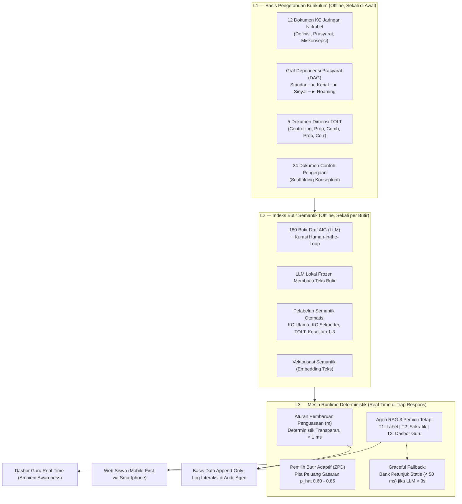

# Desain Sistem RAG-KT "LogiTrace"
## Evaluasi Formatif Adaptif Berbasis Penalaran untuk SMK TKJ — Desain Sistem dan Ekosistem Pembelajaran Terpadu

**Konteks:** Skripsi R&D (ADDIE) · 1 SMK (SMKN 4 Bandung) · 1 kelas sensus (34 siswa XI TKJ 1) · 4 sesi intervensi tatap muka (@ 90 menit) · Laboratorium komputer dengan rasio fisik 1 PC : 2 Siswa  
**Elemen Kurikulum:** *Teknologi Jaringan Kabel dan Nirkabel* (Kurikulum Merdeka Fase F TKJ)  
* **Target Intervensi (4 Sesi):** TP 2.1 (Instalasi Jaringan Kabel dan Nirkabel) & TP 2.2 (Perawatan dan Perbaikan Jaringan Kabel dan Nirkabel)
* **Kontrol NEDV (Non-Equivalent Dependent Variable, 6 Butir):** TP 2.3 (Layanan Voice over IP / VoIP, 2 butir) & TP 2.4–2.5 (Jaringan Fiber Optik, 4 butir)  
**Status Desain:** Final untuk Dijalankan · **Tingkat Kematangan:** Prototipe Teruji dengan Evaluasi Formatif (L3)  
**Prinsip Utama:** Tidak ada model yang dilatih dari nol (*training-free*). LLM lokal dijalankan secara beku (*frozen*), hanya difungsikan untuk memahami makna semantik teks soal dan menyusun petunjuk Sokratik. Mesin inferensi penguasaan beroperasi menggunakan aturan heuristik deterministik (< 1 ms) yang dipadukan dengan indeks semantik kurikulum.

---

## 0. Ringkasan Satu Halaman

| Pertanyaan Kunci | Keputusan Desain Terpilih |
|:---|:---|
| **Apa yang diprediksi?** | Estimasi peluang keberhasilan menjawab benar pada butir berikutnya ($\hat{p}$), status penguasaan kontinu per KC ($m$), dan rekomendasi bimbingan diagnostik guru. |
| **Dari mana "kecerdasan"-nya?** | Bukan dari pelatihan jaringan saraf berulang (DKT), melainkan dari: (a) basis pengetahuan kurikulum resmi buatan guru/peneliti (L1), (b) representasi semantik LLM lokal membaca teks soal (L2), dan (c) aturan pembaruan penguasaan berbasis bukti yang deterministik (L3). |
| **Bagaimana mengatasi *cold-start*?** | 6 butir soal kalibrasi awal terstandar + struktur graf prasyarat (DAG). Sistem tidak membutuhkan korpus riwayat perilaku siswa sebelumnya. |
| **Berapa kebutuhan data minimum?** | 180 butir soal adaptif (dibangkitkan via AIG berbantuan LLM lalu dikurasi intensif secara *human-in-the-loop*) + 12 dokumen KC untuk membangun sistem; ±300–500 respons siswa untuk pengujian akurasi prediksi pasca-kalibrasi (E3). |
| **Apakah memerlukan perangkat GPU khusus?** | Tidak. LogiTrace mengimplementasikan arsitektur hybrid (`SecureLLMClient`): Cloud API berlatensi ultra-rendah (< 0,8 s via Groq/DeepSeek) dengan proteksi Pre-Flight Zero-PII Sanitizer, didukung opsi model lokal CPU (3B Q4_K_M via Ollama) dan bank petunjuk statis offline (< 50 ms). |
| **Bagaimana sistem diuji secara empiris?** | Enam jalur evaluasi terstruktur (E1–E6): validitas isi & akurasi pemetaan, mutu petunjuk Sokratik, akurasi prediksi pasca-kalibrasi terhadap 3 baseline tanpa-latih, reliabilitas sistem multi-provider, kelayakan teknis/SUS, dan dampak belajar (N-Gain, $d_z$, Repeated Measures ANOVA profil TOLT, analisis dosis-respons, serta uji kontrol NEDV). |
| **Status Klaim Ilmiah & Bias Perancu (C2)** | Perlakuan intervensi diposisikan sebagai **Satu Kesatuan Ekosistem Pembelajaran Sosio-Teknis (*Integrated Socio-Technical Instructional Ecosystem*)** yang memadukan model *Single-Room Station Rotation*, strategi *Device-Purpose Split*, peran guru bergerak (*roving teacher*), dan aplikasi web adaptif LogiTrace. Perbaikan rasio 1:1 di lab PC diakui sebagai rekayasa desain instruksional terencana (*deliberate instructional design*), dan kontribusi spesifik software adaptif diuji melalui **Analisis Korelasi Dosis-Respons (*Dosage-Response*)**. |

---

## 1. Posisi Desain: Pergeseran Paradigma Data (Content vs Behavioral Corpus)

| Dimensi Komparasi | Model Jaringan Saraf Konvensional (DKT / RNN) | **Sistem LogiTrace (RAG-KT)** |
|:---|:---|:---|
| **Hakikat Pemodelan Kognitif** | Estimasi probabilitas variabel laten (*latent state*) via *backpropagation* | Pembaruan status penguasaan berbasis aturan heuristik deterministik dipadukan dengan indeks semantik kurikulum |
| **Kebutuhan Model Prediksi** | Jaringan saraf tiruan dilatih pada 100.000+ data interaksi | Tidak ada pelatihan model (*training-free*); aturan penguasaan deterministik eksplisit (< 1 ms) |
| **Representasi Pengetahuan Domain** | Tersirat (*implicit*) di dalam matriks bobot jaringan saraf numerik | Tertulis eksplisit dalam dokumen basis pengetahuan kurikulum yang dapat dibaca manusia |
| **Adaptasi ke Silabus/Materi Baru** | Wajib mengumpulkan dataset baru dan melatih ulang model (*retraining*) | Cukup menyunting dan memperbarui berkas dokumen basis pengetahuan kurikulum |
| **Pemahaman Butir Soal** | Ko-okurensi statistik biner jawaban benar/salah | Representasi semantik: LLM membaca teks soal dan mencocokkan kemiripan vektor (*embedding*) |
| **Kebutuhan Data Minimum** | Korpus perilaku siswa berskala masif (*behavioral corpus*) | Korpus konten kurikulum yang terstruktur rapi (*content corpus*) |
| **Metrik Evaluasi Utama** | Nilai global AUC (*Area Under ROC Curve*) | Akurasi pemetaan pakar (Cohen's $\kappa$), akurasi prediksi pasca-kalibrasi, reliabilitas sistem |
| **Transparansi / Jejak Audit** | Kotak hitam (*black box*); logika internal sulit dijelaskan | Deterministik transparan; setiap perubahan nilai penguasaan memiliki arti pedagogis dan dapat diaudit |

**Kalimat Kunci untuk Naskah Skripsi:**  
> *"Kebutuhan data bergeser dari korpus perilaku siswa (yang tidak tersedia pada domain kejuruan lokal) menuju korpus konten kurikulum (yang dapat ditulis secara terstruktur oleh pendidik)."*

> **Batas Kejujuran Akademis:** Model bahasa besar (LLM) bukan kontribusi orisinal peneliti. Kontribusi orisinal penelitian skripsi ini terletak pada:
> 1. Perumusan taksonomi atomik 12 KC kejuruan $\times$ 5 dimensi penalaran formal TOLT yang divalidasi pakar;
> 2. Perancangan aturan penguasaan kognitif deterministik yang dapat diaudit secara transparan;
> 3. Integrasi inovatif ke dalam ekosistem pembelajaran *Station Rotation* satu ruangan lab berbasis *Device-Purpose Split*; serta
> 4. Pengujian empiris enam jalur (E1–E6) untuk mengukur batas keandalan pendekatan *training-free* pada kelas nyata.

### 1.1 Penegasan Judul Skripsi
Berdasarkan telaah metodologis, judul resmi skripsi yang disahkan adalah:

> **"Pengembangan Web Evaluasi Formatif Adaptif Berbasis Knowledge Tracing dan Retrieval-Augmented Generation (LogiTrace) dalam Pembelajaran Station Rotation untuk Meningkatkan Logical Thinking Siswa SMK"**

Di dalam naskah, gunakan istilah payung **"Pelacakan Pengetahuan (*Knowledge Tracing*, KT)"** dan tegaskan bahwa Lapisan 3 LogiTrace menggunakan mekanisme inferensi berbasis aturan heuristik deterministik (*deterministic heuristic rule-based engine*) yang dipadukan dengan indeks semantik kurikulum, bukan estimasi probabilitas variabel laten seperti BKT/DKT konvensional.

---

## 2. Arsitektur Tiga Lapis (Three-Tier Architecture)



**Pembagian Kerja yang Tidak Boleh Dilanggar:**

| Tugas Sistem | Komponen Penanggung Jawab | Alasan Desain |
|:---|:---|:---|
| Membaca teks butir soal, mengekstrak makna semantik, menyusun petunjuk Sokratik, dan meringkas narasi kelas | **Model Bahasa Besar (LLM Lokal Frozen)** | Keunggulan utama LLM terletak pada pemahaman bahasa alami dan kontekstualisasi teks. |
| Menghitung nilai status penguasaan ($m$), menyeleksi butir adaptif berikutnya, dan memicu panggilan agen | **Aturan Heuristik Deterministik (L3 Engine)** | Wajib dieksekusi instan (< 1 ms), stabil, deterministik, bebas halusinasi, dan dapat diaudit penuh. |

---

## 3. L1 — Basis Pengetahuan Kurikulum (Knowledge Base)

Disusun satu kali di awal oleh peneliti bersama guru kejuruan senior, berakar langsung pada Kurikulum Merdeka Fase F TKJ elemen *Teknologi Jaringan Kabel dan Nirkabel* (TP 2.1 & TP 2.2).

### 3.1 Dokumen Knowledge Components (12 Berkas JSON)
Format baku dokumen spesifikasi per KC:

```json
{
  "kc_id": "WLAN_ROAMING_PROB",
  "nama": "Analisis Keputusan Roaming Jalur Pemancar Nirkabel",
  "definisi": "Menganalisis probabilitas perangkat klien nirkabel berpindah asosiasi sinyal dari Root Access Point ke WLAN Extender berdasarkan ambang batas kuat sinyal (roaming threshold) dan redaman udara.",
  "prasyarat": ["WLAN_FREQ_CHANNEL", "WLAN_SIGNAL_PROP", "WLAN_TOPOLOGY_BSS"],
  "indikator_menguasai": [
    "Menentukan titik perpindahan sinyal berdasarkan selisih threshold RSSI (misal -75 dBm)",
    "Memprediksi stabilitas koneksi saat berada di area overlap antar dua pemancar"
  ],
  "miskonsepsi_umum": [
    "Mengasumsikan perangkat selalu otomatis terhubung ke pemancar dengan jarak fisik terdekat tanpa memperhitungkan hysteresis threshold",
    "Mengira bahwa sinyal kuat selalu menjamin throughput data tinggi tanpa melihat interferensi kanal"
  ],
  "contoh_pengerjaan": "Skenario laptop bergerak menjauhi AP 1 (RSSI turun dari -60 ke -78 dBm) mendekati AP 2 (RSSI -68 dBm)...",
  "tingkat_tolt_dominan": ["probabilistic", "proportional"]
}
```

### 3.2 Graf Dependensi Prasyarat (Prerequisite DAG)
Struktur dependensi logis antar-12 KC atomik:

```
WLAN_STANDARDS ──► WLAN_FREQ_CHANNEL ──► WLAN_CHANNEL_COLLISION
        │                    │
        ▼                    ▼
WLAN_TOPOLOGY_BSS ──► WLAN_SIGNAL_PROP ──► WLAN_ROAMING_PROB
        │                    │
        ▼                    ▼
IP_PEER_CONFIG ─────► ICMP_CONNECTIVITY ─┬─► ICMP_TROUBLE_DHU
        │                                └─► ICMP_TROUBLE_RTO
        ▼                                         ▲
WLAN_SECURITY_AUTH ──► WLAN_HOST_HARDENING ───────┘
```

**Daftar 12 Knowledge Components (TP 2.1 & TP 2.2):**
1. `WLAN_STANDARDS`: Standar IEEE 802.11 b/g/n/ac/ax dan spesifikasi pita frekuensi (2,4 GHz vs 5 GHz).
2. `WLAN_TOPOLOGY_BSS`: Perbedaan arsitektur mode *Ad-Hoc* (IBSS) vs mode *Infrastructure* (BSS/ESS).
3. `IP_PEER_CONFIG`: Pengalamatan IPv4 statis, subnetting lokal, dan konfigurasi klien nirkabel.
4. `WLAN_FREQ_CHANNEL`: Alokasi kanal *non-overlapping* (1, 6, 11 pada 2,4 GHz) dan mitigasi interferensi.
5. `WLAN_SECURITY_AUTH`: Autentikasi identitas SSID dan enkripsi WPA2-PSK / WPA3-SAE.
6. `WLAN_HOST_HARDENING`: Pengamanan klien melalui filtrasi alamat fisik (*MAC Filtering*) dan dinding api (*firewall*).
7. `WLAN_SIGNAL_PROP`: Propagasi gelombang radio, nilai redaman material (*path loss*), dan RSSI (-dBm).
8. `WLAN_ROAMING_PROB`: Ambang batas perpindahan sinyal klien (*roaming threshold*) dan *hysteresis extender*.
9. `WLAN_CHANNEL_COLLISION`: Perhitungan peluang tabrakan paket (*collision*) dan beban kepadatan kanal.
10. `ICMP_CONNECTIVITY`: Pengujian ketercapaian host melalui protokol ICMP (`ping`) dan evaluasi *Round-Trip Time* (RTT).
11. `ICMP_TROUBLE_DHU`: Pelacakan akar masalah pesan galat *Destination Host Unreachable* (DHU) akibat salah subnet/ARP.
12. `ICMP_TROUBLE_RTO`: Pelacakan akar masalah pesan galat *Request Timed Out* (RTO) akibat blokade firewall atau redaman ekstrem.

*Aturan Eksekusi Graf:* Suatu butir soal hanya dapat disajikan kepada siswa apabila **seluruh KC prasyarat langsungnya telah mencapai estimasi status penguasaan $m \ge 0{,}60$**.

### 3.3 Dokumen Dimensi TOLT dan Contoh Pengerjaan
* **5 Dokumen Dimensi TOLT:** Menguraikan definisi operasional, indikator penguasaan penalaran formal, dan rubrik dua tingkat untuk: *Controlling Variables, Proportional, Combinatorial, Probabilistic,* dan *Correlational Reasoning*.
* **24 Dokumen Contoh Pengerjaan:** 2 berkas per KC (1 kasus benar + 1 analisis kasus salah/miskonsepsi) sebagai bank rujukan kontekstual bagi agen RAG.
* **Total Korpus L1:** $12 + 1 + 5 + 24 = \mathbf{42\text{ dokumen}}$ teks terstruktur.

---

## 4. L2 — Indeks Butir Semantik dan Pelabelan Otomatis

### 4.1 Konstruksi Bank Butir Soal (AIG + Human-in-the-Loop Curation)
Guna menyusun target 180 butir soal adaptif berkualitas tinggi (minimal 5 butir per KC per tingkat kesulitan) dalam linimasa penelitian yang realistis:
1. **Automated Item Generation (AIG):** Draf awal butir soal, kunci jawaban, dan opsi distraktor dibangkitkan berbantuan LLM lokal menggunakan *prompt* berbasis dokumen spesifikasi KC L1.
2. **Kurasi Human-in-the-Loop (Mandatori):** Seluruh 180 draf butir diperiksa, dimurnikan, dan disunting secara mandiri oleh peneliti untuk memastikan akurasi teknis, kejelasan bahasa, dan ketiadaan distorsi sebelum diajukan ke panel ahli (*expert judgment*).
3. **Validasi Panel Ahli:** Divalidasi oleh dosen ahli materi pendidikan ilmu komputer/jaringan dan guru kejuruan senior.

### 4.2 Pelabelan Semantik Otomatis oleh LLM Lokal
Setiap butir soal diproses satu kali (*offline indexation*):

```
SISTEM: Anda asisten kurikulum SMK TKJ. Tugas Anda memberi label butir soal.
KONTEKS: <12 dokumen KC> <5 dokumen dimensi TOLT>

PENGGUNA: Teks butir: "<teks soal>"
Kunci Jawaban: "<kunci>"

Keluarkan JSON terstruktur:
{
  "kc_utama": "<salah satu dari 12 KC>",
  "kc_sekunder": ["..."],
  "dimensi_tolt": "<salah satu dari 5 dimensi TOLT>",
  "kesulitan": 1|2|3,
  "alasan": "<maksimal 25 kata>",
  "keyakinan": 0.0-1.0
}
Aturan Ketat: Satu KC utama. Kesulitan 1 = inferensi satu langkah; Kesulitan 2 = dua langkah terarah; Kesulitan 3 = ≥3 langkah analitis atau kombinasi konsep. Jika ambigu, turunkan nilai keyakinan di bawah 0,60.
```

### 4.3 Penyimpanan, Kendali Mutu, dan Validasi (Jalur E1)
* **Penyimpanan:** Label disimpan pada tabel PostgreSQL `item_labels`, sedangkan representasi vektor teks disimpan pada ekstensi `pgvector` untuk pencarian butir serupa.
* **Ambang Kendali Mutu:** Butir dengan nilai `keyakinan < 0,60` atau yang label modelnya berbeda dari label konsensus pakar secara otomatis masuk ke **Antrean Tinjauan Guru (*Teacher Review Queue*)**.
* **Validasi Jalur E1:** Menghitung kesepakatan antar-penilai antara label LLM vs konsensus 2 pakar independen (dosen & guru) pada seluruh 180 butir soal menggunakan koefisien **Cohen's Kappa ($\kappa \ge 0{,}60$)** dan koefisien validitas isi **Aiken's V ($V \ge 0{,}70$)**. Jalur ini tidak memerlukan data respon siswa sama sekali.

---

## 5. L3 — Mesin Runtime Deterministik dan Agen RAG Tiga Pemicu

### 5.1 Model Peluang Keberhasilan Benar
Untuk setiap siswa $s$ dan komponen pengetahuan $k$, sistem menyimpan satu nilai status penguasaan kontinu $m_{s,k} \in [0{,}02;\ 0{,}98]$. Peluang keberhasilan menjawab benar butir $q$ dengan tingkat kesulitan $d_q \in \{1, 2, 3\}$ dihitung via fungsi sigmoid:

$$\hat{p}(q) = \sigma\big(\mathrm{logit}(m_{s,k_q}) + \theta_{d_q}\big)$$

Di mana $\mathrm{logit}(m) = \ln\left(\frac{m}{1-m}\right)$, $\sigma(z) = \frac{1}{1 + e^{-z}}$, serta bobot tingkat kesulitan apriori ditetapkan:
$$\theta_1 = +0{,}9\text{ (mudah)}, \quad \theta_2 = 0{,}0\text{ (sedang)}, \quad \theta_3 = -0{,}9\text{ (sulit)}$$

### 5.2 Aturan Pembaruan Penguasaan Deterministik
Setelah siswa merespons butir soal, status penguasaan diperbarui secara instan (< 1 ms):

$$m \leftarrow \begin{cases} m + \alpha_d (1 - m) h, & \text{jika respons benar } (r = 1) \\ m - \gamma_d m, & \text{jika respons salah } (r = 0) \end{cases}$$

Parameter laju penyesuaian:
$$\alpha_d = \alpha_0 \big(1 + \beta(d - 1)\big), \qquad \gamma_d = \gamma_0 \big(1 + \beta(3 - d)\big)$$

Nilai dasar heuristik apriori (*apriori baseline*):
$$\alpha_0 = 0{,}30, \quad \gamma_0 = 0{,}25, \quad \beta = 0{,}40$$
$$h = \begin{cases} 1{,}0, & \text{jika dijawab benar mandiri tanpa petunjuk} \\ 0{,}5, & \text{jika dijawab benar setelah memanfaatkan petunjuk Sokratik} \end{cases}$$

| Tingkat Kesulitan ($d$) | Laju Kenaikan $\alpha_d$ (Benar) | Laju Penurunan $\gamma_d$ (Salah) | Rasional Pedagogis |
|:---:|:---:|:---:|:---|
| **1 (Mudah)** | 0,30 | 0,45 | Salah pada butir mudah menurunkan estimasi penguasaan lebih tajam |
| **2 (Sedang)** | 0,42 | 0,35 | Keseimbangan standar bobot kenaikan dan penurunan |
| **3 (Sulit)** | 0,54 | 0,25 | Menjawab benar butir sulit memberikan bukti penguasaan kognitif yang kuat |

> **Kalibrasi Empiris Parameter (S2):** Nilai parameter di atas merupakan nilai dasar apriori. Parameter ini akan **dikalibrasi secara empiris (*empirically fine-tuned*)** pada tahap Uji Coba Kelompok Kecil (Minggu ke-7, 9–12 siswa) berdasarkan laju respons nyata dan kurva karakteristik butir.

**Peluruhan Memori Temporal Ebbinghaus (saat pembacaan profil):**
$$m_k(t) = m_k(t_{\text{akhir}}) \cdot \exp\left(-\frac{t - t_{\text{akhir}}}{\tau_k}\right), \qquad \tau_k = 60\text{ hari}$$

Setelah pembaruan, nilai penguasaan di-*clip* ke rentang tertutup $[0{,}02;\ 0{,}98]$.

### 5.3 Algoritma Pemilihan Butir Adaptif (ZPD)
Sistem menyeleksi butir soal berikutnya dari himpunan kandidat yang memenuhi:
1. Belum dijawab oleh siswa pada sesi bersangkutan;
2. Seluruh konsep prasyarat langsung pada DAG telah mencapai $m \ge 0{,}60$; serta
3. Estimasi peluang benar $\hat{p}$ berada pada **pita peluang sasaran optimal $0{,}60 \le \hat{p} \le 0{,}85$**.

Sistem memilih butir $q$ yang meminimalkan fungsi penalti:
$$\text{Skor}(q) = |\hat{p}(q) - 0{,}72| - 0{,}05 \cdot \mathbb{I}(\text{KC belum disentuh sesi ini}) + 0{,}10 \cdot \mathbb{I}(\text{KC sama dengan butir sebelumnya})$$

### 5.4 Protokol Kalibrasi Cold-Start (Sesi 1 Siswa Baru)
1. Seluruh 12 KC diinisialisasi pada prioritas rendah $m_k = 0{,}25$.
2. Siswa secara terstandar mengerjakan **6 butir kalibrasi** (2 mudah, 2 sedang, 2 sulit) yang mengukur konsep akar DAG.
3. Nilai diperbarui dengan aturan yang sama. KC yang belum terukur langsung diestimasi dari nilai rata-rata klaster prasyarat dan ditandai `keyakinan: rendah` (arsir pada dasbor guru).
4. Mulai butir ke-7 dan seterusnya: adaptif penuh.
5. **Evaluasi Akurasi Prediksi (Jalur E3):** Dihitung murni pada **butir ke-7 hingga ke-20 saja** ($14 \times 34 = \mathbf{476\text{ prediksi}}$). Butir 1–6 wajib dikeluarkan dari evaluasi.

### 5.5 Spesifikasi Tiga Pemicu Agen RAG dan Pengamanan (Guardrails)

| Pemicu | Kondisi Pemicu | Konteks Retrieval L1/L2 | Aksi & Format Keluaran |
|:---|:---|:---|:---|
| **T1 — Pelabelan Butir** | Guru menambah butir baru; label kosong atau keyakinan $< 0{,}60$. | Dokumen 12 KC, 5 TOLT, dan 5 butir termirip (*embedding*). | Usulan JSON label KC, TOLT, dan kesulitan ke antrean tinjauan guru. |
| **T2 — Bantuan Sokratik** | Siswa menekan tombol "Petunjuk" ATAU salah 2 kali berturut-turut pada KC yang sama. | Dokumen KC bersangkutan, daftar miskonsepsi umum, contoh pengerjaan, dan riwayat respons salah siswa. | Petunjuk bertingkat Level 1–3, maksimal 60 kata, **tanpa memuat kunci jawaban akhir (*leakage guard*)**. Mengadopsi prinsip *Guiding, Not Solving* (Wang et al., 2026). |
| **T3 — Dasbor Orkestrasi Guru** | Akhir sesi pembelajaran ATAU saat guru membuka dasbor kelas. | Matriks agregat penguasaan 12 KC dan log waktu respons seluruh siswa di kelas. | Mengadopsi prinsip *Ambient Awareness*: menyajikan kartu prioritas **3 Siswa Teratas yang Paling Mendesak Membutuhkan Bimbingan (*Top-3 Stuck Students*)** beserta konsep titik kebuntuan, ditambah ringkasan naratif agregat kelas. |

**Arsitektur Keamanan Bertingkat (*Defense-in-Depth* 5 Lapisan):**
1. **Lapisan 1 (Pre-Flight Zero-PII Sanitizer):** Modul `PIIScrubber` memindai dan menyensor otomatis seluruh data pribadi (NISN, NIK, nomor telepon, email, ID siswa, dan nama sekolah) sebelum payload dikirim, menjamin 100% data pribadi siswa terisolasi di laptop lokal.
2. **Lapisan 2 (Credential & Transport Hardening):** Kunci API dienkapsulasi eksklusif pada `.env` backend dengan koneksi HTTPS (TLS 1.2+).
3. **Lapisan 3 (Strict SLA Timeout):** Batas waktu tunggu inferensi dipatok maksimal 3,0 detik.
4. **Lapisan 4 (Post-Flight Leakage Guard & Anti-XSS):** Memverifikasi panjang $\le 60$ kata, memindai string kunci jawaban dan kata terlarang via regex, serta melakukan sanitasi `html.escape()`.
5. **Lapisan 5 (Graceful Fallback Instan < 50 ms):** Mengalihkan respon seketika ke **Bank Petunjuk Statis Terkurasi** di memori jika terjadi timeout, kuota limit, atau kegagalan jaringan. Pembangkitan dipatok pada `temperature = 0`.

---

## 6. Skema Basis Data dan Log Transaksi (Append-Only)

Sistem menggunakan basis data PostgreSQL dengan aturan integritas *append-only* (tabel interaksi dilarang di-*update* atau di-*delete*; koreksi dilakukan dengan baris pembalik bertanda).

| Nama Tabel | Atribut Kunci | Fungsi & Peran Audit |
|:---|:---|:---|
| `students` | `id`, `kelas`, `kode_anonim` | Menyimpan kode acak siswa untuk analisis bebas bias etika. |
| `kc` | `id`, `nama`, `prasyarat[]`, `tolt_dominan` | Cermin taksonomi 12 KC dari L1 basis pengetahuan. |
| `items` | `id`, `teks`, `kunci`, `opsi_json`, `kesulitan_asal`, `aktif` | Bank 180 butir soal adaptif LogiTrace. |
| `item_labels` | `item_id`, `kc_utama`, `kc_sekunder[]`, `dimensi_tolt`, `kesulitan`, `sumber`, `keyakinan`, `versi` | Jejak audit pelabelan semantik (LLM vs Pakar). |
| `interactions` | `id`, `siswa_id`, `item_id`, `sesi`, `urutan_sesi`, `r`, `p_hat`, `m_sebelum`, `m_sesudah`, `rt_ms`, `hint_level`, `ts` | **Tabel inti append-only** sumber seluruh evaluasi empiris. |
| `mastery_snapshot` | `siswa_id`, `kc_id`, `m`, `sesi`, `recorded_at` | Merekam kurva pertumbuhan penguasaan longitudinal. |
| `agent_logs` | `id`, `pemicu`, `prompt_hash`, `model_id`, `keluaran_json`, `is_accepted`, `latensi_ms`, `ts` | Transparansi audit kinerja LLM lokal dan fallback. |
| `calibration` | `siswa_id`, `item_id`, `urutan` | Menandai 6 butir kalibrasi agar dikecualikan dari evaluasi E3. |

---

## 7. Desain Pembelajaran: Model Station Rotation Satu Ruangan Terpadu

Pembelajaran dilaksanakan secara terpadu di dalam **satu laboratorium komputer fisik yang sama** guna mengeliminasi waktu perpindahan ruangan (*zero transit loss*). Laboratorium diorganisasikan ke dalam **dua zona aktivitas simultan**:

```
┌─────────────────────────────────────────────────────────────────────────────┐
│               LABORATORIUM KOMPUTER TKJ (SMKN 4 BANDUNG)                    │
│                                                                             │
│  ┌─────────────────────────────────┐   ┌─────────────────────────────────┐  │
│  │   ZONA A: PRAKTIK LAB MANDIRI   │   │   ZONA B: EVALUASI ADAPTIF      │  │
│  │     (Hands-on Lab Station)      │   │  & BIMBINGAN TERARAH BERGERAK   │  │
│  │                                 │   │                                 │  │
│  │  • 17 Unit PC Laboratorium      │   │  • Meja Diskusi / Smartphone    │  │
│  │  • Rasio Ideal: 1 PC : 1 Siswa  │   │  • Web LogiTrace Individual     │  │
│  │  • Praktik Kabel & Nirkabel     │   │  • Guru Bergerak (Roving)       │  │
│  │  • Verifikasi Konfigurasi Fisik │   │  • Dasbor Top-3 Stuck Students  │  │
│  │  • Cisco Packet Tracer / AP     │   │  • Wi-Fi Intranet Khusus        │  │
│  └─────────────────────────────────┘   └─────────────────────────────────┘  │
│                                  ▲       │                                  │
│                                  │       ▼                                  │
│         TRANSISI CEPAT ANTAR-ZONA SETELAH 35 MENIT (ZERO TRANSIT LOSS)      │
└─────────────────────────────────────────────────────────────────────────────┘
```

### 7.1 Strategi Device-Purpose Split
* **Smartphone Pribadi Siswa $\rightarrow$ Dialokasikan Khusus di Zona B (Evaluasi Adaptif):**  
  Menjamin kemurnian data rekaman kognitif individual (*pure individual cognitive trace*), bebas dari bias kerja kelompok atau dominasi rekan sebangku.
* **PC Laboratorium Komputer $\rightarrow$ Dialokasikan Khusus di Zona A (Praktikum Mandiri):**  
  Dengan rotasi 50% siswa di Zona A dan 50% di Zona B, kapasitas lab yang semula 1 PC : 2 Siswa secara matematis tereduksi menjadi **rasio ideal 1 PC : 1 Siswa**. Setiap siswa memperoleh hak mandiri penuh mengoperasikan unit komputer lab.

### 7.2 Peran Guru Bergerak (Roving Teacher) Berbasis Dasbor Real-Time
Guru tidak duduk di meja instruktur, melainkan bergerak aktif (*roving teacher*) di Zona B:
1. Memantau sinyal anomali pada dasbor seketika (*ambient dashboard*) yang menampilkan kartu prioritas **Top-3 Stuck Students**;
2. Mendatangi langsung meja siswa yang mengalami kebuntuan untuk memberikan bimbingan diagnostik terarah (*stealth scaffolding*);
3. Menghilangkan stigma psikososial pemanggilan siswa ke "meja bimbingan khusus" serta meniadakan friksi logistik perpindahan meja.

### 7.3 Alokasi Waktu Satu Sesi (90 Menit)
* **10 Menit Awal:** Pembuka & kuis diagnostik mandiri di ponsel cerdas (Sesi 1: 6 butir kalibrasi; Sesi 2–4: adaptif lanjutan).
* **35 Menit Rotasi 1:** Kelompok A di Zona A (Lab PC 1:1); Kelompok B di Zona B (Evaluasi Adaptif LogiTrace & Guru Bergerak).
* **1–2 Menit Transisi:** Bel berbunyi, siswa bertukar zona di ruangan yang sama secara tertib.
* **35 Menit Rotasi 2:** Kelompok B di Zona A (Lab PC 1:1); Kelompok A di Zona B (Evaluasi Adaptif LogiTrace & Guru Bergerak).
* **8–10 Menit Penutup:** Refleksi umum dipandu guru berdasarkan ringkasan naratif otomatis agen T3.

---

## 8. Instrumen Penelitian dan Sistem Penskoran Polikotomis

### 8.1 Instrumen Tes Logical Thinking (TOLT-Jaringan)
Terdiri atas **10 butir soal pilihan ganda beralasan dua tingkat (*two-tier multiple choice*)**, mencakup 5 dimensi penalaran TOLT (2 butir per dimensi) yang direkontekstualisasikan ke materi target (TP 2.1 & TP 2.2). Disediakan dalam **Bentuk A dan Bentuk B paralel** (*counterbalanced*) untuk mengeliminasi efek ingatan tes.

**Pedoman Penskoran Bergradasi Tiga Tingkat (*Polytomous Graded Scoring*):**
* **Skor 2:** Opsi jawaban benar pada *tier* 1 DAN opsi alasan logis benar pada *tier* 2 (Penalaran Ilmiah Matang).
* **Skor 1:** Opsi jawaban benar pada *tier* 1 namun alasan keliru pada *tier* 2 (Hafalan Prosedural Semu), ATAU jawaban salah perhitungan teknis minor namun alasan penalarannya sahih (Penguasaan Parsial / Miskonsepsi).
* **Skor 0:** Jawaban dan alasan keliru keduanya, atau tidak menjawab (Tidak Menguasai Konsep).
* **Rentang Skor Total:** **0 hingga 20 poin** (skor per dimensi: **0 hingga 4 poin** dengan 5 tingkatan mutu kognitif).
* **Estimasi Reliabilitas:** Menggunakan **Cronbach's Alpha ($\alpha$)** dengan target $\alpha \ge 0{,}70$.

### 8.2 Instrumen Kontrol Non-Equivalent Dependent Variable (NEDV)
Menyisipkan **6 butir soal kontrol NEDV** berformat dua tingkat dengan penskoran polikotomis setara (skor 0–2 per butir) yang diambil secara sah dari silabus kurikulum resmi yang sama namun **sengaja tidak diajarkan** selama 4 sesi intervensi nirkabel:
* **TP 2.3 (Layanan Voice over IP / VoIP):** 2 butir kontrol.
* **TP 2.4 & TP 2.5 (Jaringan dan Perbaikan Fiber Optik):** 4 butir kontrol.
* **Analisis Data:** Skor NEDV dianalisis secara terpisah murni sebagai variabel kontrol validitas internal dan tidak diakumulasikan ke dalam skor capaian target TOLT-Jaringan.

---

## 9. Rencana Evaluasi Komprehensif Enam Jalur (E1 hingga E6)

```
┌─────────────────────────────────────────────────────────────────────────────┐
│                    PROTOKOL EVALUASI EMPIRIS (E1 HINGGA E6)                 │
├─────────────────────────────────────────────────────────────────────────────┤
│ E1: Validitas Isi & Akurasi Pemetaan (180 butir, Cohen's κ ≥ 0,60, Aiken's V)│
│ E2: Mutu Petunjuk Sokratik RAG (30 sampel, 3 pakar, ICC(2,1) ≥ 0,70)         │
│ E3: Akurasi Prediksi Pasca-Kalibrasi (476 prediksi vs 3 baseline tanpa-latih)│
│ E4: Reliabilitas Sistem LLM Lokal (Run consistency ≥ 95% pada T=0, 3B vs 7B) │
│ E5: Kelayakan Teknis & Usability Pengguna (Latensi < 3s, Biaya 0, SUS ≥ 68) │
│ E6: Indikasi Dampak Belajar (N-Gain, Cohen's d_z, Profil TOLT, Dosis-Respons)│
└─────────────────────────────────────────────────────────────────────────────┘
```

### Jalur E1 — Validitas Isi dan Akurasi Pemetaan Semantik (Tanpa Data Siswa)
* **Subjek:** Seluruh 180 butir soal dinilai oleh dosen ahli pendidikan ilmu komputer dan guru TKJ senior.
* **Metrik:** Koefisien kesepakatan **Cohen's Kappa ($\kappa \ge 0{,}60$)** antara label LLM vs konsensus pakar; koefisien validitas isi **Aiken's V ($V \ge 0{,}70$)**; penyajian matriks konfusi klasifikasi KC.

### Jalur E2 — Mutu Pedagogis Petunjuk Sokratik RAG
* **Subjek:** 30 sampel petunjuk bertingkat (stratifikasi per KC dan level 1–3).
* **Metrik:** Dinilai oleh 3 pakar pada 4 dimensi (relevansi, kesesuaian level, ketiadaan kebocoran jawaban, dan kejelasan instruksi) menggunakan *Intraclass Correlation Coefficient* **ICC(2,1) $\ge 0{,}70$**.

### Jalur E3 — Akurasi Prediksi Pasca-Kalibrasi (Inti Klaim Prediktif Sistem)
* **Prosedur:** Butir 1–6 dialokasikan khusus untuk kalibrasi *cold-start*. Evaluasi prediksi dilakukan murni pada **butir ke-7 hingga ke-20 saja** ($14 \times 34 = \mathbf{476\text{ prediksi}}$).
* **Tiga Model Pembanding Tanpa-Latih (*Non-Training Baselines*):**
  1. *Base Rate Kelas:* Selalu memprediksi probabilitas benar berdasarkan proporsi rata-rata kelas;
  2. *Running Accuracy Siswa:* Memprediksi berdasarkan rata-rata akumulasi jawaban benar siswa bersangkutan sejauh ini;
  3. *Difficulty-Only Model:* Memprediksi murni dari parameter kesulitan butir tanpa memperhitungkan status penguasaan kognitif siswa.
* **Metrik & Uji Statistik:** Akurasi klasifikasi biner, *Brier Score*, dan AUC dengan 95% CI bootstrap (1.000 iterasi). Signifikansi keunggulan diuji via **Uji McNemar** ($p < 0{,}05$, target minimal 5 poin persentase di atas *baseline* terbaik).

### Jalur E4 — Pengujian Reliabilitas dan Stabilitas Model Bahasa (Multi-Provider)
* **Metrik:** Konsistensi 3 kali pengulangan pada `temperature = 0` (target $\ge 95\%$ identik), ketahanan terhadap 2 variasi redaksi *prompt*, evaluasi sensor data pribadi `PIIScrubber`, dan komparasi stabilitas pelabelan antar-provider (Cloud Groq/DeepSeek vs model lokal 3B/7B).

### Jalur E5 — Kelayakan Teknis, Latensi, dan Usability Pengguna (SUS)
* **Teknis:** Latensi waktu pemrosesan p50 dan p95 (< 10 ms untuk aturan L3; < 0,8 detik untuk Cloud API Groq/DeepSeek / < 3 detik untuk model lokal); verifikasi *graceful fallback* (< 50 ms); pencatatan biaya operasional komputasi (Rp 0 via Groq/Ollama atau < Rp 5.000 via DeepSeek-V3).
* **Usability:** Rata-rata skor kuesioner baku *System Usability Scale* (SUS) dari 34 siswa dengan kriteria Bangor et al. (target $\overline{\text{SUS}} \ge 68{,}0$, predikat minimal *Good*); didukung wawancara semi-terstruktur dengan 3 orang guru kejuruan.

### Jalur E6 — Dampak Belajar, Keseimbangan Profil TOLT, dan Hubungan Dosis-Respons
1. **Peningkatan Kognitif:** Dihitung gain skor mentah, *Normalized Gain* ($N\text{-Gain}$ Hake), dan ukuran efek berpasangan *Cohen's* $d_z = \frac{\bar{D}}{s_D}$ melalui uji *Paired Sample t-Test* / *Wilcoxon Signed-Rank Test* ($\alpha = 0{,}05$).
2. **Keseimbangan Profil 5 Dimensi TOLT (Ukuran Efek $d_z$ dan Repeated Measures ANOVA):**  
   Mengingat kelima dimensi penalaran diukur pada 34 siswa yang sama (*within-subjects*), digunakan uji **One-Way Repeated Measures ANOVA (RM-ANOVA)** dengan uji sferisitas Mauchly dan koreksi Greenhouse-Geisser/Huynh-Feldt (atau **Uji Friedman** jika non-parametrik). Guna menghindari kekeliruan penarikan kesimpulan (*Accepting the Null Fallacy*—di mana $p > 0{,}05$ keliru diklaim sebagai bukti mutlak bahwa peningkatan merata), analisis keseimbangan diverifikasi secara komprehensif melalui **diagram radar ukuran efek ($d_z$) per dimensi** dan interval kepercayaan 95%.
3. **Analisis Hubungan Dosis-Respons (*Dosage-Response Analysis*):**  
   Menguji kontribusi spesifik komponen digital Web LogiTrace di dalam ekosistem intervensi majemuk (di mana seluruh 34 siswa sama-sama berada di lab 1:1 dan didampingi guru). Melalui data log transaksi *append-only*, dilakukan analisis korelasi (Pearson/Spearman) antara variabel intensitas digital individual (frekuensi petunjuk Sokratik $h$, estimasi penguasaan akhir $m$, dan volume latihan butir adaptif) dengan perolehan $N\text{-Gain}$. Korelasi positif signifikan ($r \ge 0{,}35, p < 0{,}05$) membuktikan bahwa interaksi perangkat lunak memberikan nilai tambah nyata.
4. **Verifikasi Kontrol NEDV:** Uji beda berpasangan pada 6 butir kontrol (TP 2.3 & TP 2.4/2.5). Nilai $p > 0{,}05$ (skor NEDV terbukti tidak meningkat signifikan) memastikan bahwa lonjakan skor target murni dipicu oleh ekosistem intervensi pembelajaran, bukan oleh efek latihan tes atau kematangan alami.

### Kesetiaan Perlakuan (Treatment Fidelity)
Wajib dilaporkan untuk membuktikan bahwa sistem benar-benar beroperasi adaptif:
* Distribusi tingkat kesulitan butir per sesi;
* Frekuensi perpindahan pita peluang $\hat{p}$ per siswa;
* Frekuensi pemicuan agen T1, T2, dan T3;
* **Korelasi positif signifikan antara $m$ dan tingkat kesulitan butir yang dipilih sistem** (semakin tinggi $m$, sistem terbukti secara otomatis memilih butir yang lebih sukar); serta
* Verifikasi tepat 6 butir kalibrasi disajikan pada fase awal tiap siswa.

---

## 10. Etika Penelitian, Kedaulatan Data, dan Keamanan Infrastruktur

| Isu Etika / Teknis | Keputusan Desain dan Protokol Operasional |
|:---|:---|
| **Subjek di Bawah Umur** | Persetujuan resmi sekolah mitra, *informed consent* tertulis orang tua/wali (34/34), serta *assent* sukarela siswa. |
| **Kedaulatan & Privasi Data** | Menerapkan protokol **Pre-Flight Zero-PII Sanitization**: seluruh data pribadi (NISN, NIK, nama, kontak, ID) disensor 100% oleh modul `PIIScrubber` di laptop lokal sebelum kueri konsep dikirim ke cloud AI (DeepSeek / Groq). Basis data analitik dan identitas siswa tersimpan lokal secara eksklusif. Tersedia opsi model lokal (Ollama) dan fallback offline statis (< 50 ms). |
| **Infrastruktur Jaringan Lab (S6)** | Penyediaan **Access Point (AP) Wi-Fi khusus yang terisolasi dari internet luar (intranet lab tertutup)** di Zona B untuk menjamin stabilitas koneksi tanpa interferensi trafik sekolah. |
| **Keandalan Daya Listrik (S6)** | Unit catu daya cadangan (*Uninterruptible Power Supply* / UPS) disiapkan di Zona B untuk mengantisipasi lonjakan/gangguan listrik sekolah. |
| **Anonimisasi Data** | Seluruh tabel analisis menggunakan kode acak anonim unik (`std_01` s.d. `std_34`). Nama asli hanya tersimpan di tabel otentikasi terpisah yang dienkripsi. |
| **Etika Dasbor Guru** | Dasbor hanya menyajikan status penguasaan konsep teknis dan bukti log waktu; **dilarang menampilkan pelabelan psikologis atau vonis kecerdasan siswa** (misalnya tidak boleh ada label "siswa bodoh"). |
| **Hak Penarikan Diri** | Siswa berhak mengundurkan diri kapan saja tanpa sanksi akademik atau pengurangan nilai mata pelajaran. |
| **Retensi Data** | Data mentah disimpan terenkripsi dan dimusnahkan maksimal 1 tahun setelah sidang skripsi diselenggarakan. |

---

## 11. Keterbatasan Penelitian yang Dinyatakan Transparan di Bab 3

1. **Konteks Lokasi Tunggal:** Penelitian dilaksanakan pada 1 sekolah kejuruan, 1 rombel (34 siswa), dan 1 guru pengampu. Efek intervensi tidak terpisah sepenuhnya dari karakteristik personal pendidik bersangkutan.
2. **Ketiadaan Kelompok Kontrol Luar & Sifat Intervensi Majemuk (*Compound Treatment*):** Desain pra-eksperimen satu kelompok menguji efektivitas terpadu paket ekosistem pembelajaran (*Station Rotation* + lab 1:1 + guru bergerak + LogiTrace). Kontribusi spesifik komponen digital diuji secara internal melalui analisis korelasi dosis-respons.
3. **Penyusunan Basis Pengetahuan oleh Peneliti:** Potensi bias subjektivitas dalam merumuskan 12 KC dimitigasi melalui pengujian validitas isi dan konsistensi pakar independen (E1 & E2).
4. **Pembekuan Versi Model:** Model LLM dipatok pada satu versi rilis terkuantisasi spesifik guna menjamin reproduktifitas eksperimen.
5. **Kapasitas Bank Soal (180 Butir):** Terbatas pada cakupan materi TP 2.1 & TP 2.2, memitigasi kelelahan kognitif namun membatasi variasi jangka panjang.
6. **Transferabilitas Bersyarat:** Generalisasi hasil diarahkan pada sekolah kejuruan dengan karakteristik infrastruktur serupa (rasio lab 1:2), bukan generalisasi populasi tanpa batas.
7. **Jangka Waktu Pengukuran Retensi:** Pengukuran *post-test* dilakukan 1–2 minggu setelah intervensi berakhir, sehingga belum mengukur retensi memori jangka panjang tahunan.

---

## 12. Peta Jalan Pelaksanaan 14 Minggu (R&D ADDIE)

| Minggu ke- | Tahap Utama | Rincian Aktivitas dan Target Luaran |
|:---:|:---|:---|
| **1–2** | **Analisis & Basis Pengetahuan** | Penyusunan dokumen L1: dekomposisi kurikulum ke 12 KC, perancangan graf dependensi prasyarat (DAG), 5 dokumen dimensi TOLT, dan 24 contoh pengerjaan konteks kejuruan. |
| **2–3** | **Penyusunan Bank Butir Soal** | Pembangkitan draf 180 butir kuis adaptif berbantuan AI (*AI-assisted item generation*) berbasis dokumen L1, kurasi mandiri intensif oleh peneliti (*human-in-the-loop*), serta penulisan 10 butir tes TOLT-Jaringan (Bentuk A dan B paralel) dan 6 butir kontrol NEDV. |
| **3** | **Indeksasi L2 & Pelabelan LLM** | Pengecekan inferensi pelabelan otomatis LLM lokal; penyusunan tabel `item_labels` dan vektor embedding teks; telaah awal kesepakatan label dengan guru (*baseline* $\kappa$). |
| **4** | **Pengembangan Runtime L3** | Pengkodean mesin inferensi deterministik: model peluang logistik, aturan penguasaan berbobot, peluruhan memori, pemilih butir adaptif ZPD, skema basis data *append-only*, serta pengamanan agen RAG (T1, T2, T3) dan mekanisme *graceful fallback*. |
| **5** | **Pengembangan Front-End & Dasbor** | Integrasi antarmuka web siswa (*mobile-first*) dan dasbor analitik pemantauan guru *real-time* berbasis WebSocket yang menampilkan kartu prioritas *Top-3 Stuck Students*. |
| **6** | **Validasi Pakar (Expert Judgment)** | Penilaian kelayakan sistem oleh dosen ahli media (LORI 2.0), dosen ahli materi kurikulum/jaringan, serta guru kejuruan senior (E1 & E2); revisi instrumen dan sistem hingga berpredikat "Sangat Layak". |
| **7** | **Uji Coba Kelompok Kecil & Kalibrasi** | Uji coba terbatas pada 9–12 siswa non-sampel selama 2 sesi untuk menguji kelancaran teknis, mengumpulkan 400–600 data interaksi awal, serta **mengkalibrasi nilai parameter dasar heuristik ($\alpha_0, \gamma_0, \beta, \theta_d$) secara empiris**. |
| **8** | **Penyempurnaan Akhir Sistem** | Pembekuan versi kode sistem, basis pengetahuan L1, bank butir soal, *prompt*, dan bobot model LLM lokal (Rilis LogiTrace v1.0 Final). |
| **9** | **Uji Lapangan: Pre-Test & Sesi 1** | Pelaksanaan *pre-test* paralel (Bentuk A/B tersilang + 6 butir NEDV); pelaksanaan intervensi Sesi 1 dengan sintaks *Station Rotation* satu ruangan (6 butir kalibrasi awal siswa). |
| **10** | **Uji Lapangan: Sesi 2** | Pelaksanaan intervensi pembelajaran Sesi 2: adaptif penuh pada materi konfigurasi SSID, enkripsi WPA2/WPA3, dan isolasi variabel klien (*Controlling Variables*). |
| **11** | **Uji Lapangan: Sesi 3** | Pelaksanaan intervensi pembelajaran Sesi 3: adaptif penuh pada materi propagasi sinyal, redaman RSSI, tabrakan kanal, dan *roaming threshold* (*Proportional & Probabilistic*). |
| **12** | **Uji Lapangan: Sesi 4 & Post-Test** | Pelaksanaan intervensi pembelajaran Sesi 4: adaptif materi pemecahan galat ICMP DHU vs RTO (*Correlational Reasoning*); pelaksanaan *post-test* paralel tersilang, pengisian angket SUS (34 siswa), dan wawancara 3 guru. |
| **13** | **Analisis Data Komprehensif** | Pengolahan data empiris jalur E1 hingga E6: perhitungan Cohen's $\kappa$, Aiken's V, ICC(2,1), akurasi prediksi E3 vs 3 baseline, reliabilitas E4, skor SUS E5, gain $d_z$, Repeated Measures ANOVA profil TOLT, korelasi dosis-respons, serta uji komparatif butir kontrol NEDV. |
| **14** | **Penyusunan Laporan Skripsi** | Penulisan Bab IV (Hasil dan Pembahasan) dan Bab V (Kesimpulan, Implikasi, dan Rekomendasi) secara komprehensif untuk persiapan pendaftaran sidang skripsi. |

---

## 13. Daftar Periksa Kesiapan Sebelum Turun ke Lapangan (Pre-Flight Checklist)

- [ ] **Basis Pengetahuan L1:** 12 dokumen KC, 1 dokumen DAG dependensi prasyarat, 5 dokumen TOLT, dan 24 dokumen contoh pengerjaan telah divalidasi dan ditandatangani oleh dosen ahli materi dan guru kejuruan senior.
- [ ] **Bank Butir Soal Adaptif:** 180 butir soal adaptif (≥ 5 butir per KC per tingkat kesulitan) telah selesai dikurasi secara *human-in-the-loop* dan disetujui panel ahli.
- [ ] **Instrumen Tes TOLT & NEDV:** 10 butir tes TOLT (Bentuk A dan B paralel) dengan rubrik penskoran polikotomis 3 tingkat (skor 0, 1, 2) serta 6 butir kontrol NEDV (2 VoIP, 4 Fiber Optik) telah siap cetak/digital.
- [ ] **Audit Pelabelan L2:** Seluruh butir berstatus `keyakinan < 0,60` pada antrean tinjauan guru telah diputuskan status label resminya.
- [ ] **Pembekuan Versi Model:** Model LLM lokal terkuantisasi dipatok versinya, parameter dipatok pada `temperature = 0`, dan nilai *seed* dicatat permanen dalam berkas konfigurasi.
- [ ] **Pemeriksa Kebocoran Jawaban:** Fitur *leakage guard* pada agen T2 telah diuji coba dengan 5 kasus ekstrem dan terbukti menolak menyajikan kunci jawaban akhir.
- [ ] **Mekanisme Graceful Fallback:** Bank petunjuk statis terkurasi di Redis/PostgreSQL terverifikasi aktif merespons instan (< 50 ms) ketika latensi simulasi LLM melebihi 3 detik.
- [ ] **Dasbor Ambient Guru:** Fitur pemantauan kartu prioritas *Top-3 Stuck Students* teruji berfungsi secara *real-time* via WebSocket tanpa membebani konsentrasi pendidik.
- [ ] **Pengecualian Butir Kalibrasi:** Kolom `is_calibration = true` terverifikasi aktif pada 6 butir awal tiap siswa dan otomatis dikecualikan dari perhitungan metrik akurasi prediksi E3.
- [ ] **Integritas Basis Data:** Tabel `interactions` beroperasi dengan aturan *append-only* (hak akses `UPDATE` dan `DELETE` dinonaktifkan di tingkat basis data).
- [ ] **Infrastruktur Jaringan & Daya:** Router Access Point lokal khusus intranet (tanpa akses internet luar) dan unit UPS cadangan telah teruji stabil di laboratorium komputer.
- [ ] **Legalitas Etika Penelitian:** Surat persetujuan orang tua/wali siswa terkumpul lengkap (34/34 berkas), izin sekolah telah terbit, dan lembar persetujuan sukarela (*assent*) siswa telah ditandatangani.
