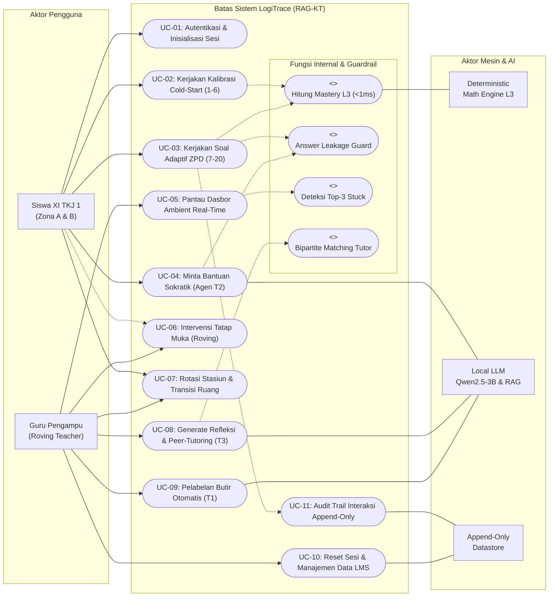

# SPESIFIKASI USE CASE SCENARIO & ACTIVITY DIAGRAM SISTEM LOGITRACE (RAG-KT)
## Model Pembelajaran Station Rotation — Konsentrasi Keahlian Teknik Komputer dan Jaringan (SMK TKJ)

---

**Identitas Dokumen:**
- **Sistem:** LogiTrace (Adaptive Formative Evaluation Web with Deterministic Knowledge Tracing & Socratic RAG)
- **Konteks Pembelajaran:** Blended Learning — Model *Station Rotation* Satu Ruangan (80 Menit / 2 JP)
- **Target Sasaran:** Peserta Didik Kelas XI TKJ 1 (34 Siswa), SMK Negeri 4 Bandung
- **Mata Pelajaran:** Teknologi Jaringan Kabel dan Nirkabel (Fase F)
- **Capaian Pembelajaran (Elemen 2):**
  - **TP 2.1:** Menerapkan instalasi jaringan kabel dan nirkabel
  - **TP 2.2:** Menerapkan perawatan dan perbaikan jaringan kabel dan nirkabel
- **Tanggal Rilis:** November 2026
- **Status Dokumen:** Final Draft (Memenuhi Format UML 2.5 & Cockburn Methodology)

---

## DAFTAR ISI
1. [Konteks Pedagogis & Tata Ruang Station Rotation](#1-konteks-pedagogis--tata-ruang-station-rotation)
2. [Identifikasi & Spesifikasi Aktor](#2-identifikasi--spesifikasi-aktor)
3. [Diagram Use Case Sistem](#3-diagram-use-case-sistem)
4. [Matriks Keterlacakan Use Case (Traceability Matrix)](#4-matriks-keterlacakan-use-case-traceability-matrix)
5. [Skenario Use Case Terinci (UC-01 s.d. UC-11)](#5-skenario-use-case-terinci)
   - [UC-01: Autentikasi & Inisialisasi Sesi Siswa](#uc-01-autentikasi--inisialisasi-sesi-siswa)
   - [UC-02: Pengerjaan Butir Kalibrasi Cold-Start (Butir 1–6)](#uc-02-pengerjaan-butir-kalibrasi-cold-start-butir-16)
   - [UC-03: Pengerjaan Butir Adaptif ZPD (Butir 7–20)](#uc-03-pengerjaan-butir-adaptif-zpd-butir-720)
   - [UC-04: Permintaan Bantuan Sokratik Bertingkat (Agen T2) & Fallback](#uc-04-permintaan-bantuan-sokratik-bertingkat-agen-t2--fallback)
   - [UC-05: Pemantauan Dasbor Ambient & Deteksi Top-3 Stuck Students](#uc-05-pemantauan-dasbor-ambient--deteksi-top-3-stuck-students)
   - [UC-06: Pelaksanaan Intervensi Klinis Tatap Muka (Roving Scaffolding)](#uc-06-pelaksanaan-intervensi-klinis-tatap-muka-roving-scaffolding)
   - [UC-07: Rotasi Stasiun & Transisi Ruangan (Zona A ↔ Zona B)](#uc-07-rotasi-stasiun--transisi-ruangan-zona-a--zona-b)
   - [UC-08: Pembangkitan Refleksi Sesi & Rekomendasi Peer-Tutoring (Agen T3)](#uc-08-pembangkitan-refleksi-sesi--rekomendasi-peer-tutoring-agen-t3)
   - [UC-09: Pelabelan Semantik & Kurasi Bank Soal (Agen T1)](#uc-09-pelabelan-semantik--kurasi-bank-soal-agen-t1)
   - [UC-10: Manajemen & Reset Sesi Kelas Formatif (Standar LMS)](#uc-10-manajemen--reset-sesi-kelas-formatif-standar-lms)
   - [UC-11: Audit Trail Interaksi Append-Only & Ekspor Data](#uc-11-audit-trail-interaksi-append-only--ekspor-data)
6. [Dokumentasi Activity Diagram (Swimlane UML)](#6-dokumentasi-activity-diagram-swimlane-uml)

---

## 1. Konteks Pedagogis & Tata Ruang Station Rotation

Pembelajaran dilaksanakan dalam **1 ruang Laboratorium Jaringan Komputer** yang ditata menjadi dua stasiun fisik berdampingan:

```text
+-----------------------------------------------------------------------------------+
|               LABORATORIUM TEKNIK KOMPUTER DAN JARINGAN (SMK NEGERI 4 BANDUNG)    |
+-----------------------------------------+-----------------------------------------+
|                ZONA A                   |                 ZONA B                  |
|    (Stasiun Praktik Komputer / 1:1)     |  (Stasiun Evaluasi Adaptif & Roving)    |
|                                         |                                         |
|  - 17 Unit PC Desktop Workstation       |  - Meja Bundar Kolaboratif Siswa        |
|  - Switch Manageable, Routerboard       |  - Siswa Mengakses LogiTrace Smartphone |
|  - Patch Panel, Crimping Tool, Tester   |  - Guru Pengampu Berkeliling (Roving)   |
|  - Fusion Splicer & Optical Power Meter |  - Dasbor Ambient Real-Time di Tablet   |
|                                         |                                         |
| [Kelompok A: Rotasi 1 | Kel. B: Rotasi 2]| [Kelompok B: Rotasi 1 | Kel. A: Rotasi 2]|
+-----------------------------------------+-----------------------------------------+
|           Papan Tulis, Smart Screen Refleksi Bersama, & Akses Pintu Keluar        |
+-----------------------------------------------------------------------------------+
```

### Struktur Waktu Sesi (Total 80 Menit / 2 Jam Pelajaran):
1. **00:00 – 05:00 (5 Menit) — Pembukaan & Pembagian Rombel:**
   - Guru membuka kelas, apersepsi TP 2.1 & TP 2.2, membagi rombel 34 siswa menjadi Kelompok A (17 siswa) dan Kelompok B (17 siswa).
2. **05:00 – 40:00 (35 Menit) — Siklus Rotasi 1:**
   - **Kelompok A di Zona A:** Mengerjakan jobsheet praktik instalasi/perawatan jaringan nirkabel di PC lab.
   - **Kelompok B di Zona B:** Mengerjakan evaluasi formatif adaptif di LogiTrace (smartphone). Guru bertindak sebagai *Roving Teacher*, mengamati dasbor ambient, dan memberikan *clinical scaffolding* tatap muka bagi siswa yang *stuck*.
3. **40:00 – 42:00 (2 Menit) — Transisi Pergantian Stasiun:**
   - Lonceng berbunyi, siswa merapikan perangkat dan bertukar posisi fisik (Kelompok A pindah ke Zona B, Kelompok B pindah ke Zona A).
4. **42:00 – 77:00 (35 Menit) — Siklus Rotasi 2:**
   - **Kelompok B di Zona A:** Praktik hands-on konfigurasi router dan fiber optic.
   - **Kelompok A di Zona B:** Evaluasi formatif adaptif di LogiTrace dengan bimbingan roving guru.
5. **77:00 – 85:00 (8 Menit) — Pleno Refleksi Akhir Sesi & Peer-Tutoring:**
   - Seluruh 34 siswa berkumpul di ruang tengah. Guru menekan tombol Agen T3 untuk menghasilkan *Narrative Session Summary* dan pasangan *Peer-Tutoring*, memaparkan refleksi, dan menutup sesi.

---

## 2. Identifikasi & Spesifikasi Aktor

| Simbol Aktor | Nama Aktor | Kategori | Peran & Tanggung Jawab Utama |
|:---|:---|:---|:---|
| `ACT-01` | **Siswa XI TKJ 1** | Primary Human Actor | Peserta didik yang menjalani evaluasi mandiri via smartphone di Zona B, membaca petunjuk sokratik (Agen T2), menerima bimbingan tatap muka guru roving, dan berpartisipasi dalam tindak lanjut *peer-tutoring*. |
| `ACT-02` | **Guru Pengampu (Roving Teacher)** | Primary Human Actor | Pendidik kejuruan yang memandu rotasi stasiun, memantau *Ambient Console* real-time, mendeteksi *Top-3 Stuck Students*, memberikan intervensi klinis tatap muka (*guiding, not solving*), dan mengesahkan hasil sintesis Agen T1 & T3. |
| `ACT-03` | **Deterministic Math Engine L3** | Secondary System Actor | Mesin kalkulasi kognitif deterministik (latensi < 1 ms) yang menghitung probabilitas keberhasilan $\hat{p}(q) = \sigma(\text{logit}(m_{s,k_q}) + \theta_{d_q})$, memfilter butir ZPD $[0.60, 0.85]$, dan mengupdate status penguasaan $m \leftarrow m \pm \Delta m$ dengan strict clipping $[0.02, 0.98]$. |
| `ACT-04` | **Local LLM & RAG Orchestrator** | Secondary AI Actor | Model AI lokal (`Qwen2.5-3B-Instruct-Q4_K_M`) yang menjalankan 3 agen spesialis: Agen T1 (pelabelan semantik butir), Agen T2 (petunjuk sokratik terbimbing < 60 kata), dan Agen T3 (ringkasan naratif refleksi & algoritma matching *peer-tutoring*). |
| `ACT-05` | **Append-Only Datastore** | Supporting System Actor | Basis data transaksional (PostgreSQL/SQLite) yang menjamin integritas data evaluasi melalui tabel `interactions` yang bersifat append-only (larangan keras `UPDATE` dan `DELETE`). |

---

## 3. Diagram Use Case Sistem



> **Berkas Diagram Vektor & Editable Tersedia:**
> - XML Draw.io: [`logitrace/docs/diagrams/use_case_diagram_station_rotation.drawio`](file:///c:/kuliah/semester_7/skripsi/apps/logitrace/docs/diagrams/use_case_diagram_station_rotation.drawio)
> - Render Vektor SVG: [`logitrace/docs/diagrams/use_case_diagram_station_rotation.svg`](file:///c:/kuliah/semester_7/skripsi/apps/logitrace/docs/diagrams/use_case_diagram_station_rotation.svg)
> - PNG Editable (Embedded XML): [`logitrace/docs/diagrams/use_case_diagram_station_rotation.drawio.png`](file:///c:/kuliah/semester_7/skripsi/apps/logitrace/docs/diagrams/use_case_diagram_station_rotation.drawio.png)

---

## 4. Matriks Keterlacakan Use Case (Traceability Matrix)

| ID | Nama Use Case | Aktor Utama | Aktor Pendukung | Persyaratan PRD Terkait |
|:---|:---|:---|:---|:---|
| **UC-01** | Autentikasi & Inisialisasi Sesi Siswa | Siswa | Guru, DBStore | PRD Bagian 4.1, Arsitektur L3 Cold-Start |
| **UC-02** | Pengerjaan Butir Kalibrasi Cold-Start | Siswa | Engine L3, DBStore | PRD Prinsip 1 & 3, Kalibrasi 6 butir $d_1-d_3$ |
| **UC-03** | Pengerjaan Butir Adaptif ZPD | Siswa | Engine L3, DBStore | PRD Bagian 3, ZPD $\hat{p} \in [0.60, 0.85]$ |
| **UC-04** | Permintaan Bantuan Sokratik Bertingkat | Siswa | LLM Qwen, Engine L3 | PRD Bagian 5, Agen T2, Regex Guard & Fallback |
| **UC-05** | Pemantauan Dasbor Ambient Real-Time | Guru | Engine L3, DBStore | PRD Bagian 6, Dasbor Guru & Top-3 Stuck Students |
| **UC-06** | Pelaksanaan Intervensi Roving Tatap Muka | Guru | Siswa | Desain Final Bab 3, Sintaks Station Rotation |
| **UC-07** | Rotasi Stasiun & Transisi Ruangan | Guru, Siswa | - | Desain Final Bab 3, Sintaks Station Rotation |
| **UC-08** | Refleksi Sesi & Rekomendasi Peer-Tutoring | Guru | LLM Qwen, Siswa | PRD Bagian 7, Agen T3, Algoritma Bipartite |
| **UC-09** | Pelabelan Semantik & Kurasi Bank Soal | Guru | LLM Qwen, DBStore | PRD Bagian 8, Agen T1, Review Queue |
| **UC-10** | Reset Sesi & Manajemen Data LMS | Guru | DBStore, Engine L3 | Standar Reusable LMS (Google Classroom style) |
| **UC-11** | Audit Trail Interaksi Append-Only | Guru/Admin | DBStore | PRD Prinsip 3, Append-Only Integrity |

---

## 5. Skenario Use Case Terinci

### UC-01: Autentikasi & Inisialisasi Sesi Siswa
- **ID:** UC-01
- **Nama:** Autentikasi & Inisialisasi Sesi Siswa
- **Aktor:** Siswa (Primary), Datastore (Secondary)
- **Tingkat Kepentingan:** Vital / High
- **Konteks Station Rotation:** Zona B (Evaluasi Formatif Smartphone, Menit 05:00 untuk Kel. B atau Menit 42:00 untuk Kel. A).
- **Pra-kondisi:** 
  1. Siswa telah berada di Zona B dan terhubung ke Wi-Fi Lab TKJ.
  2. Guru telah mengaktifkan sesi kelas formasi aktif.
- **Pasca-kondisi Sukses:**
  - Siswa berhasil masuk ke antarmuka kuis adaptif.
  - State kognitif awal siswa termuat ($m_{s,k} = 0.25$ untuk seluruh 12 KCs).
- **Pemicu:** Siswa membuka peramban web di smartphone dan mengetikkan URL LogiTrace.
- **Alur Utama (Normal Flow):**
  1. Siswa mengakses halaman login siswa LogiTrace.
  2. Siswa memasukkan kode identitas siswa (misal: `S01` s.d. `S34`) atau nama lengkap.
  3. Sistem memvalidasi eksistensi siswa pada database kelas XI TKJ 1.
  4. Sistem memeriksa apakah siswa memiliki sesi aktif yang belum tuntas.
  5. Sistem menginisialisasi vektor mastery $m_{s,k} = 0.25$ (jika belum ada) atau memuat state terakhir dari tabel `interactions`.
  6. Sistem mengarahkan siswa ke halaman pengerjaan soal dan menyajikan instruksi pengerjaan formatif.
- **Alur Alternatif (Alternative Flows):**
  - **A1: Kode Siswa Tidak Terdaftar:**
    1. Sistem menampilkan pesan peringatan: *"Kode siswa tidak ditemukan di Rombel XI TKJ 1."*
    2. Siswa melapor kepada Guru Roving yang sedang berkeliling di Zona B.
    3. Guru memeriksa daftar rombel dan memberikan kode identitas yang valid.
  - **A2: Sesi Kelas Telah Direset Guru:**
    1. Jika sesi sebelumnya telah direset, sistem membuat rekam jejak baru dari butir 1 dengan state baseline.
- **Aturan Bisnis (Business Rules):**
  - Siswa hanya dapat login ke 1 sesi pengerjaan aktif dalam satu waktu.

---

### UC-02: Pengerjaan Butir Kalibrasi Cold-Start (Butir 1–6)
- **ID:** UC-02
- **Nama:** Pengerjaan Butir Kalibrasi Cold-Start (Butir 1–6)
- **Aktor:** Siswa (Primary), Deterministic Math Engine L3, Datastore (Secondary)
- **Tingkat Kepentingan:** Vital / High
- **Konteks Station Rotation:** 5–10 menit pertama saat siswa duduk di Zona B.
- **Pra-kondisi:** Siswa telah berhasil login (UC-01) dan belum mengerjakan butir 1–6.
- **Pasca-kondisi Sukses:**
  - 6 butir kalibrasi terjawab dengan flag `is_calibration = TRUE`.
  - State kognitif $m$ terkalibrasi awal berdasarkan jawaban benar/salah.
  - Butir kalibrasi tersimpan permanen di tabel `interactions`.
- **Pemicu:** Sistem menampilkan butir soal kalibrasi pertama secara otomatis.
- **Alur Utama (Normal Flow):**
  1. Sistem memilih 6 butir kalibrasi cold-start secara acak seimbang: 2 butir mudah ($d_1$), 2 butir sedang ($d_2$), dan 2 butir sulit ($d_3$) yang mencakup spektrum 12 Knowledge Components (KCs).
  2. Sistem menampilkan butir kalibrasi secara berurutan ke smartphone siswa.
  3. Siswa membaca teks soal, opsi jawaban (A, B, C, D, E), dan diagram/kode perintah jika ada.
  4. Siswa memilih satu opsi jawaban dan menekan tombol **"Kirim Jawaban"**.
  5. Sistem mencatat waktu pengerjaan (*response time* dalam detik).
  6. Mesin L3 mengevaluasi kebenaran jawaban ($r = 1$ jika benar, $r = 0$ jika salah).
  7. Mesin L3 memperbarui mastery $m$ KC terkait secara deterministik:
     - Jika $r = 1$: $m \leftarrow m + \alpha_d (1 - m)$
     - Jika $r = 0$: $m \leftarrow m - \gamma_d m$
  8. Sistem melakukan strict clipping $m \in [0.02, 0.98]$.
  9. Sistem menyimpan data interaksi ke tabel `interactions` dengan `is_calibration = TRUE` dan `hint_used = FALSE`.
  10. Langkah 2–9 diulang hingga seluruh 6 butir kalibrasi tuntas.
  11. Sistem bertransisi otomatis ke Siklus Adaptif ZPD (UC-03).
- **Alur Alternatif (Alternative Flows):**
  - **A1: Tombol Hint Tidak Tersedia pada Butir Kalibrasi:**
    - Pada 6 butir awal, tombol "Minta Petunjuk" sengaja dinonaktifkan (*disabled*) untuk mengukur kemampuan murni baseline kognitif siswa tanpa scaffolding.
- **Aturan Bisnis (Business Rules):**
  - Data interaksi kalibrasi dikecualikan dari perhitungan metrik evaluasi akurasi prediksi adaptif E3.

---

### UC-03: Pengerjaan Butir Evaluasi Adaptif ZPD (Butir 7–20)
- **ID:** UC-03
- **Nama:** Pengerjaan Butir Evaluasi Adaptif ZPD (Butir 7–20)
- **Aktor:** Siswa (Primary), Deterministic Math Engine L3, Datastore (Secondary)
- **Tingkat Kepentingan:** Vital / High
- **Konteks Station Rotation:** 25–30 menit pertengahan di Zona B (rotasi aktif).
- **Pra-kondisi:** Siswa telah menyelesaikan 6 butir kalibrasi cold-start (UC-02).
- **Pasca-kondisi Sukses:**
  - Butir soal yang disajikan selalu berada pada Zone of Proximal Development (ZPD) siswa: $\hat{p} \in [0.60, 0.85]$.
  - Siswa menyelesaikan total 20 butir soal evaluasi formatif.
  - Dasbor siswa menampilkan profil penguasaan 12 KCs pribadi.
- **Pemicu:** Penyelesaian butir kalibrasi ke-6 atau butir adaptif sebelumnya.
- **Alur Utama (Normal Flow):**
  1. Mesin L3 mengidentifikasi Knowledge Component (KC) siswa yang memiliki nilai penguasaan ($m$) terendah atau butuh penguatan.
  2. Mesin L3 menghitung estimasi probabilitas sukses $\hat{p}(q)$ untuk seluruh kandidat butir yang belum dikerjakan:
     $$\hat{p}(q) = \sigma\big(\mathrm{logit}(m_{s, k_q}) + \theta_{d_q}\big), \quad \theta_1=+0.9, \ \theta_2=0.0, \ \theta_3=-0.9$$
  3. Sistem memfilter kandidat butir yang masuk dalam interval target ZPD $[0.60, 0.85]$.
  4. Sistem menyajikan butir terpilih ke smartphone siswa beserta opsi tombol **"Minta Petunjuk"** (Agen T2).
  5. Siswa membaca soal dan opsi jawaban.
  6. Siswa memilih jawaban dan menekan tombol **"Kirim Jawaban"** (atau meminta petunjuk sokratik terlebih dahulu melalui UC-04).
  7. Mesin L3 mengupdate penguasaan $m$:
     - Jika tanpa hint: faktor pengali $h = 1.0$.
     - Jika menggunakan hint: faktor pengali $h = 0.5$.
     - Formula:
       $$m \leftarrow \begin{cases} m + \alpha_d (1 - m) h, & \text{jika } r = 1 \\ m - \gamma_d m, & \text{jika } r = 0 \end{cases}$$
  8. Sistem melakukan append ke tabel `interactions` dan membroadcast status ke Dasbor Ambient Guru (UC-05) via WebSocket.
  9. Sistem mengulangi langkah 1–8 hingga butir ke-20 selesai.
  10. Sistem menampilkan rekap capaian formatif siswa dan ucapan selamat telah menyelesaikan evaluasi Zona B.
- **Alur Alternatif (Alternative Flows):**
  - **A1: Tidak Ada Butir Tersisa Tepat di Range $[0.60, 0.85]$:**
    1. Mesin L3 memperlebar toleransi secara bertahap: $[0.50, 0.90]$.
    2. Sistem memilih butir dengan jarak Euclidean terkecil ke titik tengah ZPD ($0.725$).
- **Aturan Bisnis (Business Rules):**
  - Runtime kalkulasi pemilihan butir ZPD dan update state harus $< 1$ milidetik per interaksi.

---

### UC-04: Permintaan Bantuan Sokratik Bertingkat (Agen T2) & Fallback
- **ID:** UC-04
- **Nama:** Permintaan Bantuan Sokratik Bertingkat (Agen T2) & Fallback
- **Aktor:** Siswa (Primary), Local LLM Qwen2.5-3B, Engine L3, Datastore (Secondary)
- **Tingkat Kepentingan:** High
- **Konteks Station Rotation:** Terjadi di Zona B saat siswa mengalami keraguan atau kesulitan bernalar pada butir adaptif (7–20).
- **Pra-kondisi:** Siswa sedang membuka butir adaptif (7–20) dan belum menekan tombol submit jawaban.
- **Pasca-kondisi Sukses:**
  - Siswa menerima bantuan sokratik pemandu (< 60 kata) tanpa kebocoran kunci jawaban.
  - Parameter penalti penguasaan diset $h = 0.5$ untuk butir tersebut.
  - Interaksi permintaan hint tercatat dalam log audit.
- **Pemicu:** Siswa mengklik tombol **"Minta Petunjuk"** pada layar soal.
- **Alur Utama (Normal Flow):**
  1. Siswa mengklik tombol **"Minta Petunjuk"** pada antarmuka kuis.
  2. Sistem menampilkan status pemuatan (*loading indicator* sokratik).
  3. Agen T2 mengambil konteks butir soal, KC terkait, dan teks distractor yang sedang dibaca siswa.
  4. Agen T2 melakukan similarity search ke basis pengetahuan RAG (pgvector) untuk mengambil cuplikan materi SOP/konfigurasi terkait.
  5. Agen T2 mengirimkan prompt terstruktur ke LLM Lokal (`Qwen2.5-3B-Instruct`) dengan *system instruction*:
     *"Berikan satu pertanyaan sokratik atau petunjuk konseptual maksimal 60 kata dalam Bahasa Indonesia yang membimbing siswa memahami akar masalah tanpa pernah menyebutkan opsi jawaban yang benar (Guiding, Not Solving)."*
  6. LLM mengembalikan respon teks.
  7. **Leakage Guard Validation:** Sistem memeriksa teks respons menggunakan Regex Answer Leakage Guard (memastikan tidak ada token kunci, teks opsi jawaban benar, atau frasa kebocoran seperti *"jawabannya adalah"*, *"pilihlah opsi"*).
  8. Waktu respon terverifikasi $\le 3.0$ detik dan lolos uji kebocoran.
  9. Sistem menampilkan petunjuk sokratik di modal/kartu petunjuk siswa.
  10. Sistem mencatat `hint_used = TRUE` untuk butir soal tersebut (menetapkan $h = 0.5$).
  11. Siswa membaca petunjuk dan kembali menganalisis butir soal.
- **Alur Alternatif (Alternative Flows):**
  - **A1: Latensi LLM Melebihi Batas Waktu (> 3.0 Detik):**
    1. Timer timeout sistem mendeteksi latensi pengerjaan LLM telah melampaui 3.0 detik.
    2. Sistem langsung membatalkan request LLM.
    3. Sistem melakukan **Instant Fallback (< 50 ms)** ke *Curated Static Hint Bank* yang telah terverifikasi oleh guru ahli.
    4. Petunjuk statis kurasi disajikan kepada siswa tanpa hambatan waktu.
  - **A2: Terdeteksi Potensi Kebocoran Jawaban (Leakage Guard Triggered):**
    1. Regex Anti-Bocor mendeteksi kemunculan token jawaban benar di dalam teks LLM.
    2. Sistem segera mendrop respons LLM tersebut.
    3. Sistem beralih ke *Static Hint Bank* yang dijamin aman $100\%$ dari kebocoran kunci.
    4. Sistem mencatat event guardrail drop ke log audit internal untuk evaluasi keamanan E5.
  - **A3: Siswa Meminta Petunjuk Berulang (Maksimal 3 Kali):**
    1. Siswa dapat meminta petunjuk sokratik hingga tingkat 3 (Level 1: Konsep Dasar, Level 2: Logika Pemecahan Masalah, Level 3: Analogi Kejuruan).
    2. Jika siswa telah meminta 3 petunjuk, tombol hint menjadi nonaktif dan sistem menyarankan siswa berkonsultasi langsung dengan Guru Roving.
- **Aturan Bisnis (Business Rules):**
  - Panjang teks petunjuk sokratik dibatasi ketat: $\le 60$ kata.
  - Fallback ke static bank harus dieksekusi dalam waktu $< 50$ ms.

---

### UC-05: Pemantauan Dasbor Ambient & Deteksi Top-3 Stuck Students
- **ID:** UC-05
- **Nama:** Pemantauan Dasbor Ambient & Deteksi Top-3 Stuck Students
- **Aktor:** Guru Pengampu (Primary), Deterministic Math Engine L3, Datastore (Secondary)
- **Tingkat Kepentingan:** High
- **Konteks Station Rotation:** Guru berkeliling di Zona B membawa tablet atau mengamati monitor konsol guru yang terpasang di dinding kelas selama 35 menit rotasi.
- **Pra-kondisi:** Siswa di Zona B sedang aktif mengerjakan evaluasi formatif.
- **Pasca-kondisi Sukses:**
  - Guru mengetahui kondisi kognitif kelas secara real-time tanpa perlu menginterupsi siswa secara acak.
  - Tiga siswa yang paling membutuhkan bantuan tatap muka langsung (*Top-3 Stuck*) teridentifikasi secara presisi.
- **Pemicu:** Aliran data interaksi siswa yang dikirimkan via WebSocket secara berkesinambungan.
- **Alur Utama (Normal Flow):**
  1. Guru membuka halaman *Ambient Console* LogiTrace di tablet / laptop guru.
  2. Dasbor menampilkan radar diagram sebaran penguasaan 12 KCs kelas secara keseluruhan.
  3. Setiap kali ada siswa di Zona B yang menjawab soal atau meminta hint, backend memproses data dan menyiarkan pembaruan via WebSocket.
  4. Sistem secara otomatis menjalankan algoritma deteksi kondisi *Stuck* berdasarkan 3 kriteria komposit:
     - Frekuensi penggunaan petunjuk berulang ($\ge 2$ kali pada butir yang sama).
     - Durasi pengerjaan butir melebihi ambang batas (*response time* $> 120$ detik).
     - Terjadinya penurunan penguasaan berturut-turut pada KC yang sama ($\Delta m < 0$).
  5. Dasbor secara otomatis memperbarui panel khusus: **"Top-3 Stuck Students"**, menampilkan nama siswa, kode PC/meja, KC yang sedang bermasalah, dan durasi keterjebakan.
  6. Guru mengamati indikator visual (kartu berwarna oranye/merah) pada konsol ambient.
  7. Guru menentukan prioritas siswa yang akan didatangi secara fisik untuk intervensi klinis (UC-06).
- **Alur Alternatif (Alternative Flows):**
  - **A1: Tidak Ada Siswa yang Berstatus Stuck:**
    1. Panel Top-3 menampilkan status hijau: *"Seluruh siswa bekerja dalam ritme adaptif normal (Zona ZPD Ideal)."*
    2. Guru membagi perhatian untuk memantau keselamatan kerja dan ketertiban praktik hands-on di Zona A.
- **Aturan Bisnis (Business Rules):**
  - Pembaruan tampilan dasbor via WebSocket harus memiliki latensi penyegaran $< 500$ ms.

---

### UC-06: Pelaksanaan Intervensi Klinis Tatap Muka (Roving Scaffolding)
- **ID:** UC-06
- **Nama:** Pelaksanaan Intervensi Klinis Tatap Muka (Roving Scaffolding)
- **Aktor:** Guru Pengampu (Primary), Siswa (Secondary)
- **Tingkat Kepentingan:** High
- **Konteks Station Rotation:** Interaksi tatap muka personal antara Guru Roving dan siswa yang terdeteksi stuck di meja Zona B.
- **Pra-kondisi:** Siswa muncul pada panel *Top-3 Stuck Students* di Dasbor Ambient Guru (UC-05).
- **Pasca-kondisi Sukses:**
  - Miskonsepsi spesifik siswa terurai tanpa guru memberikan jawaban langsung (*guiding, not solving*).
  - Siswa dapat melanjutkan pengerjaan butir soal secara mandiri.
- **Pemicu:** Notifikasi atau visual cue pada Dasbor Ambient Guru yang menunjukkan siswa mengalami kebuntuan belajar.
- **Alur Utama (Normal Flow):**
  1. Guru Roving bergerak mendekati meja siswa yang bersangkutan secara tenang (tanpa membuat siswa merasa dihakimi).
  2. Guru mengamati layar smartphone siswa untuk melihat butir soal dan topik KC yang sedang dihadapi.
  3. Guru memberikan pertanyaan pemantik (scaffolding klinis), misalnya:
     *"Menurutmu, jika subnet mask /24 diubah menjadi /26, berapa jumlah host valid yang dapat digunakan?"* atau *"Alat apa yang kita gunakan tadi di Zona A saat mengukur redaman kabel FO?"*
  4. Siswa mengaitkan kembali pengalaman praktiknya di Zona A atau materi teori yang telah dipelajari.
  5. Siswa mengutarakan pemahaman barunya kepada guru.
  6. Guru mengonfirmasi penalaran siswa dan mempersilakan siswa memilih jawaban di aplikasi LogiTrace.
  7. Guru kembali bergerak memantau sekeliling stasiun rotasi.
- **Alur Alternatif (Alternative Flows):**
  - **A1: Siswa Tetap Mengalami Kebuntuan Konsep yang Parah:**
    1. Guru mencatat nama siswa dan topik KC tersebut di catatan observasi lapangan.
    2. Siswa diprioritaskan untuk mendapatkan mitra tutor sebaya pada sesi pleno akhir (UC-08).
- **Aturan Bisnis (Business Rules):**
  - Guru dilarang keras menyebutkan huruf opsi (A/B/C/D/E) atau membacakan kunci jawaban (*Zero Answer Leakage Principle*).

---

### UC-07: Rotasi Stasiun & Transisi Ruangan (Zona A ↔ Zona B)
- **ID:** UC-07
- **Nama:** Rotasi Stasiun & Transisi Ruangan (Zona A ↔ Zona B)
- **Aktor:** Guru Pengampu (Primary), Siswa (Secondary)
- **Tingkat Kepentingan:** Vital / High
- **Konteks Station Rotation:** Menit ke-40:00 hingga 42:00 (Durasi transisi 2 menit).
- **Pra-kondisi:** Rotasi 1 (35 menit) telah selesai dilaksanakan.
- **Pasca-kondisi Sukses:**
  - Kelompok A berada di Zona B (siap melaksanakan evaluasi adaptif smartphone).
  - Kelompok B berada di Zona A (siap melaksanakan praktik PC lab hands-on).
  - Seluruh perangkat lab dan meja kuis dalam kondisi rapi dan siap pakai.
- **Pemicu:** Timer waktu 35 menit di konsol guru berbunyi (alarm lonceng rotasi).
- **Alur Utama (Normal Flow):**
  1. Guru membunyikan sinyal bel rotasi dan mengumumkan: *"Waktu Rotasi 1 telah selesai. Silakan simpan pekerjaan dan bersiap bertukar stasiun."*
  2. **Di Zona A:** Siswa Kelompok A menyimpan file konfigurasi (Packet Tracer/MikroTik backup), merapikan kursi PC lab, dan bergerak tertib menuju meja Zona B.
  3. **Di Zona B:** Siswa Kelompok B mengunci smartphone mereka, merapikan meja, dan bergerak tertib menuju PC lab di Zona A.
  4. Guru mengawasi alur pergerakan fisik di dalam ruangan untuk mencegah penumpukan di lorong tengah.
  5. Kelompok A duduk di Zona B, mengeluarkan smartphone, dan login ke LogiTrace (UC-01).
  6. Kelompok B duduk di Zona A, menyalakan monitor PC lab, dan membuka lembar jobsheet praktik.
  7. Guru memverifikasi kesiapan kedua zona dalam waktu $\le 2$ menit.
  8. Guru memulai timer Rotasi 2 (menit 42:00 s.d. 77:00).
- **Alur Alternatif (Alternative Flows):**
  - **A1: Siswa di Zona B Belum Menyelesaikan 20 Butir Saat Bel Berbunyi:**
    1. Sistem LogiTrace secara otomatis menyimpan progres terakhir siswa (state tersimpan aman pada database).
    2. Siswa diperkenankan menyelesaikan 1 butir terakhir yang sedang terbuka sebelum bergerak pindah zona.
- **Aturan Bisnis (Business Rules):**
  - Waktu jeda transisi fisik dibatasi maksimal 2 menit untuk menjaga alokasi waktu efektif 80 menit pembelajaran.

---

### UC-08: Pembangkitan Refleksi Sesi & Rekomendasi Peer-Tutoring (Agen T3)
- **ID:** UC-08
- **Nama:** Pembangkitan Refleksi Sesi & Rekomendasi Peer-Tutoring (Agen T3)
- **Aktor:** Guru Pengampu (Primary), Local LLM Qwen2.5-3B, Siswa (Secondary)
- **Tingkat Kepentingan:** High
- **Konteks Station Rotation:** Menit ke-77:00 hingga 85:00 (Fase Pleno Refleksi Akhir Kelas).
- **Pra-kondisi:** Kedua kelompok (Kelompok A dan B / seluruh 34 siswa) telah menuntaskan kedua rotasi stasiun.
- **Pasca-kondisi Sukses:**
  - Narasi evaluasi kelas komprehensif berhasil disintesis oleh Agen T3.
  - Matriks pasangan *Peer-Tutoring* yang adil dan seimbang terbentuk otomatis.
  - Siswa mengetahui mitra belajar dan topik penguatan untuk pertemuan berikutnya.
- **Pemicu:** Guru menekan tombol **"Generate Session Summary & Peer Tutoring"** pada Dasbor Ambient.
- **Alur Utama (Normal Flow):**
  1. Seluruh 34 siswa kembali berkumpul di area tengah kelas menghadap layar proyektor utama.
  2. Guru membuka dasbor ambient dan mengklik tombol **"Generate Summary & Peer Tutoring"**.
  3. Sistem mengagregasi data interaksi 34 siswa pada 12 Knowledge Components (KCs).
  4. Sistem mengidentifikasi 3 KCs dengan rata-rata mastery terendah di kelas serta miskonsepsi umum yang sering muncul.
  5. **Eksekusi Algoritma Peer-Tutoring (Bipartite Matching):**
     - Untuk setiap KC yang membutuhkan perbaikan:
     - Sistem memfilter siswa berkategori *Tutor* ($m \ge 0.70$).
     - Sistem memfilter siswa berkategori *Mentee* ($m < 0.40$).
     - Algoritma memasangkan siswa dengan aturan: 1 Tutor mendampingi maksimal 2 Mentee pada KC yang dikuasainya, mencegah *self-pairing*. Jika tidak tersedia tutor siswa, sistem menugaskan *"Guru Pendamping (Zona B)"*.
  6. Agen T3 memanggil LLM Lokal (`Qwen2.5-3B`) untuk merangkum temuan kelas dalam bentuk narasi pedagogis reflektif (maksimal 3 paragraf).
  7. Dasbor guru menampilkan modal dialog:
     - Narasi Refleksi Sesi Pembelajaran.
     - Tabel Distribusi Penguasaan 12 KCs Kelas.
     - Tabel Rekomendasi Pasangan Tutor Sebaya (Nama Tutor, Nama Mentee, Fokus Topik KC).
  8. Guru memproyeksikan hasil refleksi ke layar utama dan memaparkannya kepada seluruh siswa.
  9. Siswa mencatat mitra belajarnya dan menyimak pesan refleksi penutup dari guru.
  10. Guru memberikan apresiasi atas kerja keras kelas dan menutup pembelajaran dengan salam.
- **Alur Alternatif (Alternative Flows):**
  - **A1: Guru Mengedit Pasangan Tutor Sebaya Secara Manual:**
    1. Jika guru mempertimbangkan faktor sosiologis antarsiswa (misal: riwayat ketidakcocokan sosial), guru dapat mengubah pasangan tutor langsung pada antarmuka sebelum mengumumkannya.
- **Aturan Bisnis (Business Rules):**
  - Latensi inferensi sintesis laporan Agen T3 harus selesai dalam $< 5.0$ detik.

---

### UC-09: Pelabelan Semantik & Kurasi Bank Soal (Agen T1)
- **ID:** UC-09
- **Nama:** Pelabelan Semantik & Kurasi Bank Soal (Agen T1)
- **Aktor:** Guru Pengampu / Kurikulum (Primary), Local LLM Qwen2.5-3B, Datastore (Secondary)
- **Tingkat Kepentingan:** Medium
- **Konteks:** Dilakukan di luar jam tatap muka siswa (persiapan pembelajaran atau pembaruan bank butir soal).
- **Pra-kondisi:** Guru memiliki teks butir soal baru (soal pilihan ganda beserta opsi dan kunci) yang belum diklasifikasikan ke dalam 12 KCs.
- **Pasca-kondisi Sukses:**
  - Butir soal baru terpetakan ke Knowledge Component (KC) dan tingkat kesulitan ($d_1, d_2, d_3$) yang akurat.
  - Butir soal masuk ke bank soal aktif setelah disetujui (*approved*) oleh guru.
- **Pemicu:** Guru mengunggah butir soal baru pada tab "Review Queue" di Dasbor Guru.
- **Alur Utama (Normal Flow):**
  1. Guru membuka tab **"Review Queue Butir Soal"** pada portal guru LogiTrace.
  2. Guru memasukkan teks soal baru dan pilihan jawaban.
  3. Guru mengklik tombol **"Labeli Butir Otomatis (Agen T1)"**.
  4. Agen T1 menganalisis semantik soal dan mencocokkannya dengan taksonomi 12 KCs kurikulum TKJ menggunakan embeddings pgvector.
  5. LLM Qwen2.5-3B memberikan rekomendasi:
     - Target KC (misal: `KC04 - Perhitungan Subnetting IPv4 & VLSM`).
     - Estimasi Kesulitan ($d \in \{1, 2, 3\}$).
     - Alasan pedagogis klasifikasi (*reasoning text*).
     - Skor keyakinan (*confidence score* $\ge 0.70$).
  6. Sistem menampilkan kartu telaah (*review card*) di layar guru.
  7. Guru meninjau rekomendasi label Agen T1.
  8. Guru mengklik tombol **"Setujui & Publikasikan"** (atau mengubah label KC/kesulitan jika diperlukan).
  9. Sistem menyimpan butir soal ke tabel bank soal aktif dengan status `is_active = TRUE`.
- **Alur Alternatif (Alternative Flows):**
  - **A1: Skor Keyakinan Agen T1 Rendah (< 0.70):**
    1. Sistem memberikan penanda bendera kuning (*flag for manual review*).
    2. Guru wajib memilih KC dan kesulitan secara manual dari dropdown menu sebelum dapat menyimpannya.
- **Aturan Bisnis (Business Rules):**
  - Nilai tingkat kesulitan wajib berada pada rentang valid integer $d \in \{1, 2, 3\}$.
  - Butir baru tidak dapat disajikan kepada siswa sebelum diverifikasi oleh guru manusia (*Human-in-the-Loop*).

---

### UC-10: Manajemen & Reset Sesi Kelas Formatif (Standar LMS)
- **ID:** UC-10
- **Nama:** Manajemen & Reset Sesi Kelas Formatif (Standar LMS)
- **Aktor:** Guru Pengampu (Primary), Datastore (Secondary)
- **Tingkat Kepentingan:** Medium
- **Konteks:** Pengelolaan siklus pembelajaran antar-pertemuan atau latihan ulang seperti pada Google Classroom / Moodle.
- **Pra-kondisi:** Guru login dengan hak akses pengampu kelas XI TKJ 1.
- **Pasca-kondisi Sukses:**
  - State aktif kognitif siswa direset kembali ke nilai baseline awal untuk siklus baru.
  - Rekam jejak historis interaksi sebelumnya tetap tersimpan aman di tabel audit.
- **Pemicu:** Guru ingin mengulang siklus evaluasi formatif untuk rombel baru atau pertemuan minggu berikutnya.
- **Alur Utama (Normal Flow):**
  1. Guru mengakses menu **"Manajemen Sesi LMS"** pada dasbor guru.
  2. Guru memilih nama rombel (misal: XI TKJ 1) dan topik pembelajaran.
  3. Guru menekan tombol **"Reset Sesi Pembelajaran / Mulai Siklus Baru"**.
  4. Sistem menampilkan dialog konfirmasi keamanan: *"Apakah Anda yakin ingin memulai sesi baru? Progres siswa saat ini akan diarsipkan."*
  5. Guru mengonfirmasi persetujuan.
  6. Sistem mengarsipkan ID sesi berjalan dan membuat token sesi pembelajaran baru.
  7. State kognitif cache siswa direset kembali ke baseline $m = 0.25$.
  8. Dasbor Ambient kembali bersih dan siap menerima aliran data sesi pembelajaran berikutnya.
- **Alur Alternatif (Alternative Flows):**
  - **A1: Reset Spesifik 1 Siswa (Kasus Kendala Teknis HP Siswa):**
    1. Guru dapat memilih tombol *Reset Single Student* pada baris nama siswa tertentu tanpa mengganggu 33 siswa lainnya.
- **Aturan Bisnis (Business Rules):**
  - Tindakan reset sesi tidak menghapus rekaman data pada tabel `interactions` (mematuhi prinsip append-only).

---

### UC-11: Audit Trail Interaksi Append-Only & Ekspor Data
- **ID:** UC-11
- **Nama:** Audit Trail Interaksi Append-Only & Ekspor Data
- **Aktor:** Guru Pengampu / Peneliti Skripsi (Primary), Datastore (Secondary)
- **Tingkat Kepentingan:** High
- **Konteks:** Keperluan analisis empiris penelitian, sidang skripsi, dan verifikasi evaluasi E1 hingga E6.
- **Pra-kondisi:** Telah ada data interaksi pengerjaan kuis siswa yang tersimpan.
- **Pasca-kondisi Sukses:**
  - File data mentah interaksi berhasil diunduh dalam format CSV/JSON lengkap dengan timestamp presisi milidetik.
- **Pemicu:** Guru atau peneliti menekan tombol "Ekspor Log Interaksi".
- **Alur Utama (Normal Flow):**
  1. Pengguna membuka menu audit dan pelaporan di portal guru.
  2. Pengguna memilih rentang tanggal atau sesi rotasi tertentu.
  3. Pengguna menekan tombol **"Ekspor Data Interaksi (CSV)"**.
  4. Sistem mengekstrak seluruh baris dari tabel `interactions` tanpa modifikasi.
  5. Sistem memverifikasi integritas baris data (memastikan tidak ada data yang terhapus atau termutasi).
  6. Sistem men-generate file CSV yang memuat kolom: `interaction_id`, `student_id`, `item_id`, `kc_id`, `response`, `hint_used`, `response_time_ms`, `is_calibration`, `mastery_before`, `mastery_after`, dan `created_at`.
  7. File otomatis terunduh ke perangkat pengguna.
- **Aturan Bisnis (Business Rules):**
  - Database melarang keras operasi `UPDATE` dan `DELETE` pada tabel `interactions`.

---

## 6. Dokumentasi Activity Diagram (Swimlane UML)

Diagram aktivitas Station Rotation telah dimodelkan secara komprehensif memetakan 3 jalur swimlane vertikal:
1. **Swimlane 1: Siswa (Kelompok A & Kelompok B / 34 Siswa)**
2. **Swimlane 2: Guru Pengampu (Roving Teacher / Fasilitator)**
3. **Swimlane 3: Sistem LogiTrace (Mesin L3 & RAG Orchestrator)**

### Lokasi Berkas Diagram:
- **Draw.io XML Asli (Dapat Diedit di App/Web diagrams.net):**  
  [`logitrace/docs/diagrams/activity_diagram_station_rotation.drawio`](file:///c:/kuliah/semester_7/skripsi/apps/logitrace/docs/diagrams/activity_diagram_station_rotation.drawio)
- **Draw.io PNG Editable (Format PNG Standar dengan Embedded XML):**  
  [`logitrace/docs/diagrams/activity_diagram_station_rotation.drawio.png`](file:///c:/kuliah/semester_7/skripsi/apps/logitrace/docs/diagrams/activity_diagram_station_rotation.drawio.png)
- **High-Resolution Preview PNG:**  
  [`logitrace/docs/diagrams/activity_diagram_station_rotation.png`](file:///c:/kuliah/semester_7/skripsi/apps/logitrace/docs/diagrams/activity_diagram_station_rotation.png)
- **Vektor Grafis Scalable (SVG):**  
  [`logitrace/docs/diagrams/activity_diagram_station_rotation.svg`](file:///c:/kuliah/semester_7/skripsi/apps/logitrace/docs/diagrams/activity_diagram_station_rotation.svg)

### Rangkuman Visual Alur Aktivitas:

```text
[GURU]                          [SISWA]                          [SISTEM LOGITRACE]
   |                               |                                      |
   |---(1. Buka & Apersepsi)------>|                                      |
   |---(2. Bagi Kel A & B)-------->|                                      |
   |                               |--(Zona A: Praktik Lab PC)            |
   |                               |--(Zona B: Buka Smartphone)---------->| (Inisialisasi State m=0.25)
   |                               |                                      |---(Sajikan 6 Soal Kalibrasi)---> Siswa
   |                               |<--(Jawab Butir 1-6)------------------| (Mesin L3 Evaluasi Kalibrasi)
   |                               |                                      | (Hitung ZPD p_hat in [0.6, 0.85])
   |                               |<--(Sajikan Butir Adaptif 7-20)-------|
   |                               |--[Bingung?]                          |
   |                               |    |--Ya: Minta Hint (T2)----------->| (pgvector RAG + LLM Qwen2.5-3B)
   |                               |    |                                 | [Leakage Guard & Latency <= 3s]
   |                               |    |                                 |   |--Lolos: Socratic Hint (h=0.5)
   |                               |    |                                 |   |--Timeout/Bocor: Fallback Static
   |                               |<---|                                 |
   |                               |--(Submit Jawaban)------------------->| (Mesin L3 Update m Deterministik <1ms)
   |                               |                                      |---(WebSocket Real-Time Broadcast)
   |<--(Update Radar 12 KCs)-------|--------------------------------------|
   |[Deteksi Top-3 Stuck?]         |                                      |
   |    |--Ya: Guru Datangi Meja-->| (Intervensi Klinis Tatap Muka)       |
   |    |--Tidak: Lanjut Roving    |                                      |
   |                               |--(Tuntas Butir 20 di Zona B)         |
   |                               |                                      |
   |=== [TRANSISI 2 MENIT: BEL ROTASI BERBUNYI - KEL. A & B BERTUKAR POSISI FISIK] ===
   |                               |                                      |
   | (Rotasi 2: Kel B ke Zona A & Kel A ke Zona B - Siklus diulang)       |
   |                               |                                      |
   |=== [SESI PLENO AKHIR: REFLEKSI KELAS & PEER-TUTORING AGEN T3 (8 MENIT)] =========
   |                               |                                      |
   |---(Klik Generate Summary)------------------------------------------->| (Agregasi 12 KCs Seluruh Siswa)
   |                                                                      | (Bipartite Matching Tutor-Mentee)
   |                                                                      | (LLM Qwen2.5-3B Sintesis Narasi)
   |<--(Tampilkan Laporan T3)---------------------------------------------|
   |---(Papar Refleksi & Pasangan Peer-Tutoring)------------------------->|
   |---(Tutup Kelas & Doa)-------->|                                      |
   v                               v                                      v
 [Selesai]                      [Selesai]                              [Selesai]
```

---
*Dokumen ini disusun sebagai artefak rekayasa perangkat lunak resmi pendukung skripsi: "Web Evaluasi Formatif Adaptif Berbasis Knowledge Tracing & RAG dalam Pembelajaran Station Rotation untuk SMK TKJ".*
