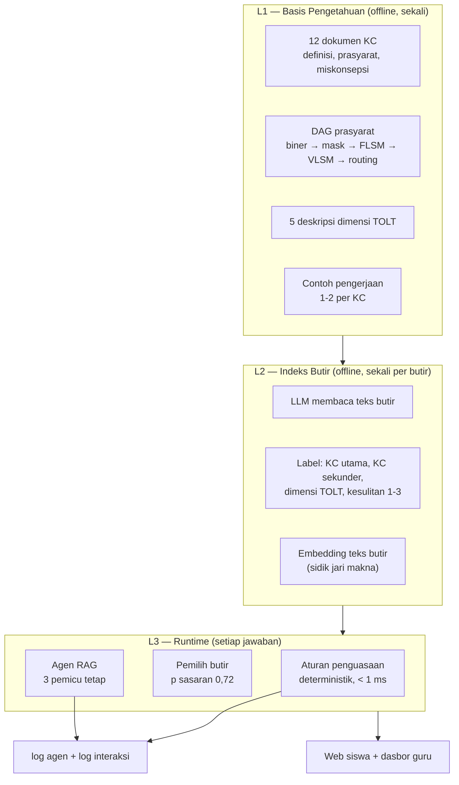

# Desain Sistem RAG-KT "LogiTrace"
## Evaluasi Formatif Adaptif Berbasis Penalaran untuk SMK TKJ — Desain yang Layak Dijalankan

**Konteks:** skripsi R&D (ADDIE) · 1 SMK · 1 kelas (34 siswa) · 4 sesi · materi pengalamatan & konfigurasi jaringan
**Status desain:** final untuk dijalankan · **tingkat kematangan:** prototipe dengan evaluasi formatif (L3)
**Prinsip utama:** tidak ada model yang dilatih. LLM dipakai beku (*frozen*), hanya untuk memahami teks dan menyusun kalimat.

---

## 0. Ringkasan satu halaman

| Pertanyaan | Jawaban desain |
|:--|:--|
| Apa yang diprediksi? | Peluang benar pada butir berikutnya, dan status penguasaan per KC |
| Dari mana "kecerdasan"-nya? | Bukan dari pelatihan, tetapi dari (a) basis pengetahuan yang ditulis dosen/guru, (b) LLM yang membaca teks soal, (c) aturan pembaruan penguasaan yang deterministik |
| Bagaimana cold start? | 6 butir kalibrasi + pengetahuan prasyarat. Tidak butuh riwayat siswa |
| Berapa data minimum? | 180 butir + 12 dokumen KC untuk membangun sistem; ±300–500 respons untuk menguji |
| Apakah perlu GPU? | Tidak untuk inferensi. Model 3B terkuantisasi berjalan di CPU server kampus |
| Bagaimana akurasinya diuji? | Empat jalur: validitas isi, akurasi pemetaan, akurasi prediksi setelah kalibrasi, reliabilitas |
| Klaim yang **tidak** dibuat | Efektivitas belajar, generalisasi statistik, keunggulan atas DKT |

---

## 1. Posisi desain: apa yang dilatih dan apa yang tidak

| Komponen | DKT/CLST | **LogiTrace (RAG-KT)** |
|:--|:--|:--|
| Model prediksi | Dilatih pada 100.000+ interaksi | Tidak ada pelatihan; aturan pembaruan eksplisit |
| Pengetahuan domain | Tersirat dalam bobot model | Tertulis dalam basis pengetahuan (dapat dibaca guru) |
| Adaptasi ke materi baru | Latih ulang | Ganti isi basis pengetahuan |
| Sumber "pemahaman" soal | Statistik ko-okurensi | LLM membaca teks + pencarian kemiripan |
| Kebutuhan data minimum | Korpus perilaku | Korpus konten |
| Metrik utama | AUC | Akurasi pemetaan, akurasi prediksi pasca-kalibrasi, reliabilitas |
| Kelemahan utama | Butuh data; tidak portabel | Tidak ada jaminan statistik; bergantung mutu basis pengetahuan |

**Kalimat kunci untuk naskah:** *"Kebutuhan data bergeser dari korpus perilaku siswa ke korpus konten kurikulum."* Pergeseran ini yang membuat domain vokasi tanpa dataset publik menjadi mungkin.

> **Batas kejujuran.** LLM bukan kontribusi Anda — sama seperti LSTM pada DKT 2015 bukan kontribusi penulisnya. Kontribusi Anda ada tiga: pemetaan butir → KC × dimensi TOLT yang divalidasi pakar, aturan penguasaan yang dapat diaudit, dan pengukuran batas pendekatan tanpa-latih ini.

### 1.1 Konsekuensi pada judul dan istilah

Karena tidak ada jaringan saraf yang dilatih, istilah **"Berbasis Deep Knowledge Tracing (DKT)"** pada judul tidak lagi akurat dan akan langsung dipersoalkan. Tiga opsi:

| Opsi judul | Catatan |
|:--|:--|
| *"Media Web Evaluasi Formatif Adaptif Berbasis Pelacakan Pengetahuan dengan LLM dan RAG…"* | Paling jujur; istilah umum *knowledge tracing* tetap dipakai |
| *"…Berbasis Knowledge Tracing dan Retrieval-Augmented Generation…"* | Menonjolkan mekanisme; cocok bila penguji AI ada di tim |
| *"…Berbasis Model Pelacakan Pengetahuan Tanpa Pelatihan (Training-Free KT)…"* | Paling menonjolkan kebaruan, tetapi istilahnya perlu Anda bela |

Di dalam naskah, pakai **"pelacakan pengetahuan (knowledge tracing, KT)"** sebagai payung, dan sebut DKT hanya ketika membahas literatur. Jangan menulis "model DKT saya" — itu klaim yang tidak dapat Anda buktikan.

---

## 2. Arsitektur tiga lapis



**Pembagian kerja yang tidak boleh dilanggar:**

| Tugas | Dikerjakan | Alasan |
|:--|:--|:--|
| Membaca teks butir, memberi label, menyusun petunjuk, meringkas | **LLM** | Keahliannya adalah bahasa |
| Menghitung penguasaan, memilih butir, memicu agen | **Aturan** | Harus < 1 ms, stabil, dapat diaudit |

---

## 3. L1 — Basis pengetahuan

Dibuat **sekali**, oleh peneliti bersama guru. Tidak diunduh.

### 3.1 Dokumen KC (12 berkas)

Format baku per KC:

```json
{
  "kc_id": "VLSM",
  "nama": "Menghitung VLSM (subnet bertingkat)",
  "definisi": "Membagi blok alamat menjadi subnet dengan ukuran berbeda sesuai kebutuhan host tiap segmen.",
  "prasyarat": ["FLSM", "HOST_COUNT", "SUBNET_MASK"],
  "indikator_menguasai": [
    "menentukan urutan alokasi dari kebutuhan host terbesar",
    "menghitung rentang tiap subnet tanpa tumpang tindih"
  ],
  "miskonsepsi_umum": [
    "mengurutkan dari kebutuhan terkecil sehingga blok besar tidak kebagian",
    "lupa menyisakan 2 alamat (network & broadcast)",
    "menghitung host = 2^n, bukan 2^n - 2"
  ],
  "contoh_pengerjaan": "…",
  "tingkat_tolt_dominan": ["combinatorial", "proportional"]
}
```

### 3.2 DAG prasyarat

```
BINER ─► SUBNET_MASK ─► HOST_COUNT ─► FLSM ─► VLSM ─► RANGE
                                      └────► GATEWAY
ROUTING_TABEL ─► ROUTING_ENTRY
ICMP ─► TROUBLESHOOT
```

Aturan pemakaian: butir hanya disajikan bila **semua** prasyaratnya memiliki $m \geq 0{,}60$. Ini menggantikan peran "pengetahuan pakar" pada model berbasis Q-matrix, tanpa biaya komputasi.

### 3.3 Dokumen dimensi TOLT

Lima berkas: *controlling variables, proportional, combinatorial, probabilistic, correlational* — masing-masing berisi definisi operasional, contoh perilaku siswa yang menunjukkan dimensi tersebut, dan contoh butir.

**Ukuran berkas:** 12 + 5 + 1 (DAG) + 24 (contoh pengerjaan) ≈ **42 dokumen**. Ini pekerjaan 3–4 hari, dan inilah "biaya data" Anda — bukan 100.000 interaksi.

---

## 4. L2 — Indeks butir

### 4.1 Pelabelan otomatis

Setiap butir (target 180) diproses **sekali**:

**Prompt pelabelan (ringkas):**

```
SISTEM: Anda asisten kurikulum SMK TKJ. Tugas Anda memberi label butir soal.
Konteks: <12 dokumen KC> <5 dimensi TOLT>

PENGGUNA: Teks butir: "<teks>"
Kunci: "<jawaban benar>"

Keluarkan JSON:
{"kc_utama": "<salah satu dari 12>",
 "kc_sekunder": ["..."],
 "dimensi_tolt": "<salah satu dari 5>",
 "kesulitan": 1|2|3,
 "alasan": "<maks 25 kata>",
 "keyakinan": 0.0-1.0}
Aturan: satu KC utama. Kesulitan 1 = satu langkah, 3 = ≥3 langkah atau
kombinasi dua konsep. Bila ragu, turunkan keyakinan di bawah 0,6.
```

### 4.2 Penyimpanan dan validasi

| Data | Tempat | Catatan |
|:--|:--|:--|
| Label KC, TOLT, kesulitan | PostgreSQL (`item_labels`) | Dapat dikoreksi guru lewat dasbor |
| Sidik jari makna (embedding) | pgvector / FAISS | Untuk pencarian butir serupa |
| Riwayat versi label | `item_labels_history` | Wajib: label berubah → tercatat kapan dan oleh siapa |

**Ambang kendali mutu:** butir dengan `keyakinan < 0,6`, atau yang label LLM-nya berbeda dengan label pakar, masuk antrean **tinjauan guru**. Tidak ada label yang dipakai diam-diam tanpa jejak.

**Validasi (E1):** bandingkan label LLM dengan label 2 pakar pada seluruh 180 butir → Cohen's κ. Target κ ≥ 0,60 (kesepakatan substansial). Ini metrik pertama Anda, dan **tidak memerlukan data siswa sama sekali**.

---

## 5. L3 — Mesin runtime

### 5.1 Model penguasaan (deterministik)

Untuk setiap siswa $s$ dan KC $k$, disimpan satu nilai $m_{s,k}\in[0{,}02,\ 0{,}98]$.

**Peluang benar** untuk butir $q$ dengan tingkat kesulitan $d_q$:

$$
\hat{p}(q)=\sigma\big(\mathrm{logit}(m_{s,k_q})+\theta_{d_q}\big),\qquad
\theta_{1}=+0{,}9,\ \ \theta_{2}=0,\ \ \theta_{3}=-0{,}9
$$

Ini menyelesaikan masalah "ambang pada besaran yang salah": $m$ adalah penguasaan, $\hat{p}$ adalah peluang pada butir tertentu.

**Pembaruan setelah jawaban** (bukan pelatihan — hanya aturan):

$$
m \leftarrow
\begin{cases}
m+\alpha_d\,(1-m)\,h, & r=1\\[4pt]
m-\gamma_d\,m, & r=0
\end{cases}
$$

$$
\alpha_d=\alpha_0\big(1+\beta(d-1)\big),\qquad
\gamma_d=\gamma_0\big(1+\beta(3-d)\big)
$$

$$
\alpha_0=0{,}30,\quad \gamma_0=0{,}25,\quad \beta=0{,}4,\quad h=\begin{cases}1{,}0&\text{tanpa petunjuk}\\0{,}5&\text{benar setelah petunjuk}\end{cases}
$$

| Kesulitan | $\alpha_d$ (benar) | $\gamma_d$ (salah) |
|:--:|:--:|:--:|
| 1 (mudah) | 0,30 | 0,45 |
| 2 (sedang) | 0,42 | 0,35 |
| 3 (sulit) | 0,54 | 0,25 |

**Peluruhan (lupa)** diterapkan saat baca, bukan lewat pekerjaan terjadwal:

$$
m_{k}(t)=m_{k}(t_{\text{akhir}})\cdot\exp\!\big(-(t-t_{\text{akhir}})/\tau_k\big),\qquad \tau_k=60\ \text{hari}
$$

Setelah setiap pembaruan, nilai di-*clip* ke $[0{,}02;\ 0{,}98]$.

**Sifat yang harus Anda tonjolkan di sidang:** benar tidak pernah menurunkan $m$; salah tidak pernah menaikkan; semua parameter punya arti; dan seluruh riwayat dapat direkonstruksi dari log. Tidak ada kotak hitam.

**Analisis sensitivitas (pengganti ablasi):** jalankan $\alpha_0\in\{0{,}20;\ 0{,}30;\ 0{,}40\}$ dan $\tau\in\{30,60,120\}$ hari; laporkan perubahan akurasi. Jika akurasi stabil, itu bukti bahwa hasil tidak bergantung pada penyetelan halus.

### 5.2 Pemilihan butir

```
kandidat = butir yang (a) belum dijawab siswa,
           (b) seluruh prasyaratnya m >= 0,60,
           (c) p_hat dalam [0,60 ; 0,85]

skor(q) = |p_hat(q) - 0,72|                 # sedekat mungkin ke tengah pita
        - 0,05 * (KC belum disentuh sesi ini)  # jaga cakupan
        + 0,10 * (KC sama dengan butir sebelumnya)

pilih q dengan skor terkecil
```

Bila kandidat kosong: turunkan ambang prasyarat ke 0,45; bila masih kosong, izinkan butir yang sudah dijawab.

Pita 0,60–0,85 dipilih karena di bawah 0,60 siswa cenderung menebak atau menyerah, di atas 0,85 tidak ada tantangan. Sebutkan dasar ini di naskah, dan lakukan **analisis sensitivitas pita** (0,55–0,85 vs 0,65–0,90).

### 5.3 Kalibrasi dan cold start

**Sesi 1, siswa baru:**

1. $m_k = 0{,}25$ untuk seluruh 12 KC (prior rendah, karena materi baru).
2. Sajikan **6 butir kalibrasi**: 2 mudah, 2 sedang, 2 sulit; dipilih agar mencakup minimal 4 KC dan memuat akar DAG (BINER, SUBNET_MASK).
3. Perbarui $m$ dengan aturan yang sama.
4. KC yang tidak terukur diberi nilai rata-rata KC terukur pada klaster prasyarat yang sama, dan ditandai `keyakinan: rendah` (ditampilkan sebagai arsir di dasbor guru).
5. Butir ke-7 dan seterusnya: adaptif penuh.

**Yang harus dilaporkan:** akurasi prediksi pada butir 7–20 **saja** (pasca-kalibrasi). Jangan mencampur butir 1–6 ke dalam evaluasi — itu akan menggelembungkan hasil.

### 5.4 Agen RAG: tiga pemicu tetap

Agen **tidak** berjalan bebas. Ia dipanggil pada tiga titik yang ditentukan kode, dengan keluaran berformat JSON yang divalidasi.

| Pemicu | Kondisi | Aksi | Keluaran |
|:--|:--|:--|:--|
| **T1 — Butir tanpa label** | Guru menambah butir baru; label kosong atau `keyakinan < 0,6` | Ambil 5 butir termirip (embedding) → usulkan KC, TOLT, kesulitan | Usulan + skor kemiripan → antrean tinjauan guru |
| **T2 — Bantuan** | Siswa menekan "petunjuk", **atau** 2 jawaban salah berturut pada KC yang sama | Ambil dokumen KC + contoh pengerjaan + daftar miskonsepsi | Petunjuk Sokratik level 1–3, maks 60 kata, **tanpa jawaban akhir** |
| **T3 — Ringkasan** | Akhir sesi, atau guru membuka dasbor | Ambil agregat penguasaan kelas | Ringkasan naratif + daftar siswa perlu perhatian + saran kelompok sesi berikutnya |

**Prompt T2 (ringkas):**

```
SISTEM: Anda tutor jaringan. Beri petunjuk bertahap, JANGAN beri jawaban akhir.

KONTEKS:
- KC: <dokumen KC VLSM>
- Miskonsepsi umum: <daftar>
- Contoh pengerjaan serupa: <1-2 contoh>
- Jawaban siswa: "<teks jawaban siswa>"
- Level petunjuk saat ini: 1|2|3
  (1 = arahkan perhatian, 2 = beri satu langkah antara, 3 = beri kerangka)

Keluarkan JSON: {"petunjuk": "...", "level": 1|2|3, "kc": "VLSM"}
Aturan: maks 60 kata; satu pertanyaan pemandu; tanpa angka jawaban akhir;
tanpa menyebut "jawabannya adalah".
```

**Guardrail wajib (kode, bukan imbauan):**

1. `temperature = 0`, `seed` tetap, versi model dipatok (`model_id` disimpan).
2. Keluaran divalidasi skema JSON; bila gagal → petunjuk statis cadangan.
3. **Pemeriksa kebocoran**: petunjuk ditolak bila memuat string jawaban akhir atau frasa "jawabannya adalah".
4. Batas 3 level; setelah level 3, sistem menampilkan video remedi mikro, bukan petunjuk ke-4.
5. Timeout 3 detik → fallback statis; tidak ada antrean yang menggantung.
6. Log setiap panggilan: prompt hash, model, latensi, token, diterima/ditolak.

---

## 6. Skema data

| Tabel | Kolom inti | Keterangan |
|:--|:--|:--|
| `students` | id, kelas, kode anonim | Tanpa nama di tabel analisis |
| `kc` | id, nama, prasyarat[] | Cermin dari basis pengetahuan |
| `items` | id, teks, kunci, kesulitan, aktif | Bank butir |
| `item_labels` | item_id, kc_utama, kc_sekunder[], dimensi_tolt, sumber (`llm`/`pakar`/`guru`), keyakinan, versi | Jejak audit |
| `interactions` | siswa, item, sesi, urutan, r, y_hat, m_sebelum, m_sesudah, waktu_respons, hint_level, durasi | Sumber semua analisis |
| `mastery_snapshot` | siswa, kc, m, waktu, sesi | Untuk kurva pertumbuhan |
| `agent_logs` | pemicu, prompt_hash, model_id, keluaran, diterima, latensi | Transparansi agen |
| `calibration` | siswa, item_id, urutan | Menandai butir 1–6 |

**Aturan integritas:** `interactions` tidak boleh diubah setelah ditulis; koreksi dilakukan dengan baris pembalik, bukan `UPDATE`. Ini melindungi Anda saat penguji meminta data mentah.

---

## 7. Alur satu sesi (90 menit)

| Waktu | Kegiatan | Sistem |
|:--|:--|:--|
| 10' | Kuis diagnostik mandiri via ponsel | Sesi 1: 6 butir kalibrasi. Sesi 2–4: langsung adaptif |
| 35' | Rotasi A: stasiun lab (PC 1:1) | — |
| 35' | Rotasi B: stasiun bimbingan guru + kuis adaptif | Butir adaptif, agen T2 aktif |
| 10' | Kuis refleksi + penutup | Agen T3 menyusun ringkasan |

Kelompok A dan B **bertukar** urutan stasiun pada sesi berikutnya (kontrol efek urutan).

Siswa dapat menyelesaikan ±20 butir adaptif per sesi → **±80 butir/siswa** → **±2.720 interaksi** dari 34 siswa.

---

## 8. Integrasi dengan Station Rotation

| Stasiun | Media | Peran LogiTrace |
|:--|:--|:--|
| Online adaptif | Ponsel pribadi (Device-Purpose Split) | Menyajikan butir, mencatat interaksi, memberi petunjuk |
| Bimbingan guru | Dasbor guru (tablet/laptop) | Heatmap KC, daftar siswa macet, saran kelompok |
| Praktik lab | PC 1:1 | Tidak dicatat sistem — di luar cakupan data |

**Catatan penting:** data DKT hanya berasal dari stasiun online. Praktik lab tidak masuk model. Sebutkan ini agar tidak ada klaim berlebih bahwa sistem "memahami" seluruh pembelajaran.

---

## 9. Rencana evaluasi

Enam jalur, semuanya dapat dijalankan dengan sumber daya yang ada.

### E1 — Validitas isi dan akurasi pemetaan *(tanpa data siswa)*

| Aspek | Rencana |
|:--|:--|
| Instrumen | 180 butir dinilai 2 pakar (dosen ilmu komputer + guru TKJ senior) |
| Ukuran | Cohen's κ label LLM vs pakar; Aiken's V untuk kesesuaian butir–KC |
| Target | κ ≥ 0,60; V ≥ 0,70 |
| Keluaran | Matriks konfusi KC, daftar butir yang disepakati berbeda |

### E2 — Mutu petunjuk

| Aspek | Rencana |
|:--|:--|
| Sampel | 30 petunjuk, stratifikasi per KC dan per level (1–3) |
| Penilai | 3 pakar, rubrik 4 dimensi (relevansi, kesesuaian level, tidak membocorkan jawaban, kejelasan) skala 1–4 |
| Ukuran | ICC(2,1) antar-penilai; rata-rata skor per dimensi |
| Tambahan | Penilaian siswa (1 butir, 5 poin) pada 10 petunjuk terakhir |

### E3 — Akurasi prediksi pasca-kalibrasi *(inti klaim prediktif)*

| Aspek | Rencana |
|:--|:--|
| Prosedur | Untuk tiap siswa: kalibrasi pada butir 1–6, lalu prediksi butir 7–20 |
| Jumlah prediksi | 14 × 34 ≈ **476** |
| Metrik | Akurasi, Brier score, AUC (dengan CI bootstrap) |
| **Pembanding wajib** | (a) **base rate** — selalu menebak proporsi benar kelas; (b) **running accuracy** — rata-rata jawaban siswa sejauh ini; (c) **kesulitan saja** — tanpa komponen penguasaan |
| Uji | McNemar untuk pasangan akurasi; CI bootstrap 1.000× pada tingkat siswa |
| Target | Akurasi ≥ 5 poin di atas pembanding terbaik, signifikan |

> Pembanding (a)–(c) sengaja dipilih karena **tidak butuh pelatihan**. Tanpa mereka, angka akurasi Anda tidak bermakna — dan inilah pengganti peran BKT.

### E4 — Reliabilitas sistem LLM

| Uji | Cara | Target |
|:--|:--|:--|
| Antar-run | 3 kali pada `temperature=0` | ≥ 95% label identik |
| Ketahanan prompt | 2 variasi redaksi prompt | Laporkan persentase label berubah |
| Antar-model | 3B vs 7B | Laporkan κ antar-model |
| Antar-penilai | LLM vs 2 pakar | κ ≥ 0,60 |

### E5 — Kelayakan teknis dan kepraktisan

| Ukuran | Cara |
|:--|:--|
| Latensi | p50/p95 per prediksi dan per panggilan agen |
| Biaya | Token per sesi; biaya per 1.000 interaksi (nol bila model lokal) |
| Keandalan | Persentase fallback statis; persentase keluaran JSON tidak valid |
| Kepraktisan | SUS kepada siswa (n=34); wawancara singkat 3 guru |

### E6 — Indikasi dampak belajar *(sekunder, bukan klaim utama)*

| Ukuran | Catatan |
|:--|:--|
| N-Gain TOLT | Dua bentuk paralel (A/B) untuk mengendalikan efek tes |
| NEDV | 6 butir topik tidak diajarkan; seharusnya tidak berubah |
| Pelaporan | Disebut **"indikasi awal"**, bukan efektivitas; tanpa kelompok kontrol |

### Kesetiaan perlakuan (fidelity)

Wajib dilaporkan, karena tanpa ini Anda tidak dapat membuktikan sistem benar-benar adaptif:

- distribusi tingkat kesulitan yang disajikan per sesi;
- jumlah perpindahan pita $p$ per siswa;
- frekuensi pemicu T1/T2/T3;
- korelasi antara $m$ dan kesulitan butir yang disajikan (harus **positif**: makin tinggi $m$, makin sulit butir yang dipilih);
- jumlah butir kalibrasi yang benar-benar disajikan (harus 6, bukan 5 atau 8).

---

## 10. Etika dan keamanan data

| Isu | Keputusan |
|:--|:--|
| Subjek di bawah umur | Persetujuan orang tua + izin sekolah + persetujuan siswa |
| Model | **Lokal** (3B terkuantisasi). Data siswa tidak dikirim ke API pihak ketiga |
| Identitas | Analisis memakai kode anonim; nama hanya di tabel operasional |
| Dasbor guru | Hanya guru kelas; menampilkan penguasaan, **bukan** prediksi "siswa ini bodoh" |
| Status afektif/psikologis | Tidak dimodelkan |
| Hak mundur | Siswa dapat berhenti tanpa memengaruhi nilai |
| Retensi | Data mentah disimpan maksimum 1 tahun setelah sidang |

---

## 11. Keterbatasan yang harus dinyatakan di Bab 3

1. Satu sekolah, satu kelas, satu guru — efek guru tidak terpisah dari efek media.
2. Tidak ada kelompok kontrol; klaim efek terbatas pada indikasi.
3. Basis pengetahuan ditulis peneliti → bias penulis mungkin; dimitigasi lewat tinjauan pakar.
4. Model LLM dapat berubah antarversi; versi dipatok dan dicatat.
5. Bank butir 180 butir membatasi variasi; siswa berpotensi melihat butir yang sama di sesi berbeda.
6. Generalisasi bersifat transferabilitas bersyarat, bukan statistik.
7. Retensi jangka panjang tidak diukur (post-test hanya 1–2 minggu setelah sesi terakhir).

---

## 12. Peta jalan 14 minggu

| Minggu | Kegiatan | Keluaran |
|:--:|:--|:--|
| 1–2 | Tulis 12 dokumen KC + DAG + 5 dokumen TOLT | L1 selesai |
| 2–3 | Tulis 180 butir (draft) | Bank butir v0 |
| 3 | Pelabelan LLM + tinjauan guru | L2 selesai, κ awal |
| 4 | Bangun runtime: aturan, pemilih, agen 3 pemicu | Prototipe API |
| 5 | Web: kuis, dasbor, log | Prototipe UI |
| 6 | Validasi ahli materi & media; revisi | Produk "Layak" |
| 7 | Uji coba 9–12 siswa, 2 sesi | 400–600 interaksi; tuning α, τ |
| 8 | Perbaikan; bekukan model & prompt | Rilis v1.0 |
| 9–12 | Uji lapangan 4 sesi, 34 siswa | ±2.720 interaksi |
| 13 | Analisis E1–E6 | Tabel hasil |
| 14 | Penulisan Bab 4–5 | Draf akhir |

---

## 13. Pemetaan ke naskah

| Bagian skripsi | Isi dari dokumen ini |
|:--|:--|
| Bab 1 — celah & novelty | Bagian 0, 1 |
| Bab 3 §3.2.2 — arsitektur | Bagian 2–5 |
| Bab 3 §3.2.3 — pengembangan | Bagian 6, 12 |
| Bab 3 §3.3 — desain uji coba | Bagian 7, 9 (E6) |
| Bab 3 §3.4 — instrumen | Bagian 9 (E1–E3), bank butir |
| Bab 3 §3.5 — analisis | Bagian 9 |
| Bab 3 §3.6 — etika | Bagian 10 |
| Bab 4 — hasil | Tabel E1–E5, fidelity, kurva penguasaan |
| Bab 5 — keterbatasan | Bagian 11 |

---

## 14. Daftar periksa sebelum uji lapangan

- [ ] 12 dokumen KC lengkap, ditinjau guru, bertanda tangan.
- [ ] 180 butir; ≥5 butir per KC per tingkat kesulitan.
- [ ] Label LLM ditinjau guru; butir `keyakinan < 0,6` sudah diputuskan.
- [ ] Prompt dipatok versi; `temperature=0`; `model_id` dicatat.
- [ ] Pemeriksa kebocoran jawaban aktif dan diuji dengan 5 kasus.
- [ ] Butir yang belum dipakai sama sekali di setiap KC (untuk E3).
- [ ] 6 butir kalibrasi ditandai `is_calibration = true` dan **dikeluarkan** dari perhitungan E3.
- [ ] Log `interactions` tidak dapat diubah (append-only).
- [ ] Persetujuan orang tua terkumpul 34/34.
- [ ] Dasbor guru tidak menampilkan label definitif ("belum paham"), hanya nilai + interval kepercayaan kasar.
