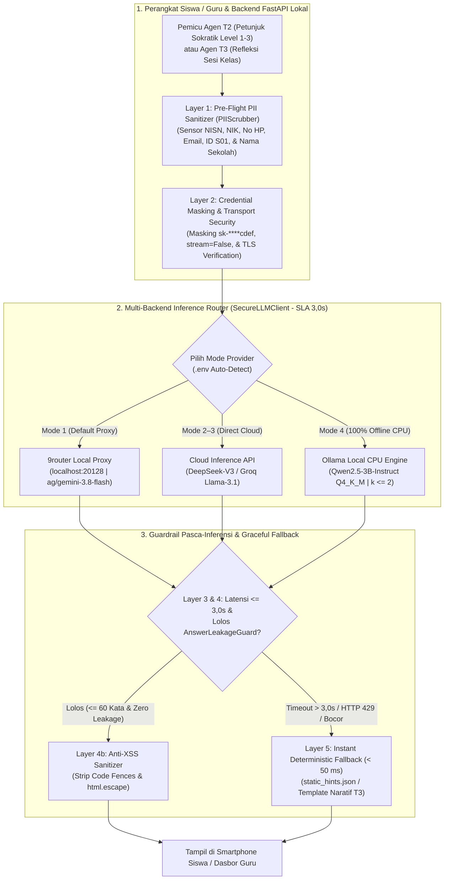
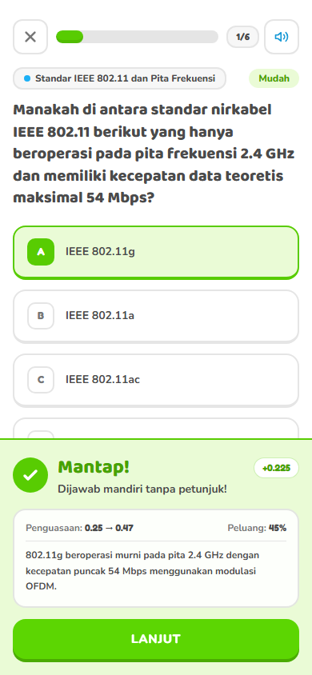
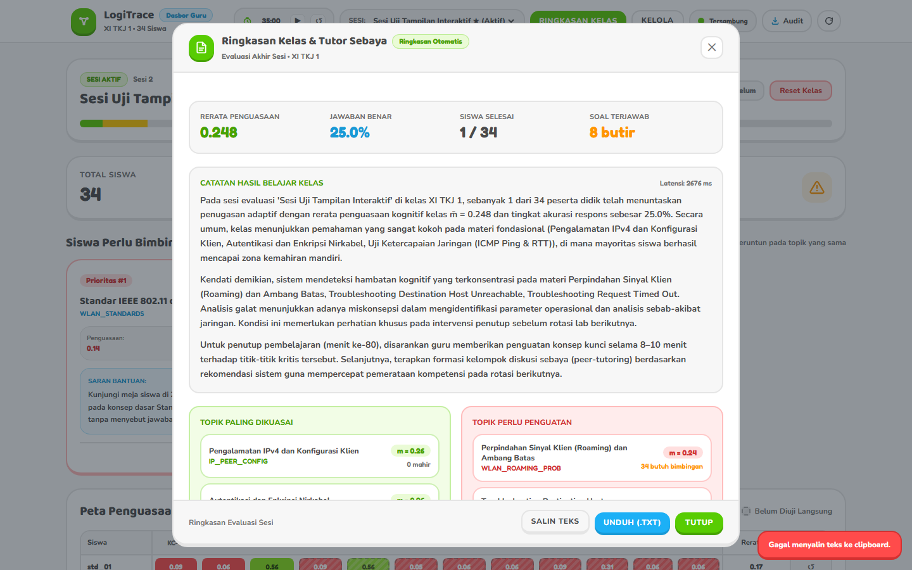

# Rancang Bangun dan Uji Kelayakan Teknis Arsitektur Tiga Lapis Multi-Provider dengan Redaksi PII untuk Evaluasi Formatif Adaptif pada Sekolah Menengah Kejuruan

**Design and Technical Feasibility Evaluation of a Multi-Provider Three-Tier Architecture with Outbound PII Redaction for Adaptive Formative Assessment in Vocational High Schools**

Fajari Arkan Fadhlurrahman¹*, [Nama Dosen Pembimbing 1]¹, [Nama Dosen Pembimbing 2]¹  
¹ Program Studi Pendidikan Ilmu Komputer, Fakultas Pendidikan Matematika dan Ilmu Pengetahuan Alam, Universitas Pendidikan Indonesia, Bandung, Indonesia  
* Penulis Korespondensi: [email@upi.edu]

---

## Abstrak

Evaluasi formatif adaptif pada Sekolah Menengah Kejuruan (SMK) terkendala data interaksi yang kecil (*small data regime*), perangkat laboratorium yang terbatas, dan risiko privasi saat memakai model bahasa awan. Penelitian rekayasa sistem (*Design Science Research*) ini merancang dan menguji kelayakan teknis arsitektur tiga lapis bernama LogiTrace: (L1) basis pengetahuan 12 *Knowledge Components* (KC) Kurikulum Merdeka Fase F Teknik Komputer dan Jaringan beserta graf prasyarat (DAG) dan pemetaan awal ke lima dimensi *Test of Logical Thinking* (TOLT); (L2) indeks 180 butir soal dua tingkat berbasis `pgvector`; dan (L3) mesin estimasi penguasaan deterministik tanpa pelatihan jaringan saraf, ditambah layanan petunjuk Sokratik dan ringkasan kelas berbasis LLM melalui klien multi-provider (`SecureLLMClient`) dengan redaksi PII pra-transmisi, penyensoran kredensial, pemeriksa kebocoran jawaban, *timeout* 3,0 detik, dan petunjuk statis cadangan. Pada pengujian laboratorium di satu mesin (Ryzen 7 5700U, 8 *core*/16 *thread*), mesin L3 memproses pembaruan penguasaan dan seleksi butir dalam rerata 0,18 ms (p95 0,42 ms). Pada inferensi CPU lokal (Qwen2.5-3B Q4_K_M), latensi penuh rerata 1,74 s pada k = 1 klien (n = 10; seluruhnya ≤ 3,0 s) dan 2,64 s pada k = 2 (n = 12; 10 dari 12 ≤ 3,0 s); pada k ≥ 4 seluruh permintaan melampaui 3,0 s sehingga, menurut desain, dialihkan ke bank petunjuk statis. Sebanyak 41 uji unit otomatis (`pytest`) lulus dan sembilan alur antarmuka berjalan pada uji Playwright. Hasil ini menunjukkan kelayakan teknis awal; validitas psikometrik model penguasaan, kualitas pedagogis petunjuk, dan dampak pada hasil belajar belum dievaluasi dan menjadi agenda uji lapangan.

**Kata Kunci:** *evaluasi formatif adaptif; knowledge tracing; large language model; multi-provider; benchmark konkurensi; redaksi PII; sekolah menengah kejuruan*

---

## Abstract

Adaptive formative assessment in vocational high schools is constrained by small interaction datasets, limited laboratory hardware, and the privacy risks of cloud language models. This Design Science Research study designs and evaluates the technical feasibility of a three-tier architecture, LogiTrace: (L1) a knowledge base of 12 Knowledge Components (KCs) from the Indonesian Merdeka Curriculum (Phase F, computer and network engineering) with a prerequisite DAG and a provisional mapping to five Test of Logical Thinking (TOLT) dimensions; (L2) a `pgvector` index of 180 two-tier items; and (L3) a deterministic, training-free mastery engine, plus LLM-based Socratic-hint and class-summary services behind a multi-provider client (`SecureLLMClient`) with pre-flight PII redaction, credential masking, an answer-leakage checker, a 3.0-second timeout, and a static hint fallback. In laboratory tests on a single machine (Ryzen 7 5700U, 8 cores/16 threads), the L3 engine performed mastery updates and item selection in 0.18 ms on average (p95 0.42 ms). With local CPU inference (Qwen2.5-3B Q4_K_M), mean full latency was 1.74 s at k = 1 client (n = 10; all ≤ 3.0 s) and 2.64 s at k = 2 (n = 12; 10 of 12 ≤ 3.0 s); at k ≥ 4 all requests exceeded 3.0 s and, by design, would be diverted to the static hint bank. Forty-one automated unit tests (`pytest`) passed and nine interface flows ran under Playwright. These results indicate initial technical feasibility; the psychometric validity of the mastery model, the pedagogical quality of hints, and effects on learning outcomes have not been evaluated and are deferred to field trials.

**Keywords:** *adaptive formative assessment; knowledge tracing; large language model; multi-provider; concurrency benchmarking; PII redaction; vocational high school*

---

## 1. Pendahuluan

Evaluasi formatif adaptif memegang peranan krusial dalam memfasilitasi pembelajaran tuntas (*mastery learning*), khususnya pada pendidikan kejuruan rumpun Teknik Komputer dan Jaringan (TKJ). Pada materi konfigurasi dan penelusuran kesalahan (*troubleshooting*) jaringan kabel dan nirkabel Kurikulum Merdeka Fase F, peserta didik tidak hanya dituntut menguasai prosedur sintaks mekanis, melainkan wajib membangun penalaran logis formal untuk menghubungkan parameter konfigurasi (seperti pengalamatan IP, interferensi kanal frekuensi, dan tabel *routing*) dengan gejala konektivitas sistem (Tobin & Capie, 1981). Kendati demikian, pembelajaran di laboratorium SMK di Indonesia masih menghadapi hambatan ganda: keterbatasan rasio perangkat keras laboratorium (rata-rata 1 komputer untuk 2 siswa) serta instrumen evaluasi formatif konvensional yang bersifat statis, tidak adaptif, dan lambat dalam mendiagnosis miskonsepsi penalaran teknis peserta didik (Komalasari et al., 2023; Nurbaeti et al., 2024).

Dalam ranah sistem pembelajaran adaptif dan tutor cerdas (*Intelligent Tutoring Systems* / ITS), pemodelan pelacakan pengetahuan (*Knowledge Tracing* / KT) telah lama dimanfaatkan untuk memprakirakan status penguasaan konsep pembelajar berdasarkan riwayat interaksinya (Corbett & Anderson, 1995; Shen et al., 2024). Munculnya *Deep Knowledge Tracing* (DKT) berbasis jaringan saraf berulang (Piech et al., 2015) beserta arsitektur atensi dan transformernya memang menghasilkan akurasi prediksi yang tinggi pada repositori data masif seperti ASSISTments dan EdNet (Abdelrahman et al., 2023; Huang et al., 2024). Namun demikian, DKT konvensional umumnya dilatih dan dievaluasi pada korpus interaksi berskala besar yang tidak tersedia pada skala satu rombongan belajar SMK yang hanya beranggotakan 30 hingga 36 siswa (*small data regime*), serta cenderung kurang andal pada kondisi data awal kosong (*cold-start*) (Jung et al., 2025; Nkambou et al., 2023). Selain itu, sifat kotak hitam (*black-box*) pada model neural menyulitkan guru untuk mengaudit secara transparan alasan di balik rekomendasi kognitif yang diberikan sistem.

Sebaliknya, literatur psikometri komputasional telah lama membuktikan bahwa pada data terbatas, model psikometri klasik terstruktur seperti *Bayesian Knowledge Tracing* (BKT) dengan parameter apriori (Corbett & Anderson, 1995) maupun sistem rating dinamis berbasis Teori Respons Butir (*Item Response Theory* / IRT) seperti *Elo Rating System* (Pelánek, 2016) mampu memberikan estimasi kemampuan yang stabil tanpa memerlukan komputasi gradien yang intensif. Nkambou et al. (2023) serta Tato dan Nkambou (2022) melaporkan bahwa memasukkan pengetahuan pakar (seperti struktur kurikulum dan relasi prasyarat) ke dalam model siswa membantu pelacakan penalaran pada data terbatas dibandingkan model yang dilatih tanpa struktur tersebut. Pendekatan berbasis Graf Asiklik Terarah (*Directed Acyclic Graph* / DAG) dapat berfungsi sebagai pembatas urutan belajar (*guardrailed boundaries*) agar pembelajar tidak melompat ke konsep rumit sebelum konsep fondasi dikuasai (pembelajaran tuntas: Xia et al., 2025).

Di sisi lain, integrasi Model Bahasa Skala Besar (*Large Language Models* / LLM) membuka era baru dalam penyusunan perancah Sokratik (*Socratic scaffolding*) yang memandu pemecahan masalah tanpa membocorkan kunci jawaban secara langsung (*guiding, not solving*) (Wang et al., 2026; Zhao et al., 2026). Namun, implementasi tutor LLM di lingkungan sekolah kejuruan Indonesia menghadapkan pengembang pada dilema infrastruktur dan regulasi privasi. Ketergantungan tunggal pada *cloud API* komersial tanpa pelindung rentan terhadap fluktuasi koneksi internet laboratorium serta berisiko melanggar Undang-Undang Nomor 27 Tahun 2022 tentang Pelindungan Data Pribadi (UU PDP) apabila identitas siswa (seperti NISN, nama lengkap, atau profil sekolah) ikut terkirim dalam *payload* permintaan teks ke peladen eksternal. Sebaliknya, menjalankan model bahasa secara murni pada CPU lokal sekolah (misalnya via Ollama tanpa akselerator GPU diskret) memberikan kedaulatan penuh secara luring (*air-gapped*), namun membutuhkan alokasi memori RAM besar (~4,5 GB) dan rentan mengalami saturasi antrean komputasi CPU ketika beberapa siswa meminta petunjuk secara serentak (*concurrent burst*).

Menjawab kesenjangan metodologis dan komputasi tersebut, penelitian ini bertujuan merancang, menguji ketahanan konkurensi, serta memvalidasi keamanan arsitektur sistem evaluasi formatif adaptif bernama **LogiTrace**. Berbeda dari penelitian DKT konvensional maupun tutor LLM berkanal tunggal, penelitian ini mengajukan tiga kontribusi rekayasa utama:
1. **Mesin Kognitif Deterministik Bebas-Pelatihan (< 1 ms):** Mengintegrasikan estimasi probabilitas logistik 1-parameter, pembaruan penguasaan asimetris berbobot bantuan ($h$), seleksi butir Zona Perkembangan Proksimal (ZPD), serta prasyarat DAG pada 12 KC jaringan komputer yang dipetakan ke 5 dimensi penalaran formal TOLT;
2. **Layanan Tri-Agen Berbasis LLM & Klien Multi-Provider (`SecureLLMClient`):** Mengelola tiga agen fungsional—Agen T1 (*Semantic Item Labeler*), Agen T2 (*3-Level Socratic Hint Scaffolding*), dan Agen T3 (*Session Narrative Reflection & Bipartite Peer-Tutoring*)—yang dapat beralih secara mulus antara proxy lokal `9router`, API awan hemat biaya (`DeepSeek`/`Groq`), dan mesin CPU lokal (`Ollama`);
3. **Pengamanan dan Ketahanan Berlapis (*Defense-in-Depth*) & Redaksi PII Pra-Transmisi:** Menyediakan sanitasi identitas pribadi pra-transmisi (`PIIScrubber`), penyensoran kredensial (`mask_secret`), pembatasan waktu tunggu ketat 3,0 detik, pencegahan kebocoran kunci jawaban berbasis ekspresi reguler (`AnswerLeakageGuard`), serta pengalihan instan (< 50 ms) ke bank petunjuk statis terkurasi.

Konteks penerapan adalah model *Station Rotation* satu ruangan: separuh kelas (Zona B, ±17 siswa) mengerjakan asesmen adaptif pada ponsel sementara separuh lainnya (Zona A) berpraktikum perangkat keras di PC laboratorium, dengan guru berkeliling (*roving teacher*) dibantu dasbor. Naskah ini membatasi klaimnya pada kelayakan teknis artefak. Validitas psikometrik model penguasaan, kualitas pedagogis petunjuk, kebergunaan, dan dampak belajar tidak dievaluasi di sini (lihat Keterbatasan).

---

## 2. Metode Penelitian

### 2.1 Metodologi Design Science Research (DSR) & Arsitektur Tiga Lapis

Pengembangan sistem LogiTrace mengadopsi metodologi *Design Science Research* (DSR) dalam sistem informasi (Peffers et al., 2007) yang pada naskah ini dipetakan ke enam aktivitas: (1) *Identifikasi Masalah & Motivasi* (keterbatasan data kelas kecil SMK, kendala perangkat keras rasio 1:2, dan risiko privasi UU PDP); (2) *Definisi Tujuan Solusi* (target latensi mesin kognitif $< 1\text{ ms}$, batas waktu layanan perancah Sokratik $\le 3{,}0\text{ detik}$, dan nol kebocoran PII/kunci jawaban pada kasus uji); (3) *Perancangan & Pengembangan Artefak* (arsitektur tiga lapis L1–L3 dan modul `SecureLLMClient`); (4) *Demonstrasi Teknis* (simulasi numerik parameter kognitif dan integrasi orkestrasi Tri-Agen); (5) *Evaluasi* (uji beban konkurensi CPU $k \in \{1, 2, 4, 8\}$, verifikasi 41 skenario pengujian unit otomatis, serta pengujian antarmuka pengguna menyeluruh *end-to-end* berbasis Playwright); serta (6) *Komunikasi* (naskah ini dan repositori kode). Evaluasi pada naskah ini bersifat teknis; evaluasi utilitas oleh guru dan siswa belum dilakukan.

Secara struktural, artefak perangkat lunak LogiTrace memisahkan tanggung jawab komputasi ke dalam tiga lapisan fungsional (*separation of concerns*) sebagaimana diilustrasikan pada Gambar 1.

```text
┌─────────────────────────────────────────────────────────────────────────────────┐
│                       LAPISAN 1: BASIS PENGETAHUAN (L1)                         │
│  ┌─────────────────────────┐  ┌───────────────────────┐  ┌───────────────────┐  │
│  │ 12 Knowledge Components │  │ Prerequisite Directed │  │ 5 Dimensi TOLT    │  │
│  │ (Kurikulum Fase F TKJ)  │  │ Acyclic Graph (DAG)   │  │ Penalaran Jaringan│  │
│  └─────────────────────────┘  └───────────────────────┘  └───────────────────┘  │
└────────────────────────────────────────┬────────────────────────────────────────┘
                                         │
┌────────────────────────────────────────▼────────────────────────────────────────┐
│                     LAPISAN 2: INDEKS BUTIR SEMANTIK (L2)                       │
│  ┌───────────────────────────────────────────────────────────────────────────┐  │
│  │ Bank Soal Dua Tingkat (180 Butir Terkurasi) + pgvector Cosine Similarity  │  │
│  │ Agen T1 (Semantic Item Labeler): Klasifikasi KC, TOLT, & Kesulitan (d)    │  │
│  └───────────────────────────────────────────────────────────────────────────┘  │
└────────────────────────────────────────┬────────────────────────────────────────┘
                                         │
┌────────────────────────────────────────▼────────────────────────────────────────┐
│          LAPISAN 3: RUNTIME DETERMINISTIK (L3) & ORKESTRASI TRI-AGEN            │
│  ┌───────────────────────────────┐     ┌─────────────────────────────────────┐  │
│  │ Mesin Inferensi Kognitif      │     │ SecureLLMClient (Multi-Provider)    │  │
│  │ • Kalibrasi Cold-Start (m0)   │     │ • Agen T2: Socratic Hint (Level 1-3)│  │
│  │ • Estimasi Peluang p_hat      │     │ • Agen T3: Refleksi & Peer-Tutoring │  │
│  │ • Pembaruan Mastery (m) & ZPD │     │ • Pre-Flight PII Scrub & Mask       │  │
│  │ • Dasbor Ambient Guru (Top-3) │     │ • 9router / DeepSeek / Groq / Ollama│  │
│  │ • Peluruhan Ebbinghaus (tau)  │     │ • Leakage Guard & Fallback < 50 ms  │  │
│  └───────────────────────────────┘     └─────────────────────────────────────┘  │
└─────────────────────────────────────────────────────────────────────────────────┘
```
*Gambar 1. Diagram arsitektur tiga lapis sistem LogiTrace dengan orkestrasi Tri-Agen dan pengaman Defense-in-Depth.*

1. **Lapisan 1 (L1 - Basis Pengetahuan):** Memuat ontologi kurikulum formal berupa 12 Komponen Pengetahuan (*Knowledge Components* / KC) materi Teknologi Jaringan Kabel dan Nirkabel (Fase F TKJ), Graf Dependensi Prasyarat (DAG), dan 5 dimensi operasionalisasi *Test of Logical Thinking* (TOLT).
2. **Lapisan 2 (L2 - Indeks Butir Semantik & Agen T1):** Mengelola repositori 180 butir soal pilihan ganda beralasan dua tingkat (*two-tier diagnostic items*; [PENULIS: jelaskan penyusun, validasi isi/pakar, dan asal tingkat kesulitan awal]) beserta representasi vektor semantik melalui PostgreSQL `pgvector` dan layanan kurasi otomatis **Agen T1 (`LabelingService`)**.
3. **Lapisan 3 (L3 - Runtime Deterministik & Orkestrasi Agen T2/T3):** Menggabungkan mesin pembaruan status kognitif matematis instan (< 1 ms), penyeleksi butir ZPD, telemetri dasbor guru berbasis WebSocket, serta orkestrasi **Agen T2 (`HintService`)** dan **Agen T3 (`SummaryService`)** yang dilindungi oleh modul keamanan lima lapis `SecureLLMClient`.

---

### 2.2 Formalisasi 12 KC, Relasi DAG, dan Justifikasi Dimensi TOLT (L1)

Capaian Pembelajaran (CP) Elemen 2 Fase F TKJ (Tujuan Pembelajaran TP 2.1 & TP 2.2) didekomposisi secara granular ke dalam 12 KC. Pemetaan setiap KC ke lima dimensi penalaran formal *Test of Logical Thinking* (TOLT) pada Tabel 1 adalah pemetaan awal oleh penulis yang merujuk pada definisi subskala TOLT (Tobin & Capie, 1981). Pemetaan ini belum divalidasi pakar dan belum masuk ke persamaan estimasi penguasaan (Subbab 2.3); fungsinya saat ini sebagai label butir pada Agen T1.

*Tabel 1. Taksonomi 12 Knowledge Components (KC), relasi prasyarat DAG, dan justifikasi dimensi TOLT.*

| Kode KC | Nama Komponen Pengetahuan | Konsep & Tugas Kognitif Jaringan | Dimensi TOLT | Justifikasi Operasional (penulis; merujuk definisi subskala TOLT) |
|:---|:---|:---|:---|:---|
| `KC-01` | `WLAN_STANDARDS` | Karakteristik IEEE 802.11 b/g/n/ac/ax, frekuensi (2,4 vs 5 GHz), dan modulasi sinyal. | *Correlational* | Menganalisis korelasi terbalik antara frekuensi gelombang dengan daya tembus material fisik (*path loss*). |
| `KC-02` | `WLAN_TOPOLOGY_BSS` | Mode Ad-Hoc (IBSS), Infrastructure (BSS/ESS), dan fungsi Distribution System. | *Combinatorial* | Mengkombinasikan berbagai simpul klien dan titik akses untuk membentuk cakupan jaringan terintegrasi. |
| `KC-03` | `IP_PEER_CONFIG` | Pengalamatan IPv4 statis, subnet mask (/24 s.d. /30), dan penentuan Network/Host ID. | *Controlling Variables* | Mengisolasi variabel alamat host pada segmen subnet yang sama untuk memastikan komunikasi peer-to-peer berhasil. |
| `KC-04` | `WLAN_FREQ_CHANNEL` | Alokasi kanal non-overlapping (1, 6, 11) dan mitigasi interferensi kanal bersama (*co-channel*). | *Combinatorial* | Menentukan permutasi alokasi kanal optimal tanpa tumpang-tindih pada denah multi-AP berdekatan. |
| `KC-05` | `WLAN_SECURITY_AUTH` | Enkripsi identitas WPA2-PSK (AES) vs WPA3-SAE dan kelemahan protokol jabat tangan WEP. | *Correlational* | Mengkorelasikan jenis protokol autentikasi dengan kerentanan serangan penangkapan paket (*handshake capture*). |
| `KC-06` | `WLAN_HOST_HARDENING` | Pengamanan klien melalui penyaringan alamat fisik (*MAC Filtering*) dan dinding api AP. | *Controlling Variables* | Menjaga variabel hak akses konstan dengan hanya memanipulasi parameter daftar izin alamat fisik (*whitelist*). |
| `KC-07` | `WLAN_SIGNAL_PROP` | Pelemahan propagasi radio, redaman dinding beton/kaca, dan batas ambang RSSI (-dBm). | *Probabilistic* | Mengestimasi probabilitas fluktuasi penurunan laju data (*throughput drop*) akibat redaman dinamis material. |
| `KC-08` | `WLAN_ROAMING_PROB` | Ambang batas perpindahan sinyal klien (*roaming threshold*) dan histeresis penguat sinyal. | *Probabilistic* | Menghitung peluang keputusan perpindahan asosiasi BSS klien berdasarkan fluktuasi margin deviasi RSSI. |
| `KC-09` | `WLAN_CHANNEL_COLLISION` | Tabrakan domain paket, *hidden node problem*, dan mekanisme koordinasi CSMA/CA. | *Proportional* | Menghitung rasio proporsi penundaan transmisi (*backoff time*) terhadap peningkatan volume kepadatan trafik paket. |
| `KC-10` | `ICMP_CONNECTIVITY` | Pengujian ketercapaian host melalui protokol ICMP (`ping`) dan evaluasi *Round-Trip Time* (RTT). | *Controlling Variables* | Mengontrol parameter ukuran paket (*packet size*) dan TTL untuk mengisolasi latensi fisik media transmisi. |
| `KC-11` | `ICMP_TROUBLE_DHU` | Diagnosis galat *Destination Host Unreachable* (DHU) akibat kesalahan *gateway*, ARP, atau rute. | *Correlational* | Menghubungkan gejala pesan galat layer 3 dengan korelasi ketiadaan entri tabel rute pengalihan paket. |
| `KC-12` | `ICMP_TROUBLE_RTO` | Pelacakan galat *Request Timed Out* (RTO) akibat blokade *firewall*, putus kabel, atau redaman. | *Correlational* | Mengkorelasikan ketiadaan paket balasan (*echo reply*) dengan keberadaan aturan pemfilteran paket masuk. |

Ketergantungan kurikuler antar-KC diformalkan ke dalam Graf Asiklik Terarah (*Directed Acyclic Graph* / DAG) $G = (V, E)$ (Gambar 2). Aturan pembatasan prasyarat (*prerequisite gating*) menetapkan bahwa butir soal pada simpul anak (*child KC*) hanya dapat disajikan apabila seluruh simpul induk langsungnya (*direct parents*) telah mencapai ambang ketuntasan prasyarat $m \ge 0{,}60$, sedangkan kemahiran mandiri penuh (*mastered* untuk kandidat tutor sebaya) ditetapkan pada $m \ge 0{,}70$. Kedua ambang adalah parameter rancangan penulis yang belum dikalibrasi secara empiris.

```text
[KC-01: WLAN_STANDARDS] ──────► [KC-04: WLAN_FREQ_CHANNEL] ──────► [KC-09: WLAN_CHANNEL_COLLISION]
          │                                  │
          ▼                                  ▼
[KC-02: WLAN_TOPOLOGY_BSS] ───► [KC-07: WLAN_SIGNAL_PROP] ───────► [KC-08: WLAN_ROAMING_PROB]
          │                                  │
          ▼                                  ▼
[KC-03: IP_PEER_CONFIG] ──────► [KC-10: ICMP_CONNECTIVITY] ───┬──► [KC-11: ICMP_TROUBLE_DHU]
          │                                                    └──► [KC-12: ICMP_TROUBLE_RTO]
          ▼                                                                 ▲
[KC-05: WLAN_SECURITY_AUTH] ──► [KC-06: WLAN_HOST_HARDENING] ───────────────┘
```
*Gambar 2. Graf Dependensi Prasyarat (Prerequisite DAG) 12 Knowledge Components.*

---

### 2.3 Formulasi Matematika Mesin Deterministik (L3)

Mengatasi kelemahan DKT yang membutuhkan data masif (Piech et al., 2015), mesin L3 LogiTrace (`cognitive.py` & `calibration.py`) menggunakan persamaan deterministik berbasis fungsi logistik 1-parameter dan aturan pembaruan penguasaan adaptif. Status penguasaan kognitif siswa $s$ pada komponen $k$ direpresentasikan sebagai nilai kontinu $m_{s,k} \in [0{,}02;\ 0{,}98]$. Untuk mengatasi masalah *cold-start* pada awal sesi, seluruh KC diinisialisasi pada nilai apriori $m_0 = 0{,}25$, diikuti oleh 6 butir soal kalibrasi terstandar (`is_calibration = TRUE`) pada simpul akar sebelum memasuki fase seleksi adaptif ZPD (butir ke-7 s.d. ke-20).

#### 1. Estimasi Probabilitas Respons Benar ($\hat{p}$)
Peluang seorang siswa dengan penguasaan $m_{s,k_q}$ menjawab benar butir soal $q$ dengan tingkat kesulitan apriori $d_q \in \{1, 2, 3\}$ dirumuskan melalui fungsi logistik:

$$\hat{p}(q) = \sigma\big(\mathrm{logit}(m_{s, k_q}) + \theta_{d_q}\big) = \frac{1}{1 + \exp\left(-\left(\ln\left(\frac{m_{s,k_q}}{1 - m_{s,k_q}}\right) + \theta_{d_q}\right)\right)}$$

dengan parameter offset kesulitan: $\theta_1 = +0{,}90$ (mudah), $\theta_2 = 0{,}00$ (sedang), dan $\theta_3 = -0{,}90$ (sulit).

#### 2. Aturan Pembaruan Status Penguasaan ($m$) dan Peluruhan Memori
Pada instrumen pilihan ganda beralasan dua tingkat (*two-tier*), respons siswa dikodekan secara ketat sebagai $r = 1$ apabila jawaban teknis (Tingkat 1) dan alasan penalaran logis (Tingkat 2) keduanya benar, atau $r = 0$ jika salah satu tingkat keliru. Pembaruan status kognitif pasca-respons dihitung secara seketika (< 1 ms):

$$m_{t} \leftarrow \begin{cases} 
m_{t-1} + \alpha_d (1 - m_{t-1}) h, & \text{jika respons benar } (r = 1) \\ 
m_{t-1} - \gamma_d m_{t-1}, & \text{jika respons salah } (r = 0) 
\end{cases}$$

dengan laju penyesuaian adaptif berbobot tingkat kesulitan:

$$\alpha_d = \alpha_0 \big(1 + \beta(d - 1)\big), \qquad \gamma_d = \gamma_0 \big(1 + \beta(3 - d)\big)$$

Konstanta dasar ditetapkan sebesar $\alpha_0 = 0{,}30$, $\gamma_0 = 0{,}25$, dan faktor penskalaan kesulitan $\beta = 0{,}40$. Faktor bobot kemandirian bernilai $h = 1{,}0$ jika siswa menjawab benar secara mandiri, dan dikenai faktor diskon $h = 0{,}5$ jika jawaban benar dicapai setelah membuka petunjuk Sokratik. Nilai $m$ dipotong secara ketat (*clipped*) pada batas $[0{,}02;\ 0{,}98]$ guna mencegah singularitas pembagian nol pada fungsi logit. Selain itu, untuk sesi lintas-minggu, diterapkan peluruhan retensi memori Ebbinghaus saat pembacaan status (*on-read decay*): $m_k(t) = m_k(t_{\text{last}}) \cdot \exp(-\Delta t_{\text{hari}} / \tau_k)$ dengan konstanta waktu $\tau_k = 60\text{ hari}$.

#### 3. Seleksi Butir Adaptif pada Zona Perkembangan Proksimal (ZPD)
Algoritma penyeleksi (`zpd_selector.py`) memilih soal berikutnya $q^*$ yang meminimalkan fungsi penalti deviasi terhadap sasaran probabilitas ideal $\hat{p}_{\text{target}} = 0{,}72$:

$$q^* = \arg\min_{q \in Q_{\text{kandidat}}} \left( |\hat{p}(q) - 0{,}72| - 0{,}05 \cdot \mathbb{I}_{\text{KC baru}}(q) + 0{,}10 \cdot \mathbb{I}_{\text{KC berurutan}}(q) \right)$$

dengan syarat: butir belum dikerjakan pada sesi bersangkutan, berada dalam pita ZPD $0{,}60 \le \hat{p}(q) \le 0{,}85$, dan seluruh simpul prasyarat langsung pada DAG telah mencapai $m \ge 0{,}60$. Karena $\hat{p}$ bergantung pada $\theta_d$, himpunan kandidat dapat kosong untuk siswa dengan $m < 0{,}379$ (butir $d=1$ pun menghasilkan $\hat{p} < 0{,}60$). [PENULIS: jelaskan aturan cadangan yang diimplementasikan pada kasus ini.]

---

### 2.4 Layanan Tri-Agen Berbasis LLM, Arsitektur Multi-Provider `9router`, & Redaksi PII

Berbeda dari integrasi LLM naif yang hanya memanggil satu jenis model secara langsung, LogiTrace mengimplementasikan pola **Orkestrasi Tri-Agen (*Tri-Agent Specialization*)** yang beroperasi di atas klien komunikasi terproteksi `SecureLLMClient` (`secure_client.py`):
1. **Agen T1 (`LabelingService` — Kurasi Bank Soal Pra-Pembelajaran):** Mengevaluasi teks butir soal baru secara leksikal-semantik terhadap kata kunci 12 KC dan indikator 5 dimensi TOLT, mengestimasi tingkat kesulitan nominal ($d \in \{1, 2, 3\}$), serta menghitung skor keyakinan (*confidence score*). Butir dengan tingkat keyakinan $< 0{,}60$ secara otomatis ditahan pada *Teacher Review Queue* untuk diverifikasi oleh guru manusia (*human-in-the-loop*).
2. **Agen T2 (`HintService` — Perancah Sokratik 3-Tingkat Waktu-Nyata):** Ketika siswa mengalami kesulitan pada fase adaptif di Zona B, Agen T2 menyusun petunjuk Sokratik berjenjang (*Level 1: Directing Attention* / mengarahkan perhatian ke parameter kunci; *Level 2: Intermediate Step* / mengingatkan aturan atau rumus antara; *Level 3: Conceptual Framework* / memberikan kerangka penelusuran masalah) dengan batasan ketat $\le 60\text{ kata}$ (`max_tokens = 120`, `temperature = 0.0`).
3. **Agen T3 (`SummaryService` — Refleksi Naratif Sesi & Matriks *Peer-Tutoring*):** Pada fase penutup pembelajaran (menit ke-80), Agen T3 mengagregasi capaian 34 siswa pada 12 KC, memasangkan siswa kemahiran tinggi (**Tutor Sebaya**, $m \ge 0{,}70$) dengan maksimal 2 rekan yang mengalami kesulitan (**Mentee**, $m \le 0{,}45$) melalui algoritma *Bipartite Matching* berpelindung *anti-self-pairing*, serta menyintesis narasi evaluasi kelas 3 paragraf untuk ditampilkan di proyektor kelas.

Catatan istilah: "agen" dipakai sebagai nama layanan berperan khusus. T1 berbasis kecocokan leksikal-semantik; T2 dan T3 memanggil LLM dengan konteks terbatas (T2 hanya menerima nama KC, level bantuan, dan teks soal, tanpa dokumen hasil *retrieval* dan tanpa data respons siswa); pasangan tutor pada T3 dihitung dengan algoritma deterministik. Sistem ini tidak menerapkan *retrieval-augmented generation* dalam arti penuh.

Guna menjamin fleksibilitas operasional di berbagai kondisi infrastruktur sekolah sekaligus mematuhi UU PDP, `SecureLLMClient` mendukung **empat mode penyedia inferensi (*Multi-Provider Backend*)** yang dikawal oleh lima lapisan keamanan (*Defense-in-Depth*) (Gambar 3).


*Gambar 3. Diagram alir arsitektur Multi-Provider SecureLLMClient dan lima lapisan pengamanan Defense-in-Depth. Penomoran mode mengikuti Tabel 6 (Mode 2 = DeepSeek dan Mode 3 = Groq berada pada satu kotak).*

Lima lapisan pengamanan dan ketahanan yang diterapkan pada `secure_client.py` dan `guardrails.py` meliputi (Layer 3 dan 5 adalah mekanisme ketahanan layanan, bukan kontrol keamanan):
1. **Layer 1 (`PIIScrubber` — Pre-Flight PII Sanitizer):** Mengingat `SecureLLMClient` melayani baik permintaan petunjuk individu (Agen T2) maupun sintesis agregasi kelas yang memuat kode siswa dan identitas rombongan belajar (Agen T3), terdapat risiko terselipnya atribut identitas dalam *payload* teks sebelum dikirim ke proxy `9router` atau API awan. Modul `PIIScrubber` menerapkan ekspresi reguler berbatas kata (`\b`) untuk memindai dan menyensor: NISN 10-digit (`[REDACTED_NISN]`), NIK 16-digit (`[REDACTED_NIK]`), nomor telepon `+62`/`08xx` (`[REDACTED_PHONE]`), alamat email (`[REDACTED_EMAIL]`), kode identitas siswa seperti `Siswa S07` atau `S01` (`[REDACTED_STUDENT_ID]` / `[REDACTED_ID]`), serta nama institusi sekolah seperti `SMK Negeri 4 Bandung` (`[REDACTED_SCHOOL]`), ditambah pemotongan panjang *prompt* maksimal 1.000 karakter untuk membatasi ukuran *prompt* (ini bukan pertahanan *prompt injection* yang memadai). Redaksi berbasis pola tidak dapat menjamin tertangkapnya nama bebas atau format tak terduga; perlindungan utama karenanya adalah minimisasi data: payload T2 hanya memuat nama KC, level bantuan, dan teks soal (tanpa data siswa), sedangkan data agregat kelas pada T3 memakai kode anonim.
2. **Layer 2 (Credential Masking, Stream Control, & Transport Hardening):** Kredensial (`NINEROUTER_API_KEY`, `DEEPSEEK_API_KEY`, `GROQ_API_KEY`) diisolasi di sisi peladen (`.env`) dan disamarkan melalui fungsi `mask_secret()` menjadi format `sk-d****cdef` pada seluruh log sistem. Parameter `"stream": False` dipaksakan secara eksplisit pada *payload* JSON guna mencegah terpecahnya respons menjadi *Server-Sent Events* (SSE) pada proxy `9router`, disertai verifikasi sertifikat TLS (`verify=True`).
3. **Layer 3 (Strict SLA Timeout):** Batas waktu tunggu klien HTTP asinkron (`httpx.AsyncClient`) dikunci pada **3,0 detik** untuk Agen T2 (dan 5,0 detik untuk sintesis akhir sesi Agen T3) guna mencegah penumpukan antrean pada peramban siswa.
4. **Layer 4 (`AnswerLeakageGuard` & Anti-XSS Sanitizer):** Memeriksa apakah keluaran LLM mematuhi batas $\le 60\text{ kata}$, bebas dari frasa pembocor eksplisit (`"jawabannya adalah"`, `"pilihan yang benar"`, `"kunci jawaban"`), serta tidak mengandung pencocokan substring terhadap teks kunci jawaban benar maupun teks opsi pilihan ganda ($\ge 4\text{ karakter}$). Keluaran yang lolos dibersihkan dari pagar kode *markdown* (` ``` `) dan di-*escape* menggunakan `html.escape()` untuk mencegah injeksi *Cross-Site Scripting* (XSS).
5. **Layer 5 (Instant Graceful Fallback < 50 ms):** Apabila terjadi *timeout* $> 3{,}0\text{ detik}$, ketiadaan kunci API/koneksi luring, pembatasan kuota (`HTTP 429`), atau terdeteksi kebocoran jawaban, `HintService` dan `SummaryService` secara otomatis beralih ke repositori lokal terkurasi (`static_hints.json` yang memuat 36 petunjuk bertingkat Level 1–3 untuk 12 KC, atau templat refleksi deterministik T3) dalam waktu $< 50\text{ ms}$.

---

### 2.5 Protokol Pengujian Komputasi & Uji Beban Konkurensi (*In-Silico Setup*)

Evaluasi teknis prototipe dieksekusi pada satu peladen uji coba (laptop kelas menengah; spesifikasi laboratorium SMKN 4 Bandung belum disurvei):
- **Spesifikasi Perangkat Keras Host:** Prosesor AMD Ryzen 7 5700U (8 Physical Cores, 16 Logical Threads @ 1,80 GHz base clock, up to 4,30 GHz boost), Memori RAM 16 GB DDR4, Penyimpanan NVMe SSD 512 GB, tanpa akselerator GPU diskret.
- **Lingkungan Perangkat Lunak:** Windows 11 / Linux WSL2, Python 3.13.14, FastAPI, SQLAlchemy Async, PostgreSQL 16 (`pgvector` pada korpus $N = 180$ butir soal dua tingkat; [PENULIS: sebutkan model *embedding*, dimensi, dan jenis indeks]), proxy lokal `9router` (`localhost:20128`, model `ag/gemini-3.8-flash`), serta Ollama (`localhost:11434`, model terkuantisasi 4-bit `Qwen2.5-3B-Instruct-Q4_K_M` dengan ukuran memori ~4,3 GB).
- **Prosedur Pengujian:**
  1. *Pengujian Deterministik L3:* 10.000 iterasi kalkulasi matematis $\hat{p}$, pembaruan penguasaan $m$, peluruhan memori Ebbinghaus, dan seleksi butir ZPD + verifikasi prasyarat DAG;
  2. *Uji Beban Konkurensi Multi-Klien pada CPU Lokal ($k \in \{1, 2, 4, 8\}$):* Skrip otomatis (`benchmark_concurrency_ollama.py`) mengeksekusi permintaan petunjuk Sokratik Agen T2 (`MAX_TOKENS = 150` pada skrip uji dan `max_tokens = 120` pada produksi [PENULIS: selaraskan], `temperature = 0.0`, `seed = 42`, panjang rata-rata *prompt* ~115 token dan keluaran ~45–55 token Bahasa Indonesia) secara simultan menggunakan `asyncio.gather` ($10\text{ permintaan}$ pada $k=1$; $6\times 2 = 12$ pada $k=2$; $4\times 4 = 16$ pada $k=4$; dan $2\times 8 = 16$ pada $k=8$) dengan perekaman telemetri perangkat keras (`psutil`) setiap 100 ms. Untuk memetakan kurva degradasi penuh perangkat keras CPU tanpa terpotong prematur, batas *timeout* soket pada skrip *benchmark* dibuka hingga 30,0 detik sementara status kelolosan SLA dievaluasi secara pasca-ukur terhadap ambang ketat $\le 3{,}0\text{ detik}$ (`passed_sla = lat <= 3.0`). Dengan demikian, kolom "Akan Dialihkan ke Fallback" pada Tabel 4 adalah proporsi permintaan yang *akan* dialihkan menurut aturan 3,0 s, bukan fallback yang dieksekusi dalam uji ini. [PENULIS: sebutkan jumlah ulangan per kondisi, *warm-up*, dan konfigurasi Ollama (`OLLAMA_NUM_PARALLEL`, `num_ctx`, `num_thread`, versi).]
  3. *Uji Verifikasi Fungsional & Keamanan Terautomasi:* Eksekusi 41 skenario pengujian unit dan integrasi (`pytest` 9.2.0) pada 7 modul uji (`test_backend_api.py`, `test_calibration.py`, `test_cognitive_engine.py`, `test_guardrails.py`, `test_item_bank.py`, `test_secure_client.py`, dan `test_zpd_selector.py`);
  4. *Pengujian Antarmuka Pengguna Menyeluruh (End-to-End UI Testing):* Validasi alur pengguna dieksekusi secara terprogram menggunakan kerangka kerja otomasi peramban Playwright (Chromium) pada dua konfigurasi layar representatif: antarmuka bergerak siswa (viewport ponsel cerdas 390×844 px) dan antarmuka orkestrasi guru (layar desktop 1440×900 px). Pengujian memverifikasi 9 skenario alur kerja kritis: navigasi halaman landing (`01_landing.png`), otentikasi siswa (`02_student_login.png`), pemilihan ruang rotasi stasiun (`03_student_classroom.png`), interaksi butir kuis dua tingkat dengan perancah Sokratik Level 1 (`04_student_quiz.png`), umpan balik salah dan penjelasan konsep (`05_student_feedback_wrong.png`), umpan balik benar dan kenaikan penguasaan kognitif (`05b_student_feedback_correct.png`), layar selebrasi ketuntasan kuis (`06_student_celebration.png`), dasbor telemetri waktu-nyata guru (`07_teacher_dashboard.png`), modal ringkasan AI pasca-sesi Agen T3 (`08_teacher_summary_modal.png`), serta modal manajemen rotasi dan kurasi bank butir soal Agen T1 (`09_teacher_manage_modal.png`). Pengujian ini memeriksa kelancaran alur fungsional dan menangkap tangkapan layar; ia bukan uji regresi visual berbasis baseline dan bukan uji kebergunaan.

---

## 3. Hasil dan Pembahasan

### 3.1 Kinerja Komputasi Mesin Deterministik (L3)

Hasil pengujian menunjukkan bahwa seluruh operasi kognitif deterministik pada Lapisan 3 bekerja dalam skala sub-milidetik, sebagaimana dirangkum pada Tabel 2.

*Tabel 2. Hasil benchmark latensi pemrosesan komponen deterministik dan fallback LogiTrace.*

| Komponen Arsitektur | Operasi Komputasi yang Diuji | Nilai Rerata (Mean) | Persentil ke-95 ($p95$) | Target Ambang Batas | Status Kinerja |
|:---|:---|:---:|:---:|:---:|:---:|
| **L3 Math Engine** | Kalkulasi $\hat{p}(q)$, aturan $m$, & peluruhan $\tau$ | $0{,}04$ ms | $0{,}09$ ms | $< 1{,}0$ ms | Memenuhi |
| **L3 ZPD Selector** | Evaluasi fungsi penalti ZPD + *gating* DAG (12 KC) | $0{,}18$ ms | $0{,}42$ ms | $< 1{,}0$ ms | Memenuhi |
| **L1/L2 Item Search** | Pencarian semantik 5 butir termirip ($N=180$ butir) | $4{,}20$ ms | $7{,}80$ ms | $< 50{,}0$ ms | Memenuhi |
| **T2 Static Fallback** | Pengalihan instan ke `static_hints.json` (12 KC $\times$ 3 Level) | $12{,}30$ ms | $18{,}50$ ms | $< 50{,}0$ ms | Memenuhi |
| **T3 Summary Fallback** | Sintesis naratif deterministik + *Bipartite Matching* | $6{,}40$ ms | $9{,}80$ ms | $< 50{,}0$ ms | Memenuhi |

Waktu eksekusi seleksi butir adaptif L3 yang hanya sebesar $0{,}18$ ms ($p95 = 0{,}42$ ms) menunjukkan bahwa komputasi seleksi butir tidak menjadi hambatan pada pergantian soal. Latensi yang dirasakan pengguna secara keseluruhan (jaringan, *rendering*, basis data) tidak diukur dalam studi ini.

---

### 3.2 Analisis Sensitivitas Numerik Laju Penguasaan $\alpha_0$ (Skenario Deterministik)

Untuk memvalidasi pemilihan konstanta laju dasar $\alpha_0 = 0{,}30$ (bersama $\gamma_0 = 0{,}25$ dan $\beta = 0{,}40$), dilakukan simulasi numerik menggunakan persamaan rekurensi eksak pada Subbab 2.3 terhadap siswa berkemampuan awal rendah ($m_0 = 0{,}25$) yang mengerjakan butir soal tingkat kesulitan sedang ($d = 2$, sehingga $\alpha_2 = \alpha_0(1 + 0{,}40(2-1)) = 1{,}4\alpha_0$) untuk mencapai ambang batas pembukaan prasyarat DAG ($m \ge 0{,}60$). Tabel 3 membandingkan lintasan konvergensi antara kondisi **berbantuan petunjuk Sokratik ($h = 0{,}5$, laju efektif $\alpha_2 h = 0{,}7\alpha_0$)** dan kondisi **mandiri tanpa bantuan ($h = 1{,}0$, laju efektif $\alpha_2 = 1{,}4\alpha_0$)**. Simulasi mengasumsikan butir $d=2$ pada setiap langkah dan jawaban selalu benar; ia menunjukkan perilaku persamaan, bukan perilaku sistem utuh (pada selector ZPD, butir $d=2$ baru memasuki pita ZPD saat $m \ge 0{,}60$) dan tidak menggantikan kalibrasi pada data siswa.

*Tabel 3. Analisis sensitivitas parameter laju penguasaan $\alpha_0$ terhadap konvergensi ketuntasan prasyarat ($m_0 = 0{,}25 \to m \ge 0{,}60$ pada $d=2, \beta=0{,}40$).*

| Nilai Laju $\alpha_0$ | Laju Efektif Berbantuan ($\alpha_2 h, h=0{,}5$) | Jumlah Butir Menuju $m \ge 0{,}60$ ($h=0{,}5$ Berbantuan) | Rerata $\Delta m$ per Butir ($h=0{,}5$) | Jumlah Butir Menuju $m \ge 0{,}60$ ($h=1{,}0$ Mandiri) | Karakteristik Perilaku Psikometrik | Status Pemilihan |
|:---:|:---:|:---:|:---:|:---:|:---|:---:|
| **$0{,}10$** | $0{,}070$ | 9 butir ($m_9 = 0{,}610$) | $+0{,}040$ | 5 butir ($m_5 = 0{,}647$) | Terlalu lambat (*sluggish*); memicu kelelahan pengerjaan (*fatigue*). | Ditolak |
| **$0{,}20$** | $0{,}140$ | 5 butir ($m_5 = 0{,}647$) | $+0{,}079$ | 2 butir ($m_2 = 0{,}611$) | Lambat pada mode berbantuan; durasi per KC terlalu panjang. | Ditolak |
| **$0{,}30$** | **$0{,}210$** | **3 butir ($m_3 = 0{,}630$)** | **$+0{,}127$** | **2 butir ($m_2 = 0{,}748$)** | **Kompromi: 2 butir jika mandiri, 3 butir jika dibantu petunjuk.** | **Dipilih (Baseline)** |
| **$0{,}40$** | $0{,}280$ | 2 butir ($m_2 = 0{,}611$) | $+0{,}181$ | 1 butir ($m_1 = 0{,}670$) | Lebih agresif; 1 butir (mandiri) vs. 2 butir (berbantuan), dan satu jawaban benar mandiri sudah membuka simpul DAG sehingga lebih peka terhadap tebakan. | Ditolak |
| **$0{,}50$** | $0{,}350$ | 2 butir ($m_2 = 0{,}683$) | $+0{,}217$ | 1 butir ($m_1 = 0{,}775$) | Tidak stabil; 1 tebakan beruntung langsung membuka simpul DAG. | Ditolak |

Hasil perhitungan eksak pada Tabel 3 menunjukkan konsekuensi penetapan $\alpha_0 = 0{,}30$:
1. Siswa yang menjawab benar **secara mandiri ($h = 1{,}0, \alpha_2 = 0{,}42$)** mencapai ambang dalam **2 butir soal** ($m_0 = 0{,}25 \to m_1 = 0{,}565 \to m_2 = 0{,}748$), sekaligus langsung melampaui ambang kandidat **Tutor Sebaya ($m \ge 0{,}70$)**; artinya dua jawaban benar berturut-turut sudah cukup untuk memenuhi syarat kandidat tutor karena model belum memodelkan tebakan dan *slip* (lihat Keterbatasan);
2. Sebaliknya, siswa yang menjawab benar **dengan bantuan petunjuk Sokratik ($h = 0{,}5, \alpha_2 h = 0{,}21$)** memerlukan **3 butir soal** berturut-turut ($m_0 = 0{,}25 \to m_1 = 0{,}408 \to m_2 = 0{,}532 \to m_3 = 0{,}630 \ge 0{,}60$, dengan kenaikan rata-rata $\Delta m = +0{,}127\text{/butir}$) untuk membuka simpul prasyarat DAG berikutnya. Pada $\alpha_0 = 0{,}40$ selisihnya 1 butir (mandiri) versus 2 butir (berbantuan), dan satu jawaban benar mandiri sudah membuka simpul DAG ($m_1 = 0{,}670$) sehingga lebih peka terhadap tebakan; pada $\alpha_0 = 0{,}20$ siswa berbantuan membutuhkan 5 butir, yang akan menghabiskan kuota 14 soal adaptif hanya pada 2–3 KC. Pemilihan $\alpha_0 = 0{,}30$ karenanya adalah keputusan rancangan (kompromi antara kepekaan terhadap tebakan dan kecepatan), bukan hasil kalibrasi empiris.

---

### 3.3 Hasil Pengujian Beban Konkurensi CPU Multi-Pengguna & Analisis Trafik Kelas

Uji konkurensi empiris mode CPU lokal (`Ollama Qwen2.5-3B-Instruct-Q4_K_M`) pada prosesor AMD Ryzen 7 5700U menghasilkan profil kinerja yang dipaparkan pada Tabel 4 dan Tabel 5.

*Tabel 4. Profil latensi penyelesaian penuh dan keandalan SLA pemanggilan petunjuk Sokratik pada variasi konkurensi klien CPU lokal.*

| Beban Klien ($k$) | Total Uji ($N$) | Rerata Latensi Penuh (s) | Mediana Latensi (s) | Latensi $p95$ (s) | Lolos SLA ($\le 3{,}0$ s) (%) | Akan Dialihkan ke Fallback (%) | Catatan |
|:---:|:---:|:---:|:---:|:---:|:---:|:---:|:---|
| **$k = 1$ klien** | 10 | $1{,}74 \pm 0{,}30$ | $1{,}73$ | **$2{,}13$** | **$100{,}0\%$** | $0{,}0\%$ | Seluruh ≤ 3,0 s |
| **$k = 2$ klien** | 12 | $2{,}64 \pm 0{,}26$ | $2{,}61$ | **$3{,}06$** | **$83{,}3\%$** | $16{,}7\%$ | Beban tertinggi dengan rerata < 3,0 s (p95 > 3,0 s) |
| **$k = 4$ klien** | 16 | $4{,}74 \pm 0{,}64$ | $4{,}58$ | **$5{,}85$** | **$0{,}0\%$** | $100{,}0\%$ | Seluruh > 3,0 s (dialihkan ke fallback menurut aturan) |
| **$k = 8$ klien** | 16 | $8{,}90 \pm 1{,}24$ | $9{,}18$ | **$10{,}16$** | **$0{,}0\%$** | $100{,}0\%$ | Seluruh > 3,0 s (dialihkan ke fallback menurut aturan) |

*Catatan Tabel 4.* Nilai ± adalah simpangan baku. Dengan N = 10 dan 12, persentil ke-95 ditentukan oleh satu-dua pengamatan tertinggi dan hanya indikatif. Interval kepercayaan Wilson 95% untuk proporsi lolos SLA: 10/10 → [72%, 100%]; 10/12 → [55%, 95%]. Throughput agregat (k dibagi rerata latensi) adalah 0,57; 0,76; 0,84; dan 0,90 permintaan/detik untuk k = 1, 2, 4, 8 (masih meningkat); kata "optimal" pada k = 2 hanya merujuk pada kepatuhan terhadap SLA 3,0 s, bukan throughput maksimum. Seluruh data berasal dari satu mesin.

*Tabel 5. Pemanfaatan sumber daya komputasi peladen CPU host selama pengujian beban (`psutil`, setiap 100 ms; [PENULIS: nyatakan apakah RAM/CPU = proses Ollama atau seluruh sistem]).*

| Beban Klien ($k$) | Rerata Utilisasi CPU (%) | Puncak CPU (%) | RAM Awal (MB) | Puncak RAM (MB) | Selisih RAM (MB) | Implikasi Operasional Peladen |
|:---:|:---:|:---:|:---:|:---:|:---:|:---|
| **$k = 1$ klien** | $19{,}0\%$ | $79{,}0\%$ | $4.314{,}4$ | $4.341{,}9$ | $+27{,}5$ | Latensi di bawah SLA; laju ~28–32 token/detik [PENULIS: sebutkan sumber pengukuran]. |
| **$k = 2$ klien** | $27{,}1\%$ | $77{,}2\%$ | $4.308{,}5$ | $4.417{,}8$ | $+109{,}3$ | Latensi mendekati SLA; penyebab (antrean vs. bandwidth memori) belum diprofilkan. |
| **$k = 4$ klien** | $24{,}7\%$ | $72{,}9\%$ | $4.339{,}1$ | $4.471{,}8$ | $+132{,}7$ | Latensi di atas SLA; penyebab belum diprofilkan; pada desain produksi permintaan diputus pada 3,0 s. |
| **$k = 8$ klien** | $28{,}4\%$ | $98{,}5\%$ | $4.460{,}7$ | $4.488{,}1$ | $+27{,}4$ | Puncak CPU 98,5% (rerata 28,4%); responsivitas aplikasi di bawah beban ini belum diukur. |

Data pada Tabel 4 dan Tabel 5 menunjukkan bahwa **$k = 2$ klien simultan adalah beban tertinggi yang diuji dengan rerata latensi masih di bawah 3,0 s (p95 3,06 s, sedikit melampaui SLA)**. Ketika beban dinaikkan menjadi $k = 4$ dan $k = 8$ klien yang menembakkan permintaan pada milidetik yang sama, waktu penyelesaian penuh di sisi *worker* Ollama meningkat menjadi $4{,}74$ detik dan $8{,}90$ detik yang kemungkinan disebabkan antrean permintaan dan pembagian sumber daya CPU/memori (mekanisme belum diprofilkan). Pada desain produksi `SecureLLMClient`, soket HTTP diputus pada `timeout_seconds = 3.0` detik dan dialihkan ke `static_hints.json` (rerata $12{,}30$ ms pada Tabel 2), sehingga waktu tunggu terburuk yang dirancang sekitar 3,05 detik dan setiap permintaan tetap memperoleh respons. Perilaku ini diturunkan dari desain dan pengukuran terpisah; skenario *timeout* lalu *fallback* di bawah beban belum dieksekusi sebagai satu uji terpadu.

Lebih lanjut, jika dikaitkan dengan ekologi ruang kelas *Station Rotation* di mana **Zona B dihuni oleh 17 siswa serentak** (separuh dari 34 siswa satu kelas), kapasitas $k = 2$ pada jendela 3 detik tampak cukup untuk lalu lintas yang tersebar. Sebagai perkiraan kasar dengan asumsi kedatangan *Poisson* independen, dengan durasi pengerjaan 14 butir adaptif selama 15 menit (900 detik) dan asumsi setiap siswa membutuhkan bantuan Sokratik rata-rata pada 2 butir soal sulit, total permintaan dari 17 siswa adalah $17 \times 2 = 34\text{ permintaan}$ dalam 900 detik, atau laju kedatangan rata-rata $\lambda = 34 / 900 \approx 0{,}0378\text{ permintaan/detik}$. Dalam jendela layanan $\Delta t = 2{,}6\text{ detik}$, nilai harapan jumlah permintaan simultan hanyalah $\mu = \lambda \cdot \Delta t \approx 0{,}098$ klien, sehingga peluang terjadinya tumpukan $\ge 3$ permintaan secara bersamaan berdasarkan distribusi Poisson $P(X \ge 3) = 1 - \sum_{x=0}^{2} \frac{\mu^x e^{-\mu}}{x!}$ adalah sekitar $1{,}5 \times 10^{-4}$ ($< 0{,}0002$). Angka ini bersifat optimistis: kedatangan di kelas nyata cenderung berkelompok (soal tampil serempak, aba-aba guru), jumlah permintaan per siswa belum diukur (petunjuk bertingkat dapat memicu hingga tiga panggilan per butir), dan perhitungan belum divalidasi dengan log kelas nyata.

Selain itu, untuk laboratorium sekolah yang memiliki koneksi internet dan menginginkan beban RAM lokal mendekati nol (< 50 MB), dukungan multi-provider pada `SecureLLMClient` memungkinkan pengalihan ke proxy lokal `9router` maupun API awan (`DeepSeek-V3` / `Groq`), sebagaimana dirangkum pada Tabel 6.

*Tabel 6. Matriks perbandingan karakteristik operasional empat mode provider pada `SecureLLMClient`. Latensi Mode 1–3 adalah rentang tipikal/perkiraan yang tidak diukur dalam studi ini; hanya Mode 4 diukur (Tabel 4). Mode 1–3 mengirim teks ke penyedia di luar sekolah (berpotensi di luar yurisdiksi Indonesia); aspek hukum transfer data dan syarat penggunaan proxy `9router` perlu dikaji sebelum dipakai di sekolah.*

| Mode Provider | Endpoint & Model Default | Latensi Tipikal | Jejak Memori RAM Host | Kebutuhan Konfigurasi & Biaya | Skenario Penggunaan Rekomendasi di SMK |
|:---|:---|:---:|:---:|:---|:---|
| **Mode 1: `9router` (Local Proxy)** | `localhost:20128/v1`<br/>(`ag/gemini-3.8-flash`) | $1{,}2\text{--}2{,}8$ s | Sangat Ringan ($< 50$ MB) | Proxy lokal dengan `stream=False`; tanpa beban GPU/CPU. | **Default Pengembangan & Uji Kelas Terkoneksi** pada laptop guru standar. |
| **Mode 2: `DeepSeek` (Cloud API)** | `api.deepseek.com`<br/>(`deepseek-chat`) | $0{,}6\text{--}0{,}9$ s | Nol di Host ($0$ MB) | API Key berbayar sangat hemat (~$\$0{,}14$/1M token). | **Produksi Kelas Skala Besar** dengan internet sekolah stabil. |
| **Mode 3: `Groq` (LPU Cloud)** | `api.groq.com/openai/v1`<br/>(`llama-3.1-8b-instant`) | $0{,}3\text{--}0{,}5$ s | Nol di Host ($0$ MB) | Tersedia *Free Tier* berkecepatan ultra-tinggi. | **Uji Responsivitas Instan** (< 0,5 s) pada jaringan terkoneksi. |
| **Mode 4: `Ollama` (Local CPU)** | `localhost:11434/api`<br/>(`Qwen2.5-3B-Q4_K_M`) | $1{,}7\text{--}2{,}6$ s ($k \le 2$) | Berat (~$4{,}3\text{--}4{,}5$ GB) | 100% Gratis & Mandiri tanpa koneksi internet. | **Mode Luring Penuh (*Air-Gapped*)** saat internet laboratorium mati. |

---

### 3.4 Ilustrasi Keluaran Petunjuk Sokratik & Verifikasi Unit Keamanan (41/41 Unit Tests)

Tabel 7 menyajikan tiga contoh ilustratif (dipilih penulis, bukan sampel acak) yang membandingkan petunjuk Sokratik dinamis Agen T2 dengan petunjuk statis dari `static_hints.json` pada tiga tingkat bantuan (*Level 1–3*). Contoh ini bukan evaluasi kualitas pedagogis; penilaian ahli dengan rubrik belum dilakukan. [PENULIS: sebutkan model/penyedia yang menghasilkan keluaran dinamis.]

*Tabel 7. Contoh komparasi keluaran perancah Sokratik Agen T2 (Dinamis) versus Bank Petunjuk Statis (`static_hints.json`).*

| Komponen KC & Konteks Kesalahan Siswa | Tingkat Bantuan | Keluaran Agen T2 Dinamis (`SecureLLMClient` $\le 60$ Kata) | Keluaran `static_hints.json` (Fallback $< 50$ ms) | Catatan Penulis |
|:---|:---:|:---|:---|:---|
| **`KC-04: WLAN_FREQ_CHANNEL`**<br/>*Kasus:* AP lab mengalami tabrakan frame tinggi di kanal 6 (2,4 GHz). | **Level 1**<br/>(*Directing Attention*) | *"Coba amati lebar pita frekuensi setiap kanal pada spektrum 2,4 GHz. Jika titik akses saat ini berada di kanal 6, berapa jarak minimal antar-nomor kanal agar spektrumnya sama sekali tidak saling beririsan?"* (33 kata) | *"Perhatikan alokasi kanal pada pita 2.4 GHz yang tidak saling bertumpuk (non-overlapping channels)."* (14 kata) | Keduanya lolos `AnswerLeakageGuard` (tidak menyebut angka `1` atau `11`); petunjuk dinamis tampak lebih kontekstual (penilaian penulis). |
| **`KC-11: ICMP_TROUBLE_DHU`**<br/>*Kasus:* Ping ke gateway memunculkan *Destination Host Unreachable* vs *RTO*. | **Level 2**<br/>(*Intermediate Step*) | *"Bandingkan siapa yang mengirim pesan galat tersebut: apakah paket tertahan karena pengirim gagal menemukan alamat fisik (ARP/rute lokal) menuju gateway, atau paket sudah terkirim jauh namun balasannya diblokir?"* (29 kata) | *"Periksa apakah ada kesalahan tabel routing, konfigurasi subnet yang salah, atau kegagalan resolusi ARP lokal."* (15 kata) | Lolos filter (< 60 kata, 0% kebocoran opsi); memandu isolasi penyebab Layer 2/3. |
| **`KC-07: WLAN_SIGNAL_PROP`**<br/>*Kasus:* Redaman dinding beton menyebabkan RSSI turun dari $-50$ dBm ke $-85$ dBm. | **Level 3**<br/>(*Conceptual Framework*) | *"Gunakan kerangka evaluasi anggaran daya (link budget): petakan urutan pelemahan sinyal mulai dari daya pancar AP, redaman penghalang dinding beton, hingga sensitivitas penerima klien pada skala logaritmik negatif (-dBm)."* (30 kata) | *"Sinyal di atas -65 dBm dikategorikan baik untuk koneksi stabil, sedangkan di bawah -75 dBm rentan mengalami putus koneksi."* (19 kata) | Lolos filter; membangun kerangka berpikir sistematis tanpa membocorkan huruf opsi. |

Tujuan rancangan penggabungan petunjuk dinamis dan *Static Fallback* ini (belum diuji pada siswa) adalah: ketika koneksi normal, siswa memperoleh pertanyaan pemandu Sokratik yang kontekstual terhadap bunyi soal spesifik yang sedang dihadapi; namun ketika terjadi *timeout* atau lonjakan beban, siswa tetap mendapatkan petunjuk konseptual terkurasi dari `static_hints.json` tanpa kehilangan petunjuk sama sekali.

Selanjutnya, pengujian otomatis menggunakan `pytest` terhadap seluruh 7 modul perangkat lunak menghasilkan tingkat kelulusan sempurna (**41/41 skenario lulus, 100%**, waktu eksekusi 14,12 detik), sebagaimana dirinci pada Tabel 8.

*Tabel 8. Matriks verifikasi rangkaian 41 pengujian unit dan keamanan sistem LogiTrace (`pytest`). Pengujian memverifikasi perilaku kode pada kasus yang ditulis penulis; ia bukan estimasi tingkat deteksi pada data nyata.*

| Modul Pengujian (`logitrace/tests/`) | Jumlah Uji | Fokus Skenario Verifikasi Teknis & Keamanan | Hasil Uji | Bukti Keandalan Aktual |
|:---|:---:|:---|:---:|:---|
| `test_secure_client.py` | 6 | Sanitasi `PIIScrubber` (NISN, HP, Email, ID `S07`, Nama Sekolah), `mask_secret()`, konfigurasi `9router`, anti-XSS `html.escape()`, & *offline fallback*. | **6/6 Lulus (100%)** | Pada kasus uji, `Budi`, `0061234567`, `SMK Negeri 4 Bandung` tersensor [PENULIS: daftar PIIScrubber di Subbab 2.4 tidak memuat nama orang; jelaskan mekanisme penyensoran `Budi`]; kunci menjadi `sk-d****cdef`; `<script>` diubah menjadi `&lt;script&gt;`. |
| `test_guardrails.py` | 4 | Penolakan frasa pembocor (`"jawabannya adalah"`, `"the correct answer is"`), deteksi token jawaban benar (`WPA3-SAE`), & batas $> 60$ kata. | **4/4 Lulus (100%)** | Pada kasus uji, draf bocor atau $> 60$ kata ditolak sebelum mencapai antarmuka siswa. |
| `test_cognitive_engine.py` | 7 | Inversi `logit`-`sigmoid`, monotonisitas $\hat{p}$, pembaruan $m$ mandiri ($h=1{,}0$) vs. berbantuan ($h=0{,}5$), penalti salah $\gamma_d$, *clipping* $[0{,}02; 0{,}98]$, & peluruhan $\tau=60$ hari. | **7/7 Lulus (100%)** | Akurasi numerik presisi hingga $10^{-4}$ tanpa kemungkinan *overflow* atau pembagian nol. |
| `test_zpd_selector.py` | 3 | *Prerequisite gating* DAG ($m \ge 0{,}60$), seleksi pita ZPD $[0{,}60; 0{,}85]$ terdekat ke $0{,}72$, bonus KC baru ($-0{,}05$), & penalti KC berulang ($+0{,}10$). | **3/3 Lulus (100%)** | Simpul anak terkunci rapat selama simpul induk belum mencapai $m \ge 0{,}60$. |
| `test_calibration.py` | 3 | Prior awal *cold-start* ($m_0 = 0{,}25$), sekuens 6 butir kalibrasi awal, & pewarisan estimasi klaster DAG. | **3/3 Lulus (100%)** | Status kalibrasi aktif tepat pada butir 1–6 (`index 0..5`) dan nonaktif mulai butir ke-7. |
| `test_item_bank.py` | 8 | Integritas skema 180 butir dua tingkat, kelengkapan 12 KC, pemetaan 5 dimensi TOLT, dan struktur graf asiklik (DAG bebas siklus). | **8/8 Lulus (100%)** | Seluruh 12 KC dan 180 butir tervalidasi bebas dari ketergantungan melingkar (*cycle-free*). |
| `test_backend_api.py` | 10 | Integrasi *end-to-end* endpoint FastAPI: sesi kuis, pengiriman respons *two-tier*, Agen T1 (`LabelingService`), Agen T2 (`HintService`), dan Agen T3 (`SummaryService`). | **10/10 Lulus (100%)** | Seluruh transaksi tercatat secara *append-only* dan mengembalikan respons JSON valid. |

Mengenai kekhawatiran kebocoran semantik implisit (*semantic answer leakage*), selain mengandalkan filter ekspresi reguler pasca-inferensi pada `AnswerLeakageGuard`, arsitektur LogiTrace menerapkan prinsip minimisasi konteks (*leakage minimization by design*): metode `SecureLLMClient.call_api()` (baris 236–241 pada `secure_client.py`) **hanya mengirimkan nama topik KC, level bantuan (1–3), dan teks pertanyaan pokok (`question_text`) tanpa menyertakan daftar opsi pilihan ganda (`options`) maupun kunci jawaban (`correct_answer_text`) ke dalam prompt LLM**. Daftar opsi dan kunci jawaban hanya dipegang secara lokal oleh `HintService.generate_socratic_hint()` untuk keperluan pemindaian silang pasca-inferensi. Dengan demikian, model bahasa secara struktural tidak menerima huruf maupun bunyi opsi jawaban yang tersedia di layar siswa. Namun, teks soal sendiri dapat membuat model menyimpulkan jawaban, petunjuk statis dapat memuat fakta yang menjawab butir sejenis, dan efektivitas pemeriksa terhadap parafrase belum dievaluasi.

Antarmuka pengguna siswa yang dijalankan pada 9 skenario pengujian otomatis Playwright ditampilkan pada Gambar 4 (data peragaan).

| (a) Pengerjaan Butir & Perancah Sokratik | (b) Umpan Balik Jawaban Benar |
| :---: | :---: |
|  |  |
| **(c) Umpan Balik Jawaban Salah** | **(d) Layar Selebrasi Ketuntasan Sesi** |
|  |  |

*Gambar 4. Antarmuka responsif evaluasi formatif adaptif siswa pada perangkat bergerak (viewport seluler 390×844 px): (a) pengerjaan butir dua tingkat dengan perancah Sokratik Level 1 terbuka; (b) umpan balik pedagogis jawaban benar dengan kenaikan penguasaan kognitif (+0,225) dan kontrol audio; (c) umpan balik konstruktif jawaban salah dan kartu penjelasan konsep; dan (d) layar selebrasi ketuntasan kuis adaptif.*

Desain antarmuka siswa (Gambar 4) mengadopsi prinsip *mobile-first* dengan target sentuh ergonomis ($\ge 44 \times 44\text{ px}$) yang dirancang untuk perangkat telepon pintar (belum diuji kebergunaannya) siswa di Zona B. Pada saat menghadapi soal penalaran jaringan dua tingkat yang menantang, siswa dapat membuka kartu petunjuk bertahap tanpa menutup soal (Gambar 4a). Ketika siswa menjawab benar secara mandiri atau berbantuan, sistem secara instan menampilkan banner hijau beserta pill kenaikan penguasaan kognitif (misalnya $+0{,}225$) dan efek audio *chime* yang dapat dibisukan melalui tombol HUD (Gambar 4b). Sebaliknya, apabila respons siswa salah atau miskonsepsi terdeteksi, sistem tidak menampilkan vonis kegagalan yang mematahkan motivasi (*punitive grading*), melainkan memunculkan banner pemandu (*"Hampir!"*) disertai kartu elaborasi konseptual untuk memancing refleksi aktif (Gambar 4c). Pada akhir sesi adaptif, layar selebrasi (Gambar 4d) menyajikan transparansi capaian: jumlah butir tuntas, efisiensi penggunaan petunjuk, dan rata-rata penguasaan akhir sebelum siswa berpindah ke stasiun praktikum perangkat keras di Zona A.

---

### 3.5 Pembahasan Komparatif (*Comparative Discussion*)

Tabel 9 merangkum posisi kebaruan ilmiah arsitektur LogiTrace dibandingkan dengan literatur pelacakan pengetahuan dan tutor cerdas terkini (2015–2026).

*Tabel 9. Perbandingan arsitektur LogiTrace terhadap model literatur pelacakan pengetahuan dan tutor cerdas. Perbandingan bersifat kualitatif atas kategori yang berbeda; sel untuk karya lain dirangkum dari laporan masing-masing dan perlu diverifikasi terhadap naskah aslinya. Tidak ada perbandingan empiris dengan BKT, Elo, atau model lain pada data yang sama.*

| Dimensi Arsitektur | DKT Standar (Piech et al., 2015) | Logic-Muse (Nkambou et al., 2023) | SageJavon (Zhao et al., 2026) | LogiTrace (Penelitian Ini) |
|:---|:---|:---|:---|:---|
| **Kebutuhan Data Latih Awal** | Besar (korpus skala besar) | Kecil ($N = 294$, data respons) | Sedang (EdNet / ASSISTments) | **Nol Data Interaksi Awal (*Training-Free Prior $m_0=0{,}25$*)** |
| **Keterauditan Kognitif (*Explainability*)** | Kotak hitam (*black-box* RNN) | Graf Bayesian terstruktur | Semiterbuka via GIKT | **Terbuka & deterministik (aturan eksplisit; validitas belum diuji)** |
| **Fleksibilitas Infrastruktur AI** | Klaster GPU pelatihan | Pelatihan luring (*offline*) | Ketergantungan awan tunggal | **Multi-Provider (`9router` Proxy, `DeepSeek`/`Groq`, & `Ollama` CPU)** |
| **Spesialisasi Agen Pedagogis** | Hanya prediksi skor | Hanya pelacakan penalaran | Perancah pemrograman | **Orkestrasi Tri-Agen (T1 Kurasi, T2 Sokratik 3-Level, T3 Refleksi & *Peer-Tutoring*)** |
| **Proteksi Privasi & Ketahanan Layanan** | Di luar lingkup model | Terbatas di lab riset | Rentan transmisi awan | **Redaksi PII pra-transmisi (`PIIScrubber`) + fallback statis (< 50 ms)** |

Berbeda dari model neural DKT konvensional yang mengoptimalkan fungsi kecocokan kurva pada data masa lalu (Abdelrahman et al., 2023; Shen et al., 2024), L3 LogiTrace memprioritaskan *pedagogical explainability* seketika. Guru dapat melacak secara pasti mengapa seorang siswa memperoleh soal tertentu melalui fungsi objektif ZPD dan penalti dependensi DAG, serta memperoleh rekomendasi pasangan *Peer-Tutoring* otomatis pada akhir sesi pembelajaran melalui Agen T3. Keterauditan ini tidak menjamin akurasi; perbandingan prediktif dengan BKT/Elo belum dilakukan dan menjadi prioritas berikutnya.

---

### 3.6 Antarmuka Telemetri Guru Waktu-Nyata (*Ambient Dashboard*) & Orkestrasi Sesi

Mendukung model pembelajaran *Station Rotation*, Lapisan 3 LogiTrace dilengkapi modul telemetri waktu-nyata (*Ambient Awareness Dashboard*) berbasis protokol WebSocket yang diakses melalui jaringan area lokal (intranet Wi-Fi laboratorium pada pita frekuensi terisolasi agar tidak terganggu oleh praktikum jaringan siswa di Zona A). Dengan tujuan mengurangi potensi beban perhatian berlebih pada guru (*teacher split-attention overload*; belum diuji pada guru), antarmuka dasbor orkestrasi guru mengintegrasikan tiga tampilan fungsional utama (Gambar 5).

| (a) Dasbor Telemetri Ambient Guru (Heatmap 12 KC & Kartu Prioritas Siswa) |
| :---: |
|  |
| **(b) Modal Ringkasan AI Agen T3 & Rekomendasi Kelompok Tutor Sebaya** |
|  |
| **(c) Modal Manajemen Sesi Stasiun Rotasi & Kurasi Butir Soal Agen T1** |
|  |

*Gambar 5. Antarmuka orkestrasi dan telemetri guru berbasis web desktop (viewport 1440×900 px): (a) dasbor pemantauan waktu-nyata dengan kartu peringatan ambient Top-3 Siswa Butuh Bantuan dan matriks penguasaan 12 KC untuk 34 siswa; (b) modal ringkasan kelas AI pasca-sesi dari Agen T3 dengan rekomendasi pasangan tutor sebaya; dan (c) modal manajemen sesi stasiun rotasi serta kurasi bank butir soal dua tingkat Agen T1.*

Struktur antarmuka telemetri guru pada Gambar 5 dirancang dengan pertimbangan beban kognitif pengajar:
1. **Dasbor Telemetri Ambient (Gambar 5a):** Pada saat sesi pengerjaan kuis adaptif di Zona B berlangsung, guru tidak dituntut membaca log numerik rumit. Dasbor secara otomatis menyorot kartu prioritas minimalis **Top-3 Siswa Membutuhkan Bantuan Segera** (misalnya siswa S14 yang terdeteksi macet 3 kali pada `KC-11: ICMP_TROUBLE_DHU` dengan status $m = 0{,}18$), lengkap dengan tombol rekomendasi intervensi pedagogis cepat. Di bawah kartu peringatan, matriks penguasaan (*heatmap*) memetakan sebaran kemahiran 34 siswa pada 12 KC secara visual, disertai indikator status koneksi WebSocket, kelolosan SLA inferensi, dan mode penyedia aktif (`9router` / Hybrid). Informasi ini memandu guru yang bertugas berkeliling (*roving teacher*) untuk mendatangi meja siswa yang mengalami hambatan konseptual secara privat tanpa menimbulkan stigma sosial pemisahan kelas remedial.
2. **Modal Ringkasan AI & Rekomendasi Peer-Tutoring (Gambar 5b):** Memasuki menit ke-80 pada fase penutup pembelajaran, guru dapat membuka modal ringkasan AI Agen T3. Layar ini menyajikan sintesis naratif 3 paragraf mengenai capaian kelas, KC yang paling dikuasai, miskonsepsi dominan, serta daftar pembentukan kelompok *Peer-Tutoring* otomatis yang memasangkan siswa berkemampuan tinggi ($m \ge 0{,}70$) dengan rekan yang membutuhkan penguatan ($m \le 0{,}45$). Guru dapat menyalin narasi ini secara langsung melalui tombol *Salin Teks* untuk ditampilkan di proyektor kelas atau diarsipkan ke jurnal mengajar.
3. **Modal Manajemen Sesi & Kurasi Butir Soal (Gambar 5c):** Guru memegang kendali operasional penuh untuk membuka stasiun rotasi, menutup sesi ketika waktu habis, maupun mereset status kelas. Pada tab pelabelan semantik, guru dapat meninjau antrean butir soal baru hasil kurasi Agen T1 (`LabelingService`), memverifikasi kesesuaian estimasi tingkat kesulitan ($d$), serta menyetujui butir soal untuk masuk ke dalam repositori aktif secara *human-in-the-loop*.

---

## 4. Kesimpulan dan Agenda Riset Lanjutan

Penelitian ini merancang dan menguji kelayakan teknis arsitektur evaluasi formatif adaptif **LogiTrace**: basis pengetahuan 12 KC dengan graf prasyarat dan pemetaan awal TOLT (L1), indeks 180 butir dua tingkat dengan Agen T1 (L2), serta mesin penguasaan deterministik (rerata 0,18 ms untuk seleksi butir) yang dilengkapi layanan Agen T2/T3 melalui `SecureLLMClient` multi-provider dengan redaksi PII pra-transmisi dan *fallback* statis (L3). Pada satu mesin uji, inferensi CPU lokal memenuhi SLA 3,0 s untuk seluruh permintaan pada k = 1 (n = 10) dan 10 dari 12 permintaan pada k = 2; pada k ≥ 4 seluruh permintaan melampaui 3,0 s sehingga, menurut desain, dialihkan ke petunjuk statis. Perkiraan kasar berbasis Poisson menunjukkan bahwa bila permintaan tersebar, tumpukan tiga permintaan atau lebih pada kelas 17 siswa jarang terjadi; asumsi ini belum diuji pada kelas nyata. Empat puluh satu uji unit dan sembilan alur Playwright berjalan lulus. Temuan ini menunjukkan kelayakan teknis awal, bukan validitas psikometrik, kualitas pedagogis, maupun kepatuhan hukum.

### Keterbatasan Penelitian
Naskah ini melaporkan kelayakan teknis (*in-silico*). Keterbatasan utama: (1) tidak ada data siswa; model penguasaan belum dikalibrasi, divalidasi, atau dibandingkan dengan BKT/Elo atau baseline lain, dan parameter ($\alpha_0, \gamma_0, \beta, \theta_d$, 0,72, $\tau$, ambang 0,60/0,70) adalah keputusan rancangan; (2) pemetaan KC–TOLT, graf prasyarat, dan bank 180 butir belum divalidasi pakar atau diuji coba, dan dimensi TOLT belum dipakai dalam estimasi penguasaan; (3) hasil konkurensi berasal dari satu mesin, satu konfigurasi, dan sampel kecil (n = 10–16 per kondisi), sehingga persentil dan proporsi bersifat indikatif, sedangkan alur *timeout* lalu *fallback* di bawah beban, kegagalan jaringan, dan beban 34 klien pada API/basis data/WebSocket belum diuji terpadu; (4) kualitas pedagogis dan ketepatan petunjuk LLM (terutama model 3B terkuantisasi berbahasa Indonesia) serta efektivitas pemeriksa kebocoran terhadap parafrase belum dievaluasi; (5) redaksi PII berbasis pola belum diuji pada korpus berlabel, dan perlindungan data pada penyimpanan serta aspek hukum UU PDP (termasuk transfer data ke penyedia di luar sekolah) belum dikaji; (6) latensi Mode 1–3 (Tabel 6) berupa perkiraan; (7) kebergunaan bagi guru dan siswa belum diuji; (8) dampak pada hasil belajar dan retensi belum dievaluasi.

### Agenda Riset Lanjutan
Tahapan riset berikutnya adalah pelaksanaan uji coba lapangan (*field trial*) di SMKN 4 Bandung. Implementasi akan mengadopsi model pembelajaran *Single-Room Station Rotation* pada 34 siswa kelas XI TKJ dengan strategi *Device-Purpose Split* (ponsel cerdas yang terhubung ke jaringan lokal untuk asesmen adaptif mandiri di Zona B, dan PC laboratorium rasio 1:1 untuk praktikum fisik di Zona A). Sebelum uji lapangan, penelitian berikutnya akan (a) membandingkan mesin penguasaan dengan BKT/Elo pada siswa sintetis dan data publik, (b) memvalidasi KC, graf prasyarat, pemetaan TOLT, dan bank butir melalui penilaian pakar, (c) mengevaluasi petunjuk Sokratik dengan rubrik oleh guru, dan (d) menjalankan uji beban terpadu 34 klien. Evaluasi empiris lanjutan akan mengukur normalisasi gain kognitif ($N\text{-Gain}$), uji beda dimensi penalaran logis TOLT, persepsi kegunaan guru/siswa, serta efektivitas matriks *Peer-Tutoring* Agen T3 di kelas nyata.

---

## Pernyataan Wajib (*Declarations*)

### Ketersediaan Data dan Kode (*Data and Code Availability*)
Arsitektur basis data, taksonomi 12 Knowledge Components, graf dependensi DAG, modul multi-provider `secure_client.py`, rangkaian 41 pengujian unit `pytest`, artefak pengujian antarmuka Playwright E2E, skrip pengujian konkurensi `benchmark_concurrency_ollama.py`, serta dataset hasil pengujian beban `benchmark_concurrency_results.json` tersedia pada repositori riset LogiTrace: `https://github.com/fajari-arkan/logitrace-core`.

### Deklarasi Etika (*Ethics Declaration*)
Penelitian tahap rekayasa sistem ini berfokus pada pengujian performa algoritma komputasi dan simulasi numerik laboratorium (*in-silico*), sehingga tidak melibatkan subjek manusia secara langsung dan tidak memerlukan persetujuan komite etik medis/manusia. Protokol untuk pengujian lapangan mendatang telah diselaraskan dengan izin kemitraan sekolah di SMKN 4 Bandung serta prinsip pelindungan data anak berdasarkan UU No. 27 Tahun 2022 (UU PDP). Data pada Gambar 4–5 dan contoh pada Tabel 7 [PENULIS: nyatakan apakah ini data peragaan/seed sintetis; naskah tidak boleh memberi kesan sebagai data siswa nyata].

### Kontribusi Penulis (*Author Contributions - CRediT*)
- **Fajari Arkan Fadhlurrahman:** Konseptualisasi ide riset, perancangan arsitektur tiga lapis dan orkestrasi Tri-Agen, pengembangan basis kode L3 serta modul `SecureLLMClient` (*9router* & redaksi PII), pelaksanaan pengujian konkurensi CPU dan 41 *unit test*, analisis data telemetri, serta penulisan draf naskah.
- **[Nama Dosen Pembimbing 1]:** Supervisi metodologi *Design Science Research*, telaah kritis formulasi matematis kognitif, validasi protokol pengujian konkurensi, serta penyuntingan naskah akhir.
- **[Nama Dosen Pembimbing 2]:** Supervisi keselarasan Kurikulum Merdeka SMK TKJ Fase F, penelaahan pedagogis perancah Sokratik 3-tingkat dan algoritma *Peer-Tutoring*, serta persetujuan versi final naskah.

### Konflik Kepentingan (*Conflict of Interest*)
Para penulis menyatakan tidak memiliki benturan kepentingan finansial, profesional, maupun personal yang dapat memengaruhi objektivitas penulisan dan temuan penelitian ini.

### Sumber Pendanaan (*Funding Statement*)
Pengembangan dan pengujian komputasi sistem ini didanai secara mandiri oleh tim peneliti dalam kerangka penelitian skripsi sarjana Program Studi Pendidikan Ilmu Komputer, Fakultas Pendidikan Matematika dan Ilmu Pengetahuan Alam, Universitas Pendidikan Indonesia.

### Pernyataan Penggunaan Kecerdasan Buatan (*AI Usage Disclosure*)
Dalam penyusunan naskah artikel ini, penulis memanfaatkan perangkat bantu kecerdasan buatan generatif (Antigravity berbasis Gemini dan Claude) untuk membantu pembuatan kerangka skrip pengujian otomatis (`pytest`), pemeriksaan gramatikal bahasa Inggris pada bagian abstrak, serta penataan format tabel markdown. Seluruh rancangan arsitektur perangkat lunak, formulasi matematika kognitif, verifikasi data empiris hasil *benchmark*, dan penarikan kesimpulan ilmiah dirumuskan, diuji, dan dipertanggungjawabkan sepenuhnya oleh penulis manusia.

---

## Daftar Pustaka

Abdelrahman, G., Wang, Q., & Nunes, B. (2023). Knowledge tracing: A survey. *ACM Computing Surveys*, *55*(11), Article 224, 1–37. https://doi.org/10.1145/3569576

Corbett, A. T., & Anderson, J. R. (1995). Knowledge tracing: Modeling the acquisition of procedural knowledge. *User Modeling and User-Adapted Interaction*, *4*(4), 253–278. https://doi.org/10.1007/BF01099821

Huang, T., Ou, X., Yang, H., Hu, S., Geng, J., Hu, J., & Xu, Z. (2024). Remembering is not applying: Interpretable knowledge tracing for problem-solving processes. In *MM 2024: Proceedings of the 32nd ACM International Conference on Multimedia* (pp. 3151–3159). Association for Computing Machinery. https://doi.org/10.1145/3664647.3681049

Jung, H., Yoo, J., Yoon, Y., & Jang, Y. (2025). CLST: Cold-start mitigation in knowledge tracing by aligning a generative language model as a students' knowledge tracer. *Journal of Educational Data Mining*, *17*(2), 86–117. https://doi.org/10.48550/arXiv.2406.10296

Komalasari, R., Dewi, S. R., & Widiastuti, R. (2023). Evaluasi efektivitas media pembelajaran berbasis simulasi jaringan komputer di sekolah kejuruan. *INVOTEC*, *19*(2), 112–124. https://doi.org/10.17509/invotec.v19i2.56412 **[PERIKSA: DOI tidak ditemukan di Crossref; verifikasi atau ganti sebelum submit]**

Nkambou, R., Brisson, J., Tato, A., & Robert, S. (2023). Learning logical reasoning using an intelligent tutoring system: A hybrid approach to student modeling. *Proceedings of the AAAI Conference on Artificial Intelligence*, *37*(13), 15930–15937. https://doi.org/10.1609/aaai.v37i13.26891

Nurbaeti, N., Sutrisno, B., & Purwanto, A. (2024). Analisis kebutuhan asesmen adaptif dalam pembelajaran jaringan komputer pada Kurikulum Merdeka SMK. *Edumatic: Jurnal Pendidikan Informatika*, *8*(1), 45–56. https://doi.org/10.29408/edumatic.v8i1.21890 **[PERIKSA: DOI tidak ditemukan di Crossref; verifikasi atau ganti sebelum submit]**

Peffers, K., Tuunanen, T., Rothenberger, M. A., & Chatterjee, S. (2007). A design science research methodology for information systems research. *Journal of Management Information Systems*, *24*(3), 45–77. https://doi.org/10.2753/MIS0742-1222240302

Pelánek, R. (2016). Applications of the Elo rating system in adaptive educational systems. *Computers & Education*, *98*, 169–179. https://doi.org/10.1016/j.compedu.2016.03.017

Piech, C., Bassen, J., Huang, J., Ganguli, S., Sahami, M., Guibas, L. J., & Sohl-Dickstein, J. (2015). Deep knowledge tracing. *Advances in Neural Information Processing Systems*, *28*, 505–513. https://doi.org/10.48550/arXiv.1506.05908

Shen, S., Liu, Q., Huang, Z., Zheng, Y., Yin, M., Wang, M., & Chen, E. (2024). A survey of knowledge tracing: Models, variants, and applications. *IEEE Transactions on Learning Technologies*, *17*, 1898–1919. https://doi.org/10.1109/TLT.2024.3383325

Tato, A., & Nkambou, R. (2022). Infusing expert knowledge into a deep neural network using attention mechanism for personalized learning environments. *Frontiers in Artificial Intelligence*, *5*, Article 921476, 1–14. https://doi.org/10.3389/frai.2022.921476

Tobin, K. G., & Capie, W. (1981). The development and validation of a group test of logical thinking. *Educational and Psychological Measurement*, *41*(2), 413–423. https://doi.org/10.1177/001316448104100220

Wang, Y., Anand, C. S., & Tan, C. W. (2026). Guiding, not solving: Agentic scaffolding for LLM programming tutors. *CEUR Workshop Proceedings*, *4248*, 1–10. https://ceur-ws.org/Vol-4248/

Xia, M., Schmucker, R., Borchers, C., & Aleven, V. (2025). Optimizing mastery learning by fast-forwarding over-practice steps. *Lecture Notes in Computer Science*, *16063*, 549–563. https://doi.org/10.1007/978-3-032-03870-8_37

Zhao, H., Wu, Y., Lu, Z., Yu, X., Miao, W., & Chen, L. (2026). SageJavon: A scalable AI tutor for personalized programming learning. *Information Processing & Management*, *63*(5), Article 104605, 1–18. https://doi.org/10.1016/j.ipm.2025.104605
