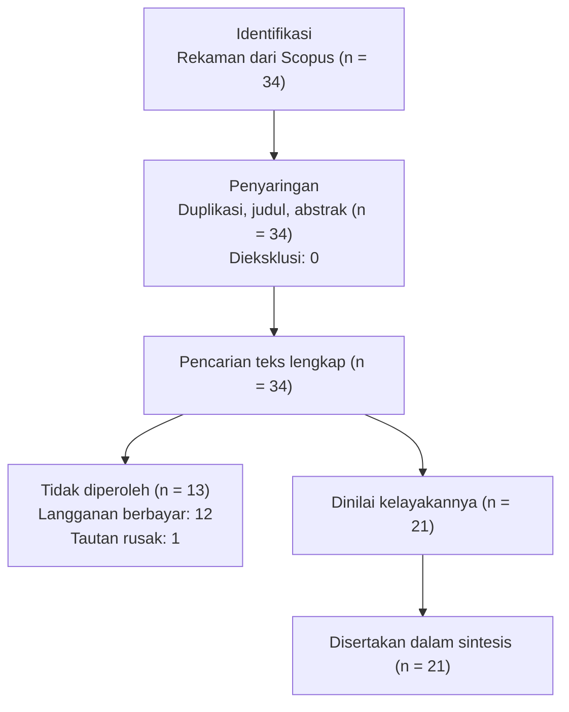

# Tinjauan Sistematis Deep Knowledge Tracing untuk Pemodelan Penalaran Logis dan Berpikir Komputasional dalam Lingkungan Pembelajaran Adaptif (2021–2026)

**A Systematic Review of Deep Knowledge Tracing for Modeling Logical Reasoning and Computational Thinking in Adaptive Learning Environments (2021–2026)**

[Nama Penulis 1]¹, [Nama Penulis 2]¹
¹ [Program Studi, Fakultas, Perguruan Tinggi, Kota, Indonesia]
Korespondensi: [email]

---

## Abstrak

Pelacakan pengetahuan (*knowledge tracing*, KT) berbasis *deep learning* banyak dipakai dalam sistem pembelajaran adaptif, tetapi model generasi awal hanya membaca urutan jawaban benar atau salah sehingga kurang mampu merekam proses penalaran. Tinjauan ini memetakan cara literatur 2021–2026 memodelkan penalaran logis, pemecahan masalah, dan pemrograman dalam KT dan *intelligent tutoring system* (ITS). Penelusuran Scopus menghasilkan 34 rekaman. Sebanyak 13 di antaranya tidak dapat diperoleh dalam teks lengkap (12 terhalang langganan berbayar, 1 tautan rusak), sehingga 21 artikel disintesis secara tematik naratif dengan pedoman PRISMA 2020. Hasilnya menunjukkan tiga hal. Pertama, delapan artikel memakai *large language model* (LLM), tujuh di antaranya terbit pada 2025–2026; artikel lain memakai model graf dan hipergraf, jaringan sekuensial berpengetahuan pakar, atau pendekatan psikometrik dan faktorisasi tensor. Kedua, kompleksitas tugas dimodelkan lewat kesulitan teks soal, status pengetahuan multiskala, episode submisi, dan jejak proses pengerjaan, sedangkan dimensi afektif dimodelkan secara eksplisit hanya oleh satu model hipergraf. Ketiga, ASSISTments adalah dataset yang paling sering dipakai (enam artikel empiris), sembilan artikel melaporkan AUC, dan bukti efek intervensi berasal dari studi berskala kecil dengan durasi pendek. Hanya dua artikel, dari satu kelompok peneliti dan satu dataset, menangani penalaran logika formal (tiga rekaman bertopik serupa termasuk yang teks lengkapnya tidak dapat diperoleh), dan tidak ada artikel yang mendefinisikan *computational thinking* sebagai konstruk terukur. Agenda riset yang diusulkan mencakup protokol evaluasi terstandar, dataset terbuka untuk penalaran, dan uji dampak belajar longitudinal.

**Kata kunci:** *deep knowledge tracing*; *intelligent tutoring system*; penalaran logis; pemecahan masalah; *large language model*; tinjauan sistematis

## Abstract

Deep-learning knowledge tracing (KT) is widely used in adaptive learning systems, yet early models read only sequences of correct and incorrect answers and capture little of the reasoning behind them. This review examines how studies published in 2021–2026 model logical reasoning, problem solving, and programming in KT and intelligent tutoring systems (ITS). A Scopus search returned 34 records; 13 full texts could not be retrieved (12 behind subscription barriers, 1 broken link), leaving 21 articles for narrative thematic synthesis following PRISMA 2020. Three findings stand out. First, eight articles build on large language models (LLMs), seven of them published in 2025–2026, alongside graph and hypergraph models, expert-informed sequential networks, and psychometric or tensor-factorization approaches. Second, task complexity is represented through problem-text difficulty, multiscale knowledge states, submission episodes, and traces of the solving process, whereas affect is modeled explicitly by only one hypergraph model. Third, ASSISTments is the most used dataset (six empirical articles), nine articles report AUC, and evidence on intervention effects comes from small, short studies. Only two articles, from one research group and one dataset, address formal logical reasoning (three further logic-focused records were among those not retrieved), and none defines computational thinking as a measurable construct. We propose a research agenda on standardized evaluation protocols, open reasoning datasets, and longitudinal learning-gain trials.

**Keywords:** deep knowledge tracing; intelligent tutoring system; logical reasoning; problem solving; large language model; systematic review

---

## 1. Pendahuluan

### 1.1 Latar belakang

Sistem pembelajaran adaptif memilih soal, petunjuk, dan urutan materi berdasarkan perkiraan seberapa jauh siswa menguasai suatu konsep. Perkiraan itu dihasilkan oleh pelacakan pengetahuan, yaitu pemodelan keadaan pengetahuan siswa dari riwayat interaksinya. Bayesian Knowledge Tracing menjadi dasar pendekatan ini (Corbett & Anderson, 1995), dan Piech et al. (2015) memperkenalkan *Deep Knowledge Tracing* (DKT) yang memakai jaringan saraf berulang untuk menggantikan parameter probabilistik buatan tangan. Survei yang ada memetakan lintasan dari model probabilistik, ke jaringan memori dan atensi, hingga model berbasis graf (Abdelrahman et al., 2023; Shen et al., 2024).

Penerapan KT pada sistem nyata sudah lama berjalan. Survei Shen et al. (2024) mencatat bahwa KT menjadi subsistem pada platform seperti ASSISTments, Cognitive Tutor, dan Khan Academy, untuk rekomendasi jalur belajar dan pengujian adaptif terkomputerisasi. Dalam sistem seperti itu, keluaran model langsung memengaruhi keputusan pedagogis: soal berikutnya, kapan siswa dinyatakan tuntas, dan kapan petunjuk diberikan. Kesalahan estimasi pada soal penalaran karenanya berdampak lebih besar daripada pada hafalan, karena siswa yang dinilai salah bisa tetap berlatih pada langkah yang sudah dikuasainya, atau berpindah ke materi yang belum siap ia hadapi.

Kurikulum saat ini menekankan keterampilan yang prosesnya berlangsung dalam banyak langkah: penalaran logis dan *computational thinking* (Wing, 2006). Menyelesaikan soal pemrograman atau pembuktian logika menuntut siswa menguraikan masalah, mencoba, gagal, memperbaiki, lalu mencoba lagi. Pelacakan yang hanya menyimpan nilai akhir benar atau salah membuang sebagian besar informasi tersebut.

### 1.2 Keterbatasan DKT konvensional pada domain penalaran

Keterbatasan itu sudah dicatat dalam beberapa studi yang ditinjau di sini. Pada domain logika formal, Nkambou et al. (2023) melaporkan bahwa DKT standar tidak pernah memprediksi jawaban benar pada enam keterampilan inferensi tidak valid yang jarang dijawab benar oleh peserta (F1 kelas "benar" = 0,0), dan F1 itu baru naik menjadi 0,47–0,80 pada model hibrida yang memakai jaringan Bayesian buatan pakar. Pada pemrograman, siswa mengirim banyak percobaan berturut-turut untuk satu soal, dan Wang et al. (2021) menunjukkan bahwa memperlakukan semua percobaan setara membuat model rentan terhadap fluktuasi jawaban. Huang et al. (2024) merumuskan masalahnya dari sisi pedagogis: siswa sering mengingat teori tetapi tidak mampu menerapkannya, sedangkan model monolitik tidak membedakan keduanya.

### 1.3 Motivasi tinjauan

Survei KT umum (Abdelrahman et al., 2023; Shen et al., 2024) membahas KT lintas domain dan tidak menjadikan penalaran logis atau pemecahan masalah multi-langkah sebagai lensa analisis utama. Sementara itu, periode 2021–2026 memuat dua perkembangan yang mengubah rancangan model: model graf dan hipergraf, serta penggunaan LLM untuk menganotasi kesulitan, mendiagnosis kesalahan, dan menyusun petunjuk. Tinjauan sistematis yang menyatukan perkembangan ini dengan pertanyaan "bagaimana penalaran direpresentasikan" belum kami temukan dalam penelusuran yang dilaporkan pada Bagian 2, meskipun penelusuran tersebut tidak dirancang untuk mencari tinjauan lain.

Dua perkembangan itu mengubah apa yang dapat dimasukkan ke model. Model generasi awal hanya menerima identitas soal atau konsep dan hasil jawaban. Model yang lebih baru dapat membaca teks soal, kode yang ditulis siswa, jejak tulisan tangan, dan sinyal afektif. Setiap tambahan informasi membawa biaya sendiri, mulai dari kebutuhan anotasi, daya komputasi, hingga persoalan privasi, dan manfaatnya baru dapat dinilai jika studi-studi tersebut dibaca berdampingan.

### 1.4 Pertanyaan penelitian dan kontribusi

Tinjauan ini menjawab tiga pertanyaan:

- **RQ1.** Bagaimana arsitektur KT berkembang dari model sekuensial, ke model graf dan hipergraf, hingga integrasi LLM dalam merepresentasikan penalaran siswa?
- **RQ2.** Bagaimana studi terkini memasukkan kompleksitas tugas dan dimensi afektif ke dalam ruang status pengetahuan?
- **RQ3.** Dataset dan metrik apa yang dominan, dan bagaimana model diwujudkan dalam intervensi ITS beserta bukti efektivitasnya?

Kontribusinya ada tiga: taksonomi arsitektur untuk 21 studi, pemetaan cara kompleksitas dan afek dimodelkan, serta pemetaan dataset, metrik, dan bukti intervensi yang disertai catatan tentang batas perbandingannya.

---

## 2. Metodologi

### 2.1 Desain protokol

Tinjauan ini mengikuti pedoman PRISMA 2020 (Page et al., 2021). Sintesis dilakukan secara naratif tematik. Meta-analisis tidak dilakukan karena dataset, rancangan evaluasi, dan metrik antarstudi berbeda.

### 2.2 Strategi penelusuran

Penelusuran dilakukan pada basis data Scopus dengan string berikut; hasilnya diekspor pada 25 Oktober 2026 [konfirmasi tanggal penelusuran jika berbeda dari tanggal ekspor].

```text
TITLE-ABS-KEY ( ( "Deep Knowledge Tracing" OR "Knowledge Tracing" )
AND ( "Adaptive Learning" OR "Intelligent Tutoring System" OR "Personalized Learning" OR "ITS" )
AND ( "Logical Reasoning" OR "Logical Thinking" OR "Problem Solving" OR "Computational Thinking" ) )
AND PUBYEAR > 2020 AND DOCTYPE ( ar OR cp ) AND LANGUAGE ( english OR indonesian )
```

Penelusuran dibatasi pada artikel jurnal (`ar`) dan makalah prosiding (`cp`) berbahasa Inggris atau Indonesia yang terbit sejak 2021.

### 2.3 Kriteria kelayakan

**Inklusi.** (a) Studi membahas pelacakan atau pemodelan pengetahuan siswa dalam konteks pembelajaran adaptif atau ITS; (b) domainnya terkait penalaran logis, pemecahan masalah, pemrograman, atau *computational thinking*; (c) berbahasa Inggris atau Indonesia; (d) teks lengkap dapat diperoleh secara sah.

**Eksklusi.** (a) Studi di luar konteks pendidikan; (b) studi tanpa komponen pemodelan atau algoritma pelacakan; (c) duplikat; (d) laporan yang teks lengkapnya tidak dapat diperoleh (*reports not retrieved*).

Penerapan kriteria dilakukan dalam dua tahap. Pada tahap judul dan abstrak, rekaman dinilai terhadap kriteria (a) dan (b). Pada tahap teks lengkap, kriteria (c) dan (d) diperiksa bersama kecocokan topik secara keseluruhan. Studi yang memuat model pelacakan sebagai komponen sistem yang lebih besar, misalnya modul KT di dalam tutor berbasis LLM, tetap dipertahankan.

### 2.4 Alur seleksi

Penelusuran menghasilkan 34 rekaman. Pemeriksaan duplikasi serta judul dan abstrak tidak mengeliminasi satu rekaman pun, sehingga 34 laporan dicari teks lengkapnya. Sebanyak 13 laporan tidak diperoleh: 12 karena hambatan langganan berbayar tanpa salinan repositori terbuka, dan 1 karena tautan repositori tidak dapat diakses atau berkas rusak. Sisanya, 21 laporan, dinilai kelayakannya dan seluruhnya disertakan (Gambar 1). Rincian 13 laporan yang tidak diperoleh disajikan pada Lampiran A. Tujuh berasal dari Springer, empat dari IEEE, satu dari Elsevier, dan satu dari Emerald; hanya satu (Li et al., 2025) bertanda akses terbuka di Scopus, yang konsisten dengan keterangan tautan rusak [konfirmasi].



*Gambar 1. Diagram alir PRISMA 2020.*

### 2.5 Ekstraksi data dan penilaian mutu

Setiap artikel diekstrak ke dalam matriks berisi: identitas dan tahun, domain pembelajaran dan definisi komponen pengetahuan, arsitektur inti, pendekatan inovatif, dataset, metrik dan nilai utama, status implementasi ITS, serta temuan kunci. Seleksi dilakukan oleh satu penelaah (penulis) dengan bantuan otomasi berbasis AI ([nama alat dan versi]) pada tahap penyaringan dan penilaian kelayakan, sehingga tidak ada penyaringan ganda independen dan tidak ada perbedaan antarpenelaah yang perlu diselesaikan. Ekstraksi dilakukan dengan bantuan agen AI (Antigravity dengan model Gemini Flash 3.8) terhadap 21 PDF yang terlebih dahulu dikonversi ke teks Markdown. Hasilnya diperiksa dengan skrip pencocokan string yang memeriksa keberadaan 81 token kunci (nilai metrik dan nama arsitektur) pada teks sumber; skrip melaporkan seluruh token ditemukan. Pencocokan ini hanya memastikan bahwa sebuah string muncul di suatu tempat dalam naskah, tidak memastikan bahwa nilai tersebut milik model yang diusulkan dan bukan pembanding, dan hanya mencakup sebagian dari nilai yang dilaporkan di tinjauan ini. Sebagai tahap kedua, agen AI memeriksa ulang nilai yang dikutip pada Tabel 1, Tabel 4, dan Tabel 5 terhadap tabel hasil pada teks konversi PDF; pemeriksaan ini menghasilkan koreksi pada skor penerimaan GuideAI dan pada nilai pembanding TreeInstruct, yang telah diperbarui. Pada tahap ketiga, penulis memeriksa secara manual 72 dari 74 butir pada log verifikasi (nilai pada Tabel 1, 4, dan 5 serta detail deskriptif seperti domain, dataset, dan ukuran sampel) langsung pada PDF asli, dengan memastikan nilai berada pada baris yang dimaksud serta metrik dan datasetnya sesuai. Dua butir tidak diperiksa penulis pada tahap ini: angka MorALERT, yang kemudian dikoreksi berdasarkan PDF Tato & Nkambou (2022) dengan bantuan AI [isi bila penulis memeriksa sendiri], dan rentang AUC historis dari survei Shen et al. (2024), yang klaimnya dihapus dari naskah. Enam butir memerlukan koreksi, yang telah diterapkan. Detail di luar log tidak diperiksa dengan cara ini. Penilaian mutu bersifat deskriptif: kami mencatat apakah dataset disebut, metrik dilaporkan, pembanding (*baseline*) disertakan, dan implementasi diuji pada pembelajar. Kami tidak memberi skor numerik dan tidak memakai instrumen penilaian mutu baku; keterbatasan ini dibahas pada Bagian 4.5.

Sintesis dilakukan dalam tiga langkah. Pertama, artikel dikode menurut inti arsitektur untuk menjawab RQ1; kode ini tidak saling lepas, sehingga model hibrida dikelompokkan menurut komponen yang menjadi sumbangan utamanya. Kedua, untuk RQ2, kami mencatat jenis informasi tambahan yang dimasukkan model (kesulitan, proses, memori, afek) dan di domain mana informasi itu dipakai. Ketiga, untuk RQ3, dataset, metrik, dan status implementasi ditabulasi, dan perbandingan kuantitatif hanya dilakukan di dalam dataset yang sama. Hitungan dalam teks (misalnya "enam artikel") merujuk pada tabulasi ini.

---

## 3. Hasil dan Sintesis

### 3.1 Karakteristik studi

Tabel 1 merangkum 21 artikel. Distribusi tahun terbitnya adalah 2021 (1 artikel), 2022 (1), 2023 (3), 2024 (5), 2025 (3), dan 2026 (8). Hampir separuh korpus (11 artikel) terbit pada 2025–2026. Berdasarkan domain, enam artikel berfokus pada pemrograman, delapan pada pemecahan masalah matematika, dua pada penalaran logika formal, dan lima pada domain lain atau lintas domain (satu survei, satu sistem pemahaman bacaan, satu klasifikasi umum pemahaman konseptual, satu desain karakter animasi 3D, dan satu model kerangka KT umum untuk K-12).

Menurut metadata Scopus, 12 artikel berupa makalah prosiding konferensi dan 9 berupa artikel jurnal. Penerbitnya adalah ACM (6 artikel), IEEE (4), ACL (2), Elsevier (2), dan masing-masing satu dari AAAI, Inderscience, Frontiers, International Educational Data Mining Society, CEUR-WS, Springer, dan Nature Research. *IEEE Transactions on Learning Technologies* memuat tiga artikel (Shen et al., 2024; Xu et al., 2024; Zhang et al., 2025). Sebanyak 11 dari 21 artikel bertanda akses terbuka di Scopus. Komposisi ini perlu dibaca bersama Lampiran A: Springer menyumbang tujuh dari 13 laporan yang tidak diperoleh tetapi hanya satu dari 21 yang disertakan.

*Tabel 1. Karakteristik 21 artikel yang disertakan.*

| No | Artikel | Domain | Inti model | Dataset | Metrik utama | Status implementasi |
|:--:|:--|:--|:--|:--|:--|:--|
| 1 | Tato & Nkambou (2022) | Logika formal; penalaran sosio-moral | DKT + jaringan Bayesian via atensi (Logic-Muse); LSTM/CNN + pakar via atensi (MorALERT) | Logic-Muse (294 partisipan, 48 butir); MorALERT (731 verbatim berbahasa Prancis, 678 setelah penyaringan) | ACC 0,82 (Logic-Muse); ACC 0,75, F1 0,73 (MorALERT, klasifikasi teks) | Evaluasi luring; model diintegrasikan ke gim MorALERT yang sedang diujicobakan (hasil tidak dilaporkan) |
| 2 | Nkambou et al. (2023) | Logika formal | CDM-DINA + DKTm + BN | Logic-Muse (294 partisipan daring, 48 butir) | ACC 0,82 (BN saja 0,65; DKT 0,74; DKTm 0,80) | Evaluasi luring pada data kuesioner; ITS Logic-Muse sebagai konteks |
| 3 | Wang et al. (2021) | Pemrograman (CSIntro, MasteryGrids) dan tugas MOOC (MORF) | GRATE (faktorisasi tensor berbasis peringkat) | MORF (686 siswa), CSIntro (120), MasteryGrids (382) | AUC 0,7035 (MasteryGrids); RMSE 0,2033 (MORF), 0,3726 (CSIntro) | Log ITS (luring) |
| 4 | Samonte et al. (2024) | Pemrograman | Adaptasi DAS3H + CBR | Tinjauan 16 studi primer | N/A | Rancangan konseptual tutor |
| 5 | Yang et al. (2025) | Pemrograman | DPKT (CodeBERT, GAT, kesulitan dari LLM) | Project CodeNet | AUC 0,754–0,768 | Model luring |
| 6 | Shao et al. (2026) | Pemrograman | MIE+MLPKT (LLM, multiskala) | Code-S, Code-F, BePKT | AUC 0,838–0,893 | Model luring |
| 7 | Wang et al. (2026) | Pemrograman | SHARP (scaffolding Sokratik + KT) | MULTI-DEBUG (50 soal, siswa simulasi LLM); pilot 42 siswa | Task success 92–98% | Platform AskCodey, pilot tanpa kontrol |
| 8 | Zhao et al. (2026) | Pemrograman | SageJavon (RAG, LLM, GIKT) | Dataset Java; ASSIST09/12, EdNet | ACC 0,761–0,793 | Dipakai 85 mahasiswa |
| 9 | Huang et al. (2024) | Matematika | PSKT (tiga fase penyelesaian) | ASSIST12/17, EdNet-KT1, Junyi, Eedi | AUC 0,775–0,825 | Model luring |
| 10 | Li (2026) | Matematika | STGNN-MKT | ASSIST09, KDDCup2010 | AUC 0,901; 0,893 | Model luring |
| 11 | Huang et al. (2026) | Matematika | AHGKT (hipergraf afektif) | ASSIST09/12/17 | AUC 0,799–0,829 | Model luring |
| 12 | Xu et al. (2024) | Matematika | FCIKT (feature crosses) | ASSIST09/12, EdNet | Selisih AUC vs. GIKT +0,31 s.d. +3,01% | Model luring |
| 13 | Park et al. (2026) | Matematika | STATUSKT (OCR + Teacher/Student GPT) | KT-PSP-25 (QANDA) | AUC 0,585–0,677 | Log platform komersial (luring) |
| 14 | Xia et al. (2026) | Matematika (persamaan linear) | Fast-forwarding + BKT | Data APTA/DataShop (164 siswa, 10.937 langkah); 10.000 siswa simulasi | Overpractice turun hingga 35,7% | Simulasi pelajar (AFM + BKT) |
| 15 | Liang et al. (2023) | Matematika | CEMAL (GPT-3.5 sebagai pembuat latihan) | MAWPS, ASDiv-a, SVAMP | Akurasi 76,4–94,7% | Kerangka *machine teaching* |
| 16 | Jadhav et al. (2023) | Matematika (diskalkulia) | BKT + DAG | 137 anak (6–10 tahun) | Deskriptif | Prototipe tervalidasi pakar |
| 17 | Jung et al. (2025) | Lintas domain | CLST (Mistral-7B + LoRA) | NIPS34, Algebra05, Assist09, Classting (ilmu sosial, sains) | AUC 0,557–0,722 (*cold-start*, 8–64 siswa) | Model luring |
| 18 | Zhang et al. (2025) | Pemahaman bacaan | Faktorisasi tensor + GAN/GPT-4o | AutoTutor ARC | RMSE 0,3715–0,4545 | Dataset ITS percakapan |
| 19 | Shukla et al. (2026) | STEM (statistika, pembelajaran mesin, biologi) | GuideAI (biosensor + LLM) | 25 partisipan (studi laboratorium); survei formatif daring 66 | NASA-TLX, tes pilihan ganda, skala Likert 1–7 | Prototipe sistem, studi laboratorium *within-subjects* |
| 20 | Wang et al. (2024) | Desain karakter animasi | *Smart Learning Partner* (agen AI) dalam rancangan sistem VR | 52 siswa eksperimen vs. 110 kontrol; satu tugas | Penilaian kualitatif guru, tanpa uji statistik | Uji pada satu tugas mata kuliah; peran VR dalam eksperimen tidak dijelaskan |
| 21 | Shen et al. (2024) | Lintas domain | Survei dan taksonomi KT | Banyak dataset | N/A | Tinjauan |

*Catatan.* Nilai berasal dari matriks ekstraksi; butir kunci diperiksa terhadap PDF sumber (Bagian 2.5). Tahun mengikuti ekspor Scopus.

Tiga artikel (Liang et al., 2023; Shukla et al., 2026; Wang et al., 2024) tidak memuat modul KT dalam arsitektur intinya menurut matriks ekstraksi, dan satu artikel (Samonte et al., 2024) hanya menyajikan rancangan. Artikel-artikel ini tetap dianalisis karena memenuhi kriteria penelusuran dan relevan untuk RQ3, tetapi tidak dipakai sebagai bukti kinerja KT. Artinya, enam belas artikel menyajikan atau menguji model pelacakan atau pemodelan performa siswa.

Berdasarkan status implementasi, dua belas artikel mengevaluasi model secara luring pada log interaksi, data respons, atau korpus teks (termasuk Nkambou et al., 2023, dan Tato & Nkambou, 2022), empat diuji pada pembelajar dalam sistem hidup atau kelas (Shukla et al., 2026; Wang et al., 2024, 2026; Zhao et al., 2026), satu berupa prototipe (Jadhav et al., 2023), dua berupa simulasi atau kerangka komputasi (Liang et al., 2023; Xia et al., 2026), dan dua berupa survei atau rancangan konseptual (Samonte et al., 2024; Shen et al., 2024).

### 3.2 RQ1: Taksonomi arsitektur

Artikel dikelompokkan menurut arsitektur intinya (Tabel 2). Pengelompokan ini tidak mengklaim kategori yang saling lepas karena beberapa model memadukan komponen dari kelompok berbeda.

*Tabel 2. Taksonomi arsitektur (kelompok menurut inti model).*

| Kelompok | Jumlah | Artikel |
|:--|:--:|:--|
| Psikometrik, probabilistik, dan faktorisasi | 5 | Jadhav et al. (2023); Samonte et al. (2024); Wang et al. (2021); Xia et al. (2026); Zhang et al. (2025) |
| Jaringan sekuensial atau atensi dengan pengetahuan pakar atau fitur | 4 | Huang et al. (2024); Nkambou et al. (2023); Tato & Nkambou (2022); Xu et al. (2024) |
| Graf dan hipergraf | 2 | Huang et al. (2026); Li (2026) |
| Terintegrasi LLM | 8 | Jung et al. (2025); Liang et al. (2023); Park et al. (2026); Shao et al. (2026); Shukla et al. (2026); Wang et al. (2026); Yang et al. (2025); Zhao et al. (2026) |
| Survei | 1 | Shen et al. (2024) |
| Lainnya (VR tanpa KT) | 1 | Wang et al. (2024) |

**Model sekuensial dan atensi.** Empat artikel masih bertumpu pada jaringan saraf sekuensial, tetapi menambahkan struktur di luar urutan jawaban. Tato dan Nkambou (2022) menyuntikkan jaringan Bayesian buatan pakar logika ke LSTM-DKT lewat mekanisme atensi. Nkambou et al. (2023) mengevaluasi pendekatan itu pada data Logic-Muse: model diagnosis kognitif DINA dengan Q-matriks 16×9 buatan pakar menginisialisasi jaringan Bayesian bagi siswa baru, dan DKT diberi penyamaran fungsi rugi (*loss masking*). Pada data 294 partisipan, akurasi menaik secara bertahap: 0,65 untuk jaringan Bayesian saja, 0,74 untuk DKT, 0,80 untuk DKT dengan penyamaran, dan 0,82 untuk model hibrida penuh (rerata 20 percobaan; 20% data uji, 15% validasi). Xu et al. (2024) menyilangkan fitur kesulitan soal, konsep laten, dan identitas soal untuk menangkap hubungan nonlinier orde tinggi, sedangkan Huang et al. (2024) memisahkan penguasaan teori dari kemampuan menerapkan lewat tiga tahap: sebelum penyelesaian (persepsi masalah dan perolehan pengetahuan lewat mekanisme gerbang), selama penyelesaian (penerapan pengetahuan, dengan respons dihitung memakai IRT empat parameter), dan sesudahnya (internalisasi dan kelupaan). Artikel menandai keunggulannya signifikan (uji-t, p < 0,05, validasi silang 5-fold) pada lima dataset; selisih AUC terhadap pembanding terbaik, dihitung dari Tabel 2 artikel, adalah +0,028 (ASSIST12), +0,012 (ASSIST17), +0,010 (EdNet-KT1), +0,002 (Junyi), dan +0,011 (Eedi).

**Model psikometrik dan faktorisasi.** Kelompok ini tidak memakai jaringan saraf sebagai inti, tetapi menjawab masalah yang sama. Wang et al. (2021) mengelompokkan percobaan berulang menjadi episode granular dan menerapkan regularisasi peringkat berpasangan pada faktorisasi tensor tiga dimensi. Pada MasteryGrids, model ini mencapai AUC 0,7035 dibandingkan DKT 0,6968, DKVMN 0,6881, dan iBKT 0,6048, dan menghasilkan RMSE 0,3726 pada CSIntro dibandingkan 0,4132 (DKT) dan 0,4202 (DKVMN). Keunggulan terhadap DKT dan DKVMN pada MasteryGrids serta terhadap pembanding tensor terkuat (FDTF 0,3752 pada CSIntro; 0,2088 pada MORF) tidak signifikan secara statistik menurut tanda signifikansi artikel. Xia et al. (2026) memakai BKT pada tingkat langkah, Jadhav et al. (2023) memakai BKT berbasis graf asiklik terarah untuk anak dengan diskalkulia, dan Samonte et al. (2024) mengusulkan adaptasi DAS3H untuk penjadwalan latihan terdistribusi. Zhang et al. (2025) menggabungkan faktorisasi tensor dengan augmentasi sintetis (GAN dan GPT-4o) untuk data yang 80–90% hilang. Pada AutoTutor ARC, faktorisasi tensor memberi RMSE terendah di semua pelajaran dibanding BKT, PFA, dan SPARFA-Lite menurut artikel, tetapi selisihnya terhadap BKT kecil pada beberapa pelajaran (misalnya 0,4328 vs. 0,4331 pada Pelajaran 1 M).

**Model graf dan hipergraf.** Li (2026) membangun graf heterogen siswa–soal–titik pengetahuan, memakai atensi sadar meta-path untuk dimensi spasial dan konvolusi temporal berpagar kelupaan (kurva Ebbinghaus) untuk dimensi waktu. Huang et al. (2026) memakai hipergraf dua tingkat: satu lapisan untuk relasi tingkat tinggi soal–konsep dan satu lapisan untuk empat status afektif. Komponen graf juga muncul sebagai bagian model lain: GAT pada Yang et al. (2025), representasi graf pada Shao et al. (2026), dan GIKT pada Zhao et al. (2026).

**Model terintegrasi LLM.** Delapan artikel memakai LLM dengan peran yang berbeda-beda (Tabel 3), dan tujuh di antaranya terbit pada 2025–2026. Hanya satu (Jung et al., 2025) memakai LLM sebagai pelacak itu sendiri, sedangkan yang lain memakainya sebagai sumber fitur atau komponen sistem.

*Tabel 3. Peran LLM dalam artikel yang terintegrasi LLM.*

| Artikel | LLM | Peran |
|:--|:--|:--|
| Jung et al. (2025) | Mistral-7B (LoRA) | Pelacak: KT dirumuskan sebagai tugas bahasa dengan teks soal |
| Yang et al. (2025) | Anotasi LLM + CodeBERT | Anotasi kesulitan teks soal dan kesulitan konsep |
| Shao et al. (2026) | DeepSeek-V3.1 | Ekstraksi vektor penyebab kesalahan dan skor parsial 0–1 |
| Park et al. (2026) | Teacher/Student GPT + OCR | Distilasi tulisan tangan menjadi indikator kemahiran |
| Wang et al. (2026) | LLM + modul KT | Petunjuk Sokratik berdasarkan estimasi milestone |
| Zhao et al. (2026) | LLM + RAG + GIKT | Tutor pemrograman Java |
| Liang et al. (2023) | GPT-3.5-turbo | Pembuat latihan yang menutup kelemahan model siswa (tanpa KT) |
| Shukla et al. (2026) | LLM + biosensor | Intervensi multimodal (tanpa KT) |

Pada korpus ini, perubahan yang paling konsisten bukan penggantian LSTM oleh LLM, melainkan pergeseran sumber informasi: dari identitas butir soal ke teks soal, kode siswa, dan jejak tulisan tangan.

**Ringkasan menurut domain.** Membaca ulang taksonomi menurut domain memperlihatkan bahwa pilihan arsitektur mengikuti sifat tugasnya.

*Pemrograman.* Pada enam artikel pemrograman, masalah utamanya adalah label biner yang kasar dan banyaknya percobaan per soal. Yang et al. (2025) menguji DPKT pada empat bahasa di Project CodeNet dan memperoleh AUC 0,762 (C++), 0,757 (C), 0,754 (Java), dan 0,768 (Python), dengan akurasi 74,5%, 71,5%, 72,9%, dan 68,1%. Urutan AUC dan akurasi tidak sejalan: Python memiliki AUC tertinggi tetapi akurasi terendah, sehingga satu metrik saja tidak cukup untuk menilai model. DPKT terbaik pada tujuh dari delapan kolom Tabel 4 artikelnya; pada akurasi Python (68,1%) beberapa pembanding lebih tinggi (THKT 70,0%; QIKT 69,5%), selisih AUC terhadap pembanding terbaik hanya 0,4–2,4 poin, dan sebaran hasil (SD) tidak dilaporkan karena penulis menganggap variasinya minimal (validasi silang 5-fold). Shao et al. (2026) melaporkan akurasi 0,8451 (Code-S), 0,8305 (Code-F), dan 0,8408 (BePKT), dengan RMSE 0,1904, 0,2015, dan 0,1735; dataset ini memakai 18 konsep (Code-S dan Code-F) dan 106 konsep (BePKT). Dua artikel lain menempatkan KT di dalam tutor. Wang et al. (2026) mengestimasi milestone penyelesaian lewat pembelajaran metrik berbasis *triplet loss* dan memakai modul KT (LSTM satu lapis) untuk menyusun petunjuk Sokratik yang tidak membeberkan kode jawaban (skor ketidaklangsungan 1,0, sama untuk semua metode berpetunjuk). Tanpa modul KT, *task success* turun menjadi 82%, 82%, dan 88% (selisih 16, 12, dan 4 poin dari versi penuh), tanpa uji statistik. Zhao et al. (2026) menyusun SageJavon dengan alur Learn–Practice–Evaluate–Support berdasarkan Taksonomi Bloom di atas graf pengetahuan Java, dan GIKT-nya mencapai akurasi 0,7932 (dataset Java), 0,7931 (ASSIST09), 0,7823 (ASSIST12), dan 0,7612 (EdNet); akurasi ini berasal dari reproduksi GIKT oleh penulis artikel, dan AUC tidak dilaporkan.

*Matematika.* Kedelapan artikel matematika bervariasi paling lebar. Dua memakai graf (Huang et al., 2026; Li, 2026), dua memakai struktur proses atau fitur (Huang et al., 2024; Xu et al., 2024), satu mengolah jejak tulisan tangan (Park et al., 2026), satu bekerja di tingkat langkah (Xia et al., 2026), satu menyasar anak berkebutuhan khusus (Jadhav et al., 2023), dan satu tidak memakai KT sama sekali (Liang et al., 2023). Xia et al. (2026) mengujinya pada persamaan linear satu variabel (sembilan keterampilan) dengan data tutor APTA dari 164 siswa kelas 6–8 (10.937 langkah) dan 10.000 siswa simulasi yang dibangkitkan dari parameter AFM hasil data tersebut. Liang et al. (2023) memakai GPT-3.5-turbo untuk membuat latihan yang menyasar kesalahan model penyelesai (RoBERTa 144 juta dan 377 juta parameter, serta LSTM 20 juta); penyelesai besar mencapai akurasi 94,7% (MAWPS), 93,3% (ASDiv-a), 85,4% (SVAMP dalam distribusi), dan 76,4% (SVAMP luar distribusi), dan penyelesai kecil 93,9%, 90,9%, 81,5%, dan 68,6%. Hasil ini menunjukkan manfaat latihan yang disesuaikan, tetapi penerimanya adalah model komputasi, bukan siswa.

*Logika formal.* Dua artikel logika memakai ITS Logic-Muse dan gim serius MorALERT. Pada MorALERT (731 verbatim berbahasa Prancis beranotasi pakar, 678 setelah kelas 0 dibuang), tugasnya adalah mengklasifikasi tingkat penalaran sosio-moral dari teks, bukan menelusuri pengetahuan; model akhir (ensambel suara) mencapai akurasi 0,75, presisi 0,72, *recall* 0,75, dan F1 0,73 (Tato & Nkambou, 2022). Domain ini satu-satunya yang melaporkan F1 per keterampilan, dan alasannya masuk akal: pada keterampilan yang sangat mudah atau sangat sulit, salah satu kelas (jawaban salah atau benar) sangat langka, sehingga akurasi keseluruhan dapat tinggi sementara prediksi untuk kelas langka itu gagal total.

### 3.3 RQ2: Kompleksitas tugas dan dimensi afektif

**Kesulitan tugas.** Yang et al. (2025) memisahkan dua kesulitan pada soal pemrograman: kesulitan memahami teks soal dan kesulitan konsep pengetahuan, keduanya dianotasi LLM. Xu et al. (2024) menyilangkan kesulitan soal dengan konsep laten. Shao et al. (2026) mengganti label biner lulus atau gagal dengan skor parsial 0–1 dan menyusun status pengetahuan pada tiga tingkat (konsep, soal, penalaran kode). Pada dataset yang dipakainya, model ini mencapai AUC 0,8926 (Code-S), 0,8738 (Code-F), dan 0,8380 (BePKT), lebih tinggi dari 18 pembanding. AUC itu dihitung setelah skor kontinu dibinarisasi pada 0,5, sehingga tidak setara dengan AUC pada label biner artikel lain; selisih terhadap pembanding terbaik hanya 0,008–0,015, dan uji signifikansi dilaporkan hanya untuk RMSE pada Code-S.

**Struktur proses.** Wang et al. (2021) menangani banyak percobaan berturut-turut. Huang et al. (2024) memodelkan fase sebelum, selama, dan sesudah penyelesaian dengan parameter psikometrik yang dapat ditafsirkan. Park et al. (2026) mengekstrak jejak tulisan tangan menjadi indikator kemahiran matematika menurut standar NRC (pemahaman konseptual, kelancaran prosedural, kompetensi strategis, penalaran adaptif, disposisi produktif) dan menyisipkannya ke 10 model KT. Gabungan ini menaikkan AUC titik pada kesepuluh model yang diuji, tetapi kenaikannya kecil: dari 0,0008 (DKT+) hingga 0,0200 (SAINT, 0,6201 menjadi 0,6401), dengan DKT naik 0,0032 (0,6165 menjadi 0,6197). Dua model (DKT+, $p$ = 0,4894; SAKT, $p$ = 0,0843) tidak menunjukkan kenaikan yang signifikan. AUC absolut berada pada kisaran rendah (0,585–0,677).

**Struktur penalaran logis.** Dua artikel menangani logika formal. Keduanya mengkodekan struktur domain: 16 tipe item yang menguji empat bentuk inferensi (*modus ponens*, *modus tollens*, penegasan konsekuen, penyangkalan anteseden) pada tiga tingkat konten (familiar, kontrafaktual, abstrak), dengan sembilan keterampilan inti dalam Q-matriks (Nkambou et al., 2023; Tato & Nkambou, 2022). Kedua artikel berasal dari kelompok yang sama dan memakai data 294 partisipan yang sama; akurasi DKT 0,74 dan DKT+BN 0,82 serta F1 untuk empat keterampilan (AcCcf, DaCcf, AcA, DaA) identik pada keduanya, sehingga keduanya tidak dapat dianggap dua bukti independen. Akurasi jaringan Bayesian saja berbeda antarartikel (0,69 pada Tato & Nkambou, 2022; 0,65 pada Nkambou et al., 2023). Pada keterampilan yang sangat mudah (MPP, MTT), model hibrida tidak membantu: F1 untuk jawaban salah tetap 0,0–0,19 (Tato & Nkambou, 2022). Artikel 2023 menyebut peningkatan "signifikan" tetapi hanya melaporkan rerata dari 20 percobaan, tanpa uji statistik atau sebaran. Tiga rekaman lain yang tidak berhasil diambil juga berfokus pada penalaran logis menurut judul atau kata kuncinya (Guevara et al., 2026; Nkambou et al., 2021; Tato & Nkambou, 2026), sehingga tipisnya bukti logika formal dalam korpus sebagian merupakan akibat hambatan akses, bukan hanya cerminan literatur.

**Dependensi konsep dan memori.** Li (2026) memodelkan prasyarat antarkonsep lewat graf dan penurunan penguasaan lewat gerbang kelupaan, dengan AUC 0,872 pada sampel berinterval lebih dari 30 hari. Huang et al. (2024) dan Samonte et al. (2024) juga memasukkan peluruhan memori, masing-masing sebagai bagian model dan sebagai rancangan penjadwalan.

**Dimensi afektif dan kognitif.** Huang et al. (2026) adalah satu-satunya model KT yang memodelkan status afektif (bosan, konsentrasi, bingung, frustrasi) secara eksplisit, dengan AUC 0,8289 (ASSIST09), 0,8103 (ASSIST12), dan 0,7986 (ASSIST17). Label afek tersedia pada ASSIST12 dan ASSIST17 (dari detektor afek tanpa sensor); pada ASSIST09 afek dipelajari tanpa pengawasan lewat pembelajaran kontrastif. Peningkatan AUC terhadap pembanding terbaik adalah 5,49% pada ASSIST12 tetapi hanya 0,88% pada ASSIST17 (ACC 0,11%). Abstrak menyebut peningkatan "signifikan secara statistik", tetapi uji yang mendukungnya tidak ditemukan di teks; kalimat hasil artikel juga menukar label AUC dan ACC, sehingga angka di sini mengikuti Tabel 3 dan 4 artikel. Shukla et al. (2026) mengukur keadaan fisiologis (pelacak mata, variabilitas denyut jantung, postur, dan catatan tulisan tangan) dan memetakannya ke enam dimensi (beban kognitif, atensi, keterlibatan, pemahaman, stres, kelelahan) dengan ambang deviasi z ≥ 1,0 dan ≥ 1,5 untuk memicu intervensi LLM, tetapi sistemnya tidak memuat modul KT. Jadhav et al. (2023) menambahkan kecepatan respons ke BKT. Tidak satu pun dari artikel ini, menurut matriks ekstraksi, memodelkan afek pada tugas penalaran logika atau pemrograman.

**Computational thinking.** Menurut matriks ekstraksi, tidak ada artikel yang mendefinisikan komponen pengetahuannya sebagai konstruk *computational thinking* (misalnya dekomposisi, abstraksi, pengenalan pola, atau perancangan algoritma). Enam artikel pemrograman mendekati konstruk itu hanya lewat konsep pemrograman (*loop*, rekursi, struktur data) dan, pada Wang et al. (2026), lewat milestone pemecahan galat.

### 3.4 RQ3: Dataset, metrik, dan intervensi ITS

**Dataset.** ASSISTments dipakai oleh enam artikel empiris (Huang et al., 2024, 2026; Jung et al., 2025; Li, 2026; Xu et al., 2024; Zhao et al., 2026), EdNet oleh tiga (Huang et al., 2024; Xu et al., 2024; Zhao et al., 2026), dan sisanya memakai dataset sendiri atau khusus domain: Project CodeNet, Code-S, Code-F, BePKT, MORF, CSIntro, MasteryGrids, Logic-Muse, MorALERT, AutoTutor ARC, KT-PSP-25, KDDCup2010, serta tiga set soal cerita matematika. Dataset penalaran logika (Logic-Muse) bersumber dari satu kelompok peneliti, dan tidak ada dataset terbuka yang dipakai bersama oleh lebih dari satu kelompok untuk penalaran logis.

**Metrik.** Sembilan artikel melaporkan AUC (satu di antaranya, Xu et al., 2024, hanya sebagai selisih terhadap pembanding menurut matriks ekstraksi). Metrik lain mencakup akurasi, RMSE, MAE, F1, *task success rate*, dan ukuran efisiensi pedagogis. Artikel yang bukan studi prediksi (Samonte et al., 2024; Shukla et al., 2026; Wang et al., 2024; Xia et al., 2026; Jadhav et al., 2023) memakai ukuran lain atau tidak melaporkan metrik prediktif.

Karena dataset, pembagian data, dan pembanding berbeda, Tabel 4 hanya membandingkan model pada dataset yang sama.

*Tabel 4. AUC pada dataset yang dipakai bersama.*

| Dataset | Model | AUC | ACC |
|:--|:--|:--:|:--:|
| ASSISTments2009 | STGNN-MKT (Li, 2026) | 0,901 | 0,845 |
| ASSISTments2009 | AHGKT (Huang et al., 2026) | 0,8289 | 0,7941 |
| ASSISTments2012 | PSKT (Huang et al., 2024) | 0,8252 | 0,7838 |
| ASSISTments2012 | AHGKT (Huang et al., 2026) | 0,8103 | 0,7936 |
| ASSISTments2017 | PSKT (Huang et al., 2024) | 0,8182 | 0,7503 |
| ASSISTments2017 | AHGKT (Huang et al., 2026) | 0,7986 | 0,7336 |

Pada pemrograman, DPKT mencapai AUC 0,754–0,768 pada empat bahasa di CodeNet (Yang et al., 2025), sedangkan MIE+MLPKT mencapai 0,838–0,893 pada tiga dataset lain (Shao et al., 2026); keduanya tidak dapat dibandingkan langsung. AUC 0,901 pada ASSIST09 (Li, 2026) adalah yang tertinggi pada dataset itu di korpus. Li (2026) memakai subset 1.000 siswa dan 101 titik pengetahuan, melaporkan DKT 0,781 dan pembanding terbaik (DGMN) 0,849 pada tabel yang sama, dan tidak merinci proporsi maupun dasar pembagian data latih dan uji pada Bagian 5.1. Teks artikel itu sendiri juga tidak konsisten: abstrak melaporkan peningkatan akurasi 5,3–6,7%, sedangkan teks melaporkan 8,3% (ASSIST09) dan 7,9–8,9% (KDDCup2010); teks menyebut DGKT (0,832) sebagai pembanding terbaik padahal Tabel 1 memuat DGMN 0,849; dan laju belajar awal ditulis 3,0. Karena subset dan protokolnya berbeda dari evaluasi pada dataset penuh, nilai ini tidak dapat dibandingkan langsung dengan studi lain dan perlu dicermati sebelum disimpulkan sebagai keunggulan arsitektur.

Pada kondisi data sedikit, Jung et al. (2025) melaporkan AUC *cold-start* untuk 8, 16, 32, dan 64 siswa: 0,635 hingga 0,661 (NIPS34), 0,655 hingga 0,722 (Algebra05), dan 0,682 hingga 0,711 (Assist09), serta 0,557 hingga 0,604 pada data Classting (ilmu sosial dan sains). Artikel melaporkan peningkatan hingga 24,52% pada Assist09 dan 11,82% pada Classting Science. Dihitung dari Tabel 2 artikel, 24,52% setara selisih terhadap DKT (0,689 vs. 0,553 pada 8 siswa), sedangkan selisih terhadap pembanding terbaik pada Assist09 adalah 11,9% (8 siswa) dan 4,1–5,2% (32–64 siswa); angka 11,82% pada Science cocok dengan selisih terhadap pembanding terbaik (11,8% pada 8 siswa). Tato dan Nkambou (2022) mengatasi data kecil dengan pengetahuan pakar, dan Zhang et al. (2025) dengan data sintetis.

**Bentuk intervensi ITS.** Tabel 5 merangkum artikel yang menguji sistem pada pembelajar.

*Tabel 5. Bukti dari sistem yang diuji pada pembelajar.*

| Artikel | Sistem dan peserta | Hasil yang dilaporkan |
|:--|:--|:--|
| Wang et al. (2026) | AskCodey; benchmark MULTI-DEBUG (50 soal) dengan LLM "siswa" simulasi, lalu pilot 42 siswa (15–17 tahun; 90 menit; dua soal) | Benchmark: *task success* 98%, 94%, 92% (1, 2, 3 *bug*) vs. TreeInstruct 84%, 72%, 72%; 1,84 giliran per *bug* pada 3 *bug* (TreeInstruct 1,04). Pilot: penyelesaian tugas 78%; kepercayaan diri *debugging* (swa-laporan) naik dari 4,2 ke 5,8 ($p$ < 0,001), tanpa kelompok kontrol |
| Zhao et al. (2026) | SageJavon; 85 mahasiswa (desain *crossover*: setiap peserta memakai SageJavon dan Baidu) | Dibanding Baidu (Tabel 8 artikel): beban kognitif lebih rendah pada demand fisik dan temporal ($p$ < 0,001), frustrasi ($p$ = 0,002), upaya ($p$ = 0,031), dan demand mental ($p$ = 0,043); performa persepsian lebih tinggi ($p$ < 0,001); pemahaman konsep ($p$ = 0,045), transfer pengetahuan ($p$ = 0,049), koreksi kesalahan ($p$ = 0,001), dan metakognisi ($p$ = 0,006) lebih tinggi; kegunaan sistem dan kemungkinan merekomendasikan (4,35 vs. 4,19; skala tidak dinyatakan pada teks) tidak berbeda signifikan ($p$ = 0,187; 0,258); korelasi jumlah latihan rekomendasi yang diselesaikan dengan nilai ujian akhir $r$ = 0,62 (observasional) |
| Shukla et al. (2026) | GuideAI; 25 partisipan (*within-subjects*; kontrol: LLM tanpa adaptasi dengan sensor yang sama); survei formatif daring 66 | Skor tes tepat setelah tiap sesi (menurut teks artikel): pemecahan masalah teks 75% vs 52%, gambar 78% vs 48%, audio 70% vs 59% ($p$ < 0,05), video 72% vs 68% (tidak signifikan); *recall* gambar 82% vs 62%, audio 70% vs 52% ($p$ < 0,05), teks 65% vs 64%, video 72% vs 70%; rata-rata +16,5 dan +10,3 poin persentase; NASA-TLX lebih rendah untuk demand mental, fisik, upaya, dan frustrasi ($\Delta$ 0,23–0,54 pada skala 1–7; semua $p$ < 0,05) dengan performa persepsian lebih tinggi; persepsi fokus ($p$ = 0,0418) dan persepsi pemahaman ($p$ = 0,0402) lebih tinggi; rerata Likert GuideAI 3,75–5,60 |
| Wang et al. (2024) | *Smart Learning Partner*; kuliah desain karakter animasi; 52 siswa eksperimen vs. 110 kontrol; satu tugas (gambar sapi berlari) | Penilaian kualitatif guru: *overall performance* "Outstanding" vs. "Ordinary"; artikel menyebut hasil "signifikan" tanpa uji statistik |
| Jadhav et al. (2023) | EDSense; 137 anak 6–10 tahun | Prototipe divalidasi pakar; hasil deskriptif |

Pada tingkat simulasi, Xia et al. (2026) melaporkan bahwa lompatan langkah (*fast-forwarding*) mengurangi latihan berlebih hingga 35,7% pada selektor soal *mastery hard* tanpa penalti kurang latihan yang berarti (M = 0,44 vs. 0,43); pada selektor lain pengurangannya 0,1% (*mastery easy*), 7,9% (*focused practice*), 8,5% (*deterministic*), dan 14,0% (*random*). Hasil ini berasal dari simulasi pelajar pada satu domain, bukan dari siswa yang menggunakan sistem.

Nkambou et al. (2023) dan Tato & Nkambou (2022) tidak ada pada Tabel 5 karena hasilnya berupa akurasi prediksi pada data respons 294 partisipan (48 butir) dan klasifikasi 731 verbatim, bukan pengujian pada pembelajar yang memakai sistem; model dari artikel 2022 hanya dilaporkan telah diintegrasikan ke gim MorALERT yang sedang diujicobakan. Dua hal perlu dicatat dari Tabel 5. Pertama, pembanding pada studi SageJavon adalah mesin pencari (Baidu), bukan tutor lain, dan seluruh ukurannya berupa skala persepsi diri. Kedua, ukuran sampel kecil sampai sedang (25–294) dan sebagian besar hasil berupa kepuasan, beban kognitif, atau rubrik, bukan nilai ujian tertunda. Tidak satu pun studi pada Tabel 5 melaporkan capaian belajar tertunda; Shukla et al. (2026) menyebut "retensi" pada abstrak, tetapi mengukur hasil tepat setelah tiap sesi dan menyatakan tidak ada penilaian jangka panjang. Pada artikel yang sama, data disebut berpasangan, tetapi uji yang dilaporkan adalah Wilcoxon *rank-sum* dengan statistik U, yaitu uji untuk sampel independen. Ketiga, hasil kuat pada tutor LLM (Wang et al., 2026) berasal dari benchmark dengan siswa simulasi LLM, sedangkan pilot 42 siswa tidak memiliki kelompok kontrol dan hasil utamanya berupa kepercayaan diri yang dilaporkan sendiri.

---

## 4. Pembahasan

### 4.1 Dari skor biner ke diagnosis proses

Pola yang menghubungkan banyak artikel adalah upaya menambah informasi yang diterima model. Shao et al. (2026) mengganti label lulus-gagal dengan alasan kesalahan dan skor parsial, Park et al. (2026) memasukkan jejak penyelesaian, Huang et al. (2024) membedakan mengingat dari menerapkan, dan Wang et al. (2021) membedakan percobaan dalam satu soal. Semua pendekatan ini menjawab keterbatasan yang diidentifikasi pada Bagian 1.2.

Bukti bahwa pergeseran ini meningkatkan prediksi ada tetapi tidak seragam. Pada Park et al. (2026), informasi proses memperbaiki seluruh model dasar yang diuji, tetapi kenaikan AUC berkisar 0,001–0,020, dua model di antaranya tidak signifikan, dan AUC absolutnya di bawah 0,68. Pada Shao et al. (2026), kenaikan lebih besar, tetapi dataset dan 18 pembandingnya berbeda dari studi lain, sehingga besar manfaatnya tidak dapat dipindahkan antarstudi. Kesimpulan yang aman adalah bahwa informasi proses membantu, bukan bahwa satu arsitektur unggul.

Perlu juga dicatat bahwa korpus ini condong ke domain matematika dan pemrograman. Penalaran logika formal hanya diwakili dua artikel dari satu kelompok (dan tiga rekaman bertopik serupa tidak dapat diperoleh), dan konstruk *computational thinking* tidak didefinisikan secara eksplisit oleh artikel mana pun. Jadi judul tinjauan ini lebih tepat dibaca sebagai pemetaan model KT untuk pemecahan masalah dan pemrograman yang berdekatan dengan kedua konstruk tersebut, bukan bukti bahwa KT sudah mengukur *computational thinking*.

### 4.2 Komponen yang saling melengkapi

Dibaca bersama, ketiga arus arsitektur menyumbang jenis informasi yang berbeda. Graf dan hipergraf menangkap relasi antarkonsep dan antara soal dengan konsep (Huang et al., 2026; Li, 2026). LLM membaca makna teks soal, kode, dan tulisan tangan (Park et al., 2026; Shao et al., 2026; Yang et al., 2025). Struktur pakar memberi batas yang dapat diaudit pada data kecil (Nkambou et al., 2023). Karena itu, korpus ini tidak mendukung narasi bahwa satu arus menggantikan arus lainnya. Beberapa model malah menggabungkannya: DPKT memakai anotasi LLM bersama CodeBERT dan GAT (Yang et al., 2025), dan SageJavon memakai LLM, RAG, dan GIKT dalam satu sistem (Zhao et al., 2026). Pertanyaan yang belum terjawab adalah kombinasi mana yang paling bernilai per satuan biaya, karena studi ablasi lintas arus tidak ditemukan dalam korpus.

Peran keluaran KT dalam sistem juga berubah. Pada beberapa artikel, estimasi penguasaan tidak berhenti sebagai prediksi, melainkan memengaruhi keputusan pedagogis: modul KT mengatur tingkat petunjuk Sokratik (Wang et al., 2026), status penguasaan memicu pelompatan langkah (Xia et al., 2026), dan GIKT memilih latihan pada pita probabilitas keberhasilan menengah sebagai aproksimasi zona perkembangan proksimal (Zhao et al., 2026). Namun, hanya sedikit yang menguji apakah keputusan itu menghasilkan belajar yang lebih baik dibanding keputusan tanpa KT, dan ini menjadi celah antara akurasi prediksi dan dampak pedagogis.

### 4.3 Cold-start, keterjelasan, dan biaya

**Cold-start dan data langka.** Tiga strategi muncul: transfer semantik dari LLM (Jung et al., 2025), pengetahuan pakar (Nkambou et al., 2023; Tato & Nkambou, 2022), dan data sintetis (Zhang et al., 2025). Ketiganya belum pernah dibandingkan pada dataset yang sama. Hasil CLST juga menunjukkan bahwa AUC pada 8 siswa (0,574–0,689) masih jauh di bawah AUC 0,80–0,90 yang dilaporkan artikel lain pada data lengkap (dataset berbeda), sehingga manfaat LLM terutama relatif terhadap pembanding, bukan dalam nilai absolut.

**Keterjelasan.** Hanya sebagian artikel menyajikan keluaran yang dapat dibaca guru: PSKT menyajikan parameter status belajar yang bermakna (Huang et al., 2024), STATUSKT menyajikan diagnosis berbasis indikator kemahiran (Park et al., 2026), dan model berpengetahuan pakar mempertahankan struktur yang dapat diaudit (Tato & Nkambou, 2022). Model berbasis LLM yang memakai anotasi atau penjelasan bebas belum dilaporkan diuji keterjelasannya oleh guru.

**Biaya komputasi.** Matriks ekstraksi tidak mencatat latensi atau biaya inferensi. Padahal beberapa model memakai LLM 7 miliar parameter (Jung et al., 2025), LLM besar untuk ekstraksi (Shao et al., 2026), rantai OCR dan GPT (Park et al., 2026), atau sensor fisiologis (Shukla et al., 2026). Kelayakan penerapan pada server kampus atau sekolah di Indonesia tidak dapat dinilai dari korpus ini.

### 4.4 Implikasi bagi rancangan ITS

Pertama, perancang ITS pemrograman dapat mengikuti pola beberapa artikel: menyimpan alasan kesalahan dan skor parsial, bukan hanya status lulus atau gagal (Shao et al., 2026), dan memakai LLM untuk membimbing, bukan menjawab (Wang et al., 2026). Kedua, pada soal bertahap, adaptivitas tingkat langkah dapat memangkas latihan berlebih (Xia et al., 2026), meskipun bukti baru berasal dari simulasi pada satu domain dan besarnya bergantung pada selektor soal. Ketiga, untuk domain dengan data kecil seperti logika formal, memasukkan struktur domain buatan pakar tampak relevan (Nkambou et al., 2023; satu dataset 294 partisipan dan tanpa uji signifikansi). Keempat, sistem yang memakai sinyal afektif atau fisiologis memerlukan perlindungan privasi dan persetujuan pengguna; Shukla et al. (2026) melaporkan persetujuan komite etik, anonimisasi, dan menyarankan pemrosesan di perangkat untuk penerapan nyata, tetapi juga mencatat kebutuhan perangkat keras khusus yang membatasi penerapan di kelas biasa.

### 4.5 Ancaman validitas dan keterbatasan

Pertama, penelusuran hanya memakai Scopus. Kedua, 13 dari 34 laporan (38%) tidak dapat diperoleh teks lengkapnya, dan alasan akses, bukan mutu, yang menentukan keterlibatannya. Bias ini terlihat pada data: Springer menyumbang tujuh dari 13 laporan yang tidak diperoleh tetapi hanya satu dari 21 yang disertakan, dan tiga dari 13 laporan itu berfokus pada penalaran logis (Guevara et al., 2026; Nkambou et al., 2021; Tato & Nkambou, 2026). Satu rekaman lain membahas arsitektur neural-simbolik untuk pemodelan pembelajar (Hooshyar, 2024). Kesimpulan tentang sedikitnya bukti logika formal dan model neural-simbolik karenanya tidak dapat digeneralisasi. Ketiga, string penelusuran memuat istilah luas seperti "ITS" dan "Problem Solving", dan seluruh 21 laporan yang diperoleh lolos tanpa eksklusi pada tahap kelayakan; hal ini kemungkinan menjelaskan mengapa tiga artikel tanpa modul KT ikut masuk. Keempat, penilaian mutu bersifat deskriptif tanpa instrumen baku, sehingga bobot bukti antarstudi tidak dapat dibedakan secara kuantitatif. Kelima, nilai metrik diambil dari matriks ekstraksi yang dihasilkan agen AI, diperiksa oleh agen AI (pencocokan string dan pemeriksaan tabel hasil), lalu oleh penulis untuk 72 dari 74 butir kunci. Pemeriksaan ini menemukan enam koreksi, termasuk kesalahan domain, ukuran dan jenis sampel, serta rentang nilai, sehingga kesalahan serupa pada detail di luar log tidak dapat dikesampingkan, dan tidak ada penelaah manusia kedua. Keenam, seleksi dilakukan oleh satu penelaah dengan otomasi AI tanpa penyaringan ganda independen, dan keluaran otomasi tersebut tidak divalidasi terhadap penilaian manusia kedua, sehingga kesalahan seleksi tidak dapat dikesampingkan. Ketujuh, 2026 mencakup 8 dari 21 artikel, dan sebagian mungkin belum melalui seluruh proses penerbitan. Terakhir, tinjauan ini membatasi bahasa pada Inggris dan Indonesia.

---

## 5. Kesimpulan dan Rekomendasi

### 5.1 Rangkuman temuan

**RQ1.** Dari 21 artikel, delapan terintegrasi LLM, lima memakai pendekatan psikometrik atau faktorisasi, empat memakai jaringan sekuensial atau atensi dengan struktur tambahan, dan dua memakai model graf atau hipergraf. Tujuh dari delapan artikel LLM terbit pada 2025–2026, tetapi mayoritas memakai LLM sebagai penyedia fitur atau komponen sistem, bukan sebagai pelacak.

**RQ2.** Kompleksitas tugas dimodelkan lewat kesulitan teks soal, status pengetahuan multiskala, episode submisi, dan jejak proses. Bukti logika formal terbatas pada dua artikel dari satu kelompok, dan tiga rekaman bertopik serupa tidak dapat diperoleh. Afek hanya dimodelkan secara eksplisit oleh satu model KT (hipergraf), dan *computational thinking* tidak didefinisikan sebagai konstruk oleh artikel mana pun.

**RQ3.** ASSISTments paling sering dipakai (enam artikel empiris), sembilan artikel melaporkan AUC, dan perbandingan lintas studi dibatasi oleh perbedaan dataset dan protokol. Bukti intervensi berasal dari studi kecil dengan hasil jangka pendek, dan sebagian bukti terkuat berasal dari simulasi atau benchmark sintetis.

Terhadap tujuan awal tinjauan ini, bukti yang ada mendukung klaim terbatas: model KT sudah mulai merepresentasikan proses pemecahan masalah dan pemrograman, tetapi bukti untuk penalaran logis formal tipis dan untuk *computational thinking* belum ada. Hasil ini dibatasi oleh 21 artikel dengan teks lengkap, sehingga tidak boleh diperluas menjadi pernyataan tentang seluruh literatur KT.

### 5.2 Agenda riset

1. **Protokol evaluasi terstandar.** Studi KT perlu melaporkan pembagian data, pembanding, dan prapemrosesan secara seragam agar AUC dapat dibandingkan antarstudi.
2. **Dataset terbuka untuk penalaran.** Perlu dataset logika formal dan pemrograman yang dikumpulkan lintas kelompok, termasuk dengan definisi komponen pengetahuan yang merujuk pada konstruk *computational thinking*.
3. **Uji dampak belajar longitudinal.** Studi lapangan perlu menguji capaian tertunda dan retensi, dengan ukuran sampel dan kelompok kontrol yang memadai.
4. **Laporan biaya dan latensi.** Model berbasis LLM dan sensor perlu melaporkan kebutuhan komputasi serta kelayakan di lingkungan sekolah dan kampus.
5. **Keterjelasan yang diuji pada guru.** Klaim keterjelasan perlu diuji dengan pengguna, bukan hanya dinyatakan sebagai sifat model.
6. **Perluasan afek ke tugas penalaran.** Pemodelan afektif belum dicoba pada logika formal dan pemrograman.
7. **Model hibrida simbolik-neural.** Hasil Nkambou et al. (2023) dan Tato & Nkambou (2022) menunjukkan nilai struktur pakar pada data kecil, dan perlu diuji pada domain lain serta dibandingkan dengan pendekatan LLM.

---

## Pernyataan

**Ketersediaan data.** Matriks ekstraksi 21 artikel dan log verifikasi manual (74 butir) tersedia [di repositori/atas permintaan penulis korespondensi]. String penelusuran dilaporkan pada Bagian 2.2.

**Etika.** Tinjauan ini memakai data dari publikasi dan tidak melibatkan subjek manusia secara langsung.

**Kontribusi penulis (CRediT).** [Konseptualisasi: …; Metodologi: …; Investigasi: …; Penulisan draf awal: …; Penulisan, reviu, dan penyuntingan: …; Supervisi: …]

**Konflik kepentingan.** [Penulis menyatakan tidak ada konflik kepentingan / isi sesuai kondisi.]

**Pendanaan.** [Penelitian ini tidak menerima pendanaan khusus / isi sumber dana.]

**Penggunaan alat AI.** Alat AI generatif digunakan pada tiga tahap: seleksi rekaman ([nama alat dan versi]), ekstraksi data dari 21 artikel (Antigravity dengan Gemini Flash 3.8), serta penyusunan draf naskah dari matriks ekstraksi dan penyuntingan bahasa (Claude, Anthropic). Penulis memeriksa 72 butir nilai dan deskripsi kunci terhadap PDF sumber (Bagian 2.5) dan bertanggung jawab penuh atas isi naskah.

---

## Daftar Pustaka

> Catatan untuk penulis: entri korpus kini memakai metadata ekspor Scopus (sumber, volume, halaman, DOI). Tiga entri tidak memiliki DOI di Scopus (Jung et al., Park et al., Wang et al. 2026) dan perlu dilengkapi dari laman penerbit. Lima referensi di luar korpus (Abdelrahman, Corbett & Anderson, Page, Piech, Wing) ditulis dari ingatan dan DOI-nya perlu diverifikasi. Hapus catatan ini sebelum submit.

Abdelrahman, G., Wang, Q., & Nunes, B. (2023). Knowledge tracing: A survey. *ACM Computing Surveys, 55*(11), Article 224. https://doi.org/10.1145/3569576

Corbett, A. T., & Anderson, J. R. (1995). Knowledge tracing: Modeling the acquisition of procedural knowledge. *User Modeling and User-Adapted Interaction, 4*(4), 253–278. [DOI: verifikasi]

Guevara, R., Villavicencio, M., & Benavides, D. (2026). Work-in-progress: LOGIA - A proposal for a learning framework supported by generative AI for logical reasoning in programming. In *Proceedings of the IEEE Global Engineering Education Conference (EDUCON)*. IEEE. https://doi.org/10.1109/EDUCON67543.2026.11574488

Hooshyar, D. (2024). Temporal learner modelling through integration of neural and symbolic architectures. *Education and Information Technologies, 29*(1), 1119–1146. https://doi.org/10.1007/s10639-023-12334-y

Huang, C., Cheng, X., Wang, Y., Zeng, H., Huang, X., & Huang, Q. (2026). Affect is key: Enhancing knowledge tracing with hypergraph-based affective state modeling. *Expert Systems with Applications, 331*, Article 133323. https://doi.org/10.1016/j.eswa.2026.133323

Huang, T., Ou, X., Yang, H., Hu, S., Geng, J., Hu, J., & Xu, Z. (2024). Remembering is not applying: Interpretable knowledge tracing for problem-solving processes. In *MM 2024: Proceedings of the 32nd ACM International Conference on Multimedia* (pp. 3151–3159). Association for Computing Machinery. https://doi.org/10.1145/3664647.3681049

Jadhav, D., Chettri, S. K., Tripathy, A. K., Ghate, O., Chaudhari, R., & Avhad, S. (2023). Unlocking math potential: EDSense - A personalized intervention tool for children with dyscalculia. In *Proceedings of the 3rd International Conference on Advanced Computing Technologies and Applications (ICACTA 2023)*. IEEE. https://doi.org/10.1109/ICACTA58201.2023.10393795

Jung, H., Yoon, Y., Yoo, J., & Jang, Y. (2025). CLST: Cold-start mitigation in knowledge tracing by aligning a generative language model as a students' knowledge tracer. *Journal of Educational Data Mining, 17*(2), 86–117. [DOI/URL: verifikasi]

Li, Q., Yuan, X., Yue, J., Shen, X., Liang, R., Liu, S., & Yan, Z. (2025). Dual-view multi-scale cognitive representation for deep knowledge tracing. *Knowledge-Based Systems, 310*, Article 113010. https://doi.org/10.1016/j.knosys.2025.113010

Li, X. (2026). Knowledge tracing in mathematical problem-solving processes: A spatio-temporal graph neural network approach. *International Journal of Information and Communication Technology, 27*(14), 23–41. https://doi.org/10.1504/IJICT.2026.10076456

Liang, Z., Yu, W., Rajpurohit, T., Clark, P., Zhang, X., & Kalyan, A. (2023). Let GPT be a math tutor: Teaching math word problem solvers with customized exercise generation. In *Proceedings of the 2023 Conference on Empirical Methods in Natural Language Processing* (pp. 14384–14396). Association for Computational Linguistics. https://doi.org/10.18653/v1/2023.emnlp-main.889

Nkambou, R., Brisson, J., Robert, S., & Tato, A. (2021). Learning logical reasoning: Improving the student model with a data driven approach. *Lecture Notes in Computer Science, 12677*, 60–67. https://doi.org/10.1007/978-3-030-80421-3_7

Nkambou, R., Brisson, J., Tato, A., & Robert, S. (2023). Learning logical reasoning using an intelligent tutoring system: A hybrid approach to student modeling. *Proceedings of the AAAI Conference on Artificial Intelligence, 37*(13), 15930–15937. https://doi.org/10.1609/aaai.v37i13.26891

Page, M. J., McKenzie, J. E., Bossuyt, P. M., Boutron, I., Hoffmann, T. C., Mulrow, C. D., Shamseer, L., Tetzlaff, J. M., Akl, E. A., Brennan, S. E., Chou, R., Glanville, J., Grimshaw, J. M., Hróbjartsson, A., Lalu, M. M., Li, T., Loder, E. W., Mayo-Wilson, E., McDonald, S., … Moher, D. (2021). The PRISMA 2020 statement: An updated guideline for reporting systematic reviews. *BMJ, 372*, Article n71. https://doi.org/10.1136/bmj.n71

Park, J., Kang, S., Park, J., Kim, J., Shin, J., Park, S., & Yu, Y. (2026). Tracing mathematical proficiency through problem-solving processes. In *Proceedings of the Annual Meeting of the Association for Computational Linguistics* (pp. 19251–19269). Association for Computational Linguistics. [DOI/URL: verifikasi]

Piech, C., Bassen, J., Huang, J., Ganguli, S., Sahami, M., Guibas, L. J., & Sohl-Dickstein, J. (2015). Deep knowledge tracing. *Advances in Neural Information Processing Systems, 28*, 505–513. [DOI/URL: verifikasi]

Samonte, M. J. C., Evangelista, R. C. B., & Marcelo, D. N. B. (2024). Adapting DAS3H model for a personalized distributed practice schedule to improve long-term memorization in designing an intelligent programming language tutor. In *ACM International Conference Proceeding Series* (pp. 75–82). Association for Computing Machinery. https://doi.org/10.1145/3675812.3675854

Shao, M., Zhang, T., Yin, Y., Wu, W., Li, Z., Yu, M., Leng, F., & Yu, G. (2026). Leveraging LLM and multiscale knowledge states to improve knowledge tracing in programming tasks. In *WWW 2026: Proceedings of the ACM Web Conference 2026* (pp. 7378–7389). Association for Computing Machinery. https://doi.org/10.1145/3774904.3792525

Shen, S., Liu, Q., Huang, Z., Zheng, Y., Yin, M., Wang, M., & Chen, E. (2024). A survey of knowledge tracing: Models, variants, and applications. *IEEE Transactions on Learning Technologies, 17*, 1898–1919. https://doi.org/10.1109/TLT.2024.3383325

Shukla, A., Bajpai, S., Modi, C., & Siddharth, S. (2026). GuideAI: A real-time personalized learning solution with adaptive interventions. In *Proceedings of the 31st International Conference on Intelligent User Interfaces (IUI '26)* (pp. 1218–1234). Association for Computing Machinery. https://doi.org/10.1145/3742413.3789125

Tato, A., & Nkambou, R. (2022). Infusing expert knowledge into a deep neural network using attention mechanism for personalized learning environments. *Frontiers in Artificial Intelligence, 5*, Article 921476. https://doi.org/10.3389/frai.2022.921476

Tato, A., & Nkambou, R. (2026). Leveraging LLMs for Bayesian and deep knowledge tracing in the Logic-Muse intelligent tutoring system. *Lecture Notes in Computer Science, 15723*, 182–191. https://doi.org/10.1007/978-3-031-98281-1_14

Wang, C., Sahebi, S., Zhao, S., Brusilovsky, P., & Moraes, L. O. (2021). Knowledge tracing for complex problem solving: Granular rank-based tensor factorization. In *UMAP 2021: Proceedings of the 29th ACM Conference on User Modeling, Adaptation and Personalization* (pp. 179–188). Association for Computing Machinery. https://doi.org/10.1145/3450613.3456831

Wang, X., Liu, S., & Adams, P. (2024). Design and implementation of an AI-enhanced heuristic learning system in a virtual realm. In *Proceedings of ICDTE 2024* (Berlin, Germany, August 7–9, 2024; pp. 255–263). Association for Computing Machinery. https://doi.org/10.1145/3696230.3696231

Wang, Y., Anand, C. S., & Tan, C. W. (2026). Guiding, not solving: Agentic scaffolding for LLM programming tutors. *CEUR Workshop Proceedings, 4248*, 1–10. [URL: verifikasi]

Wing, J. M. (2006). Computational thinking. *Communications of the ACM, 49*(3), 33–35. https://doi.org/10.1145/1118178.1118215

Xia, M., Schmucker, R., Borchers, C., & Aleven, V. (2026). Optimizing mastery learning by fast-forwarding over-practice steps. *Lecture Notes in Computer Science, 16063*, 549–563. https://doi.org/10.1007/978-3-032-03870-8_37

Xu, L., Wang, Z., Zhang, S., Yuan, X., Wang, M., & Chen, E. (2024). Modeling student performance using feature crosses information for knowledge tracing. *IEEE Transactions on Learning Technologies, 17*, 1390–1403. https://doi.org/10.1109/TLT.2024.3381045

Yang, L., Sun, X., Li, H., Xu, R., & Wei, X. (2025). Difficulty aware programming knowledge tracing via large language models. *Scientific Reports, 15*(1), Article 11475. https://doi.org/10.1038/s41598-025-96540-3

Zhang, L., Lin, J., Sabatini, J., Borchers, C., Weitekamp, D., Cao, M., Hollander, J., Hu, X., & Graesser, A. C. (2025). Data augmentation for sparse multidimensional learning performance data using generative AI. *IEEE Transactions on Learning Technologies, 18*, 145–164. https://doi.org/10.1109/TLT.2025.3526582

Zhao, H., Wu, Y., Lu, Z., Yu, X., Miao, W., & Chen, L. (2026). SageJavon: A scalable AI tutor for personalized programming learning. *Information Processing & Management, 63*(5), Article 104605. https://doi.org/10.1016/j.ipm.2025.104605

---

## Lampiran A. Rekaman Scopus yang teks lengkapnya tidak diperoleh (n = 13)

Daftar disusun menurut penulis pertama dari ekspor Scopus; tahun, sumber, dan DOI mengikuti metadata ekspor.

| Rekaman | Sumber (jenis dokumen) | Topik menurut judul atau kata kunci |
|:--|:--|:--|
| Cai & Li (2026). Enhanced knowledge tracing via imputing knowledge states. https://doi.org/10.1007/978-981-95-3055-7_14 | Lecture Notes in Computer Science 15921 (prosiding) | KT, imputasi status pengetahuan |
| Chukhray et al. (2025). Diagnostic models and a crypto-based sense-economic approach to enhancing motivation in intelligent mathematics learning systems. https://doi.org/10.1007/978-3-032-10477-9_11 | Communications in Computer and Information Science 2763 (prosiding) | Model diagnostik, motivasi, ITS matematika |
| Das & Cheng (2025). GraphRAG-augmented mastery modeling for student programming learning trajectory prediction and explanation via fuzzy clustering. https://doi.org/10.1109/ICDMW69685.2025.00441 | IEEE ICDM Workshops (prosiding) | KT, pemrograman, GraphRAG |
| Guevara et al. (2026). Work-in-progress: LOGIA. https://doi.org/10.1109/EDUCON67543.2026.11574488 | IEEE EDUCON (prosiding) | Penalaran logis dalam pemrograman, AI generatif |
| Hooshyar (2024). Temporal learner modelling through integration of neural and symbolic architectures. https://doi.org/10.1007/s10639-023-12334-y | Education and Information Technologies 29(1) (artikel) | Pemodelan pembelajar neural-simbolik |
| Li et al. (2025). Dual-view multi-scale cognitive representation for deep knowledge tracing. https://doi.org/10.1016/j.knosys.2025.113010 | Knowledge-Based Systems 310 (artikel; akses terbuka di Scopus) | KT, representasi multiskala, pemecahan masalah |
| Nkambou et al. (2021). Learning logical reasoning: Improving the student model with a data driven approach. https://doi.org/10.1007/978-3-030-80421-3_7 | Lecture Notes in Computer Science 12677 (prosiding) | Penalaran logis, model siswa |
| Subha et al. (2024). Intelligent tutoring systems using long short-term memory networks and Bayesian knowledge tracing. https://doi.org/10.1109/ICMCSI61536.2024.00010 | ICMCSI 2024 (prosiding) | ITS, LSTM, BKT |
| Tato & Nkambou (2026). Leveraging LLMs for Bayesian and deep knowledge tracing in the Logic-Muse intelligent tutoring system. https://doi.org/10.1007/978-3-031-98281-1_14 | Lecture Notes in Computer Science 15723 (prosiding) | Penalaran logis, LLM, KT |
| Yin et al. (2026). Personalized smart courses for university physics based on knowledge graph and large language models. https://doi.org/10.1108/ITSE-10-2025-0313 | Interactive Technology and Smart Education (artikel) | KT, graf pengetahuan, LLM |
| Zhang et al. (2025). Improving knowledge tracing leveraging student group classification with Optimized-TransformerNet. https://doi.org/10.1007/978-981-96-9952-0_32 | Communications in Computer and Information Science 2567 (prosiding) | KT, Transformer |
| Zhang et al. (2025). Dynamic requirement-driven exercise recommendation via confusion-aware knowledge tracing and nonlinear combinatorial optimization. https://doi.org/10.1109/TLT.2025.3622946 | IEEE Transactions on Learning Technologies 18 (artikel) | KT, rekomendasi latihan |
| Zhou et al. (2027). Learner-exercises bidirectional dynamic interaction knowledge tracing. https://doi.org/10.1007/978-981-92-3450-9_8 | Lecture Notes in Computer Science 16667 (prosiding) | KT, estimasi kesulitan personal |
