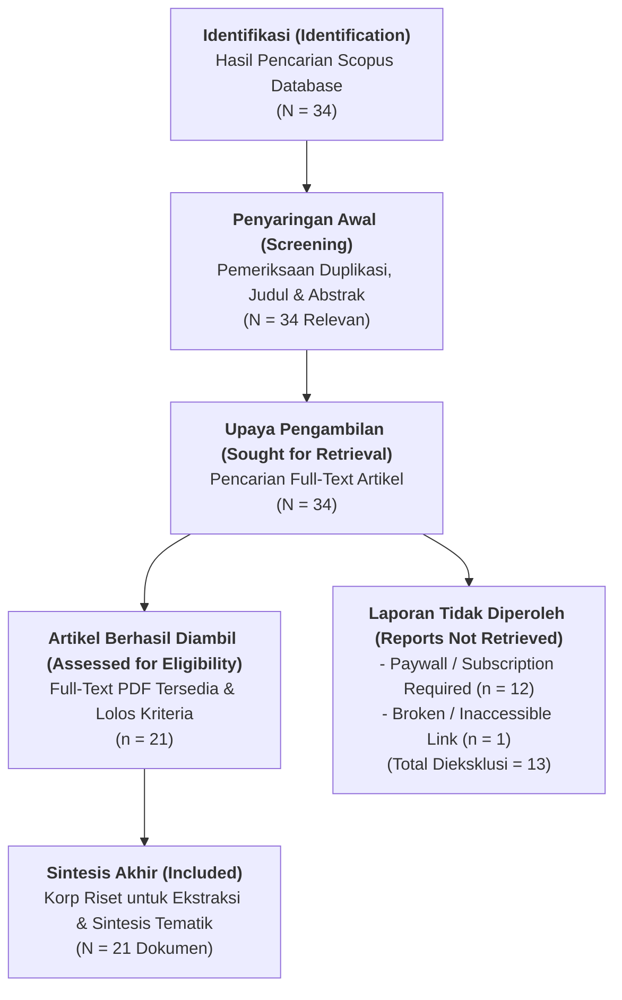

# 🔄 RENCANA OPERASIONAL FINAL: SYSTEMATIC LITERATURE REVIEW (SLR)
## Deep Knowledge Tracing untuk Penalaran Logis dan Computational Thinking dalam Pembelajaran Adaptif (2021–2026)

Target Luaran: **Jurnal Terindeks SINTA 3** (Bidang Pendidikan Teknologi / Ilmu Komputer / Pembelajaran Digital)

---

## 🧭 Diagram Alir Metodologi PRISMA 2020 (Status Final)



---

## 🔍 1. Parameter Pencarian Scopus & Protokol Seleksi

### Search String Resmi (Telah Dieksekusi):
```text
TITLE-ABS-KEY ( ( "Deep Knowledge Tracing" OR "Knowledge Tracing" ) AND ( "Adaptive Learning" OR "Intelligent Tutoring System" OR "Personalized Learning" OR "ITS" ) AND ( "Logical Reasoning" OR "Logical Thinking" OR "Problem Solving" OR "Computational Thinking" ) ) AND PUBYEAR > 2020 AND DOCTYPE ( ar OR cp ) AND LANGUAGE ( english OR indonesian )
```

### Justifikasi Metodologis Eksklusi (Untuk Bab Metode):
> *"Dari 34 rekaman literatur awal yang teridentifikasi dalam basis data Scopus, seluruh artikel diperiksa kesesuaian judul dan abstraknya. Pada tahap pengambilan naskah lengkap (full-text retrieval), sebanyak 13 dokumen tidak dapat diperoleh (reports not retrieved) karena pembatasan langganan berbayar (subscription-based access/paywall, n=12) serta ketidakterjangkauan repositori penerbit (inaccessible repository link, n=1). Dengan demikian, sebanyak 21 artikel dengan naskah lengkap (open access dan terverifikasi) memenuhi kriteria kelayakan dan disertakan (included) dalam sintesis kualitatif dan kuantitatif secara mendalam."*

---

## 📚 2. Korpus 21 Artikel Terinklusi (Included Full-Text)

Berikut 21 artikel ilmiah yang telah tersinkronisasi dan file PDF-nya tersimpan di subfolder [`pdf/`](file:///c:/kuliah/semester_7/skripsi/slr/pdf):

| No | Tahun | Judul Artikel | File PDF | Fokus Klaster |
|:--:|:----:|:---------------------------------------------------------------------------------------------------------------------------------------------------------|:-------------------------------------------------------------------------------------------------------------------------------------------------------------|:-------------------|
| 1 | 2024 | Remembering is Not Applying: Interpretable Knowledge Tracing for Problem-solving Processes | `Remembering is Not Applying Interpretable Knowledge Tracing for Problem-solving Processes.pdf` | GNN & Problem-Solving |
| 2 | 2025 | Data Augmentation for Sparse Multidimensional Learning Performance Data Using Generative AI | `Data Augmentation for Sparse Multidimensional Learning Performance Data Using Generative AI.pdf` | Generative AI & Data Sparsity |
| 3 | 2023 | Learning Logical Reasoning Using an Intelligent Tutoring System: A Hybrid Approach to Student Modeling | `Learning Logical Reasoning Using an Intelligent Tutoring System A Hybrid Approach to Student Modeling.pdf` | Hybrid ITS & Logic Modeling |
| 4 | 2024 | Modeling Student Performance Using Feature Crosses Information for Knowledge Tracing | `Modeling Student Performance Using Feature Crosses Information for Knowledge Tracing.pdf` | Feature Crosses DKT |
| 5 | 2026 | Knowledge tracing in mathematical problem-solving processes: a spatio-temporal graph neural network approach | `Knowledge tracing in mathematical problem-solving processes a spatio-temporal graph neural network approach.pdf` | Spatio-Temporal GNN |
| 6 | 2022 | Infusing Expert Knowledge Into a Deep Neural Network Using Attention Mechanism for Personalized Learning Environments | `Infusing Expert Knowledge Into a Deep Neural Network Using Attention Mechanism for Personalized Learning Environments.pdf` | Attention + Expert Knowledge |
| 7 | 2024 | Adapting DAS3H Model for a Personalized Distributed Practice Schedule to Improve Long-Term Memorization in Designing an Intelligent Programming Language Tutor | `Adapting DAS3H Model for a Personalized Distributed Practice Schedule to Improve Long-Term Memorization in Designing an Intelligent Programming Language Tutor.pdf` | Distributed Practice / DAS3H |
| 8 | 2023 | Unlocking Math Potential: EDSense - A Personalized Intervention Tool for Children with Dyscalculia | `Unlocking Math Potential EDSense - A Personalized Intervention Tool for Children with Dyscalculia.pdf` | Personalized Adaptive Tool |
| 9 | 2024 | A Survey of Knowledge Tracing: Models, Variants, and Applications | `A Survey of Knowledge Tracing Models, Variants, and Applications.pdf` | Baseline Survey & Taxonomy |
| 10 | 2023 | Let GPT be a Math Tutor: Teaching Math Word Problem Solvers with Customized Exercise Generation | `Let GPT be a Math Tutor Teaching Math Word Problem Solvers with Customized Exercise Generation.pdf` | LLM Exercise Generation |
| 11 | 2025 | CLST: Cold-Start Mitigation in Knowledge Tracing by Aligning a Generative Language Model as a Students' Knowledge Tracer | `CLST Cold-Start Mitigation in Knowledge Tracing by Aligning a Generative Language Model as a Students' Knowledge Tracer.pdf` | LLM Knowledge Tracing & Cold-Start |
| 12 | 2021 | Knowledge tracing for complex problem solving: Granular rank-based tensor factorization | `Knowledge tracing for complex problem solving Granular rank-based tensor factorization.pdf` | Tensor Factorization (GRATE) |
| 13 | 2026 | Guiding, Not Solving: Agentic Scaffolding for LLM Programming Tutors | `Guiding, Not Solving Agentic Scaffolding for LLM Programming Tutors.pdf` | Agentic Scaffolding LLM |
| 14 | 2026 | Optimizing Mastery Learning by Fast-Forwarding Over-Practice Steps | `Optimizing Mastery Learning by Fast-Forwarding Over-Practice Steps.pdf` | Mastery Learning Optimization |
| 15 | 2026 | GuideAI: A Real-time Personalized Learning Solution with Adaptive Interventions | `GuideAI A Real-time Personalized Learning Solution with Adaptive Interventions.pdf` | Real-time Adaptive ITS |
| 16 | 2026 | Affect is key: Enhancing knowledge tracing with hypergraph-based affective state modeling | `Affect is key Enhancing knowledge tracing with hypergraph-based affective state modeling.pdf` | Hypergraph Affective State |
| 17 | 2026 | Tracing Mathematical Proficiency Through Problem-Solving Processes | `Tracing Mathematical Proficiency Through Problem-Solving Processes.pdf` | Multi-step Problem Solving |
| 18 | 2024 | Design and Implementation of an AI-Enhanced Heuristic Learning System in a Virtual Realm | `Design and Implementation of an AI-Enhanced Heuristic Learning System in a Virtual Realm.pdf` | Virtual Heuristic Learning |
| 19 | 2026 | Leveraging LLM and Multiscale Knowledge States to Improve Knowledge Tracing in Programming Tasks | `Leveraging LLM and Multiscale Knowledge States to Improve Knowledge Tracing in Programming Tasks.pdf` | Multiscale State & LLM |
| 20 | 2025 | Difficulty aware programming knowledge tracing via large language models | `Difficulty aware programming knowledge tracing via large language models.pdf` | Difficulty-Aware LLM DKT |
| 21 | 2026 | SageJavon: A scalable AI tutor for personalized programming learning | `SageJavon A scalable AI tutor for personalized programming learning.pdf` | Scalable AI Programming Tutor |

---

## 🎯 3. Pemetaan Tiga Tema Pembahasan Utama

1. **Tema 1: Integrasi Large Language Models (LLM) & Agen Cerdas dalam Pelacakan Pengetahuan**
   * Pergeseran paradigma dari *black-box* DKT berbasis representasi sekuensial (LSTM) murni ke model hibrida LLM.
   * Contoh artikel kunci: *Difficulty Aware DKT via LLMs (2025)*, *CLST Cold-Start Mitigation (2025)*, *Guiding, Not Solving (2026)*, *Leveraging LLM & Multiscale States (2026)*, *SageJavon (2026)*.
2. **Tema 2: Arsitektur Kompleks untuk Proses Penalaran Logis dan Problem-Solving**
   * Pemanfaatan *Graph Neural Networks (GNN)*, *Spatio-Temporal GNN*, *Tensor Factorization*, dan *Hypergraph* guna menangkap dependensi konsep multi-langkah dan status afektif peserta didik.
   * Contoh artikel kunci: *Spatio-Temporal GNN (2026)*, *Remembering is Not Applying (2024)*, *Affect is Key (2026)*, *GRATE (2021)*.
3. **Tema 3: Lingkungan Pembelajaran Adaptif dan Intervensi Personalisasi Berbasis DKT**
   * Implementasi praktis pada *Intelligent Tutoring Systems (ITS)* untuk pemrograman (*programming*) dan matematika, strategi *distributed practice* (DAS3H), dan pengurangan *over-practice*.
   * Contoh artikel kunci: *GuideAI (2026)*, *Optimizing Mastery Learning (2026)*, *Adapting DAS3H (2024)*, *Learning Logical Reasoning ITS (2023)*.

---

## 🚀 4. Tahapan Tindakan Selanjutnya (Action Plan) - Status Eksekusi

1. **Penyusunan `writing_plan.md`**: Menetapkan struktur bab, alokasi kata, Research Questions (RQ1–RQ3), dan timeline pengerjaan naskah. (**SELESAI**)
2. **Pengisian Matriks Ekstraksi**: Mengisi rincian teknis dari 21 artikel (arsitektur, dataset, metrik evaluasi AUC/RMSE/Accuracy, temuan spesifik) pada `ekstraksi_21_paper_slr.md`. (**SELESAI**)
3. **Drafting Naskah SLR**: Menulis naskah lengkap per bagian di subfolder `draft_sections/` dan digabungkan menjadi naskah komprehensif `naskah_slr_lengkap.md`. (**SELESAI**)
4. **Audit Sitasi & Telaah Kualitas (Review)**: Verifikasi kesesuaian referensi (APA 7th Edition), eliminasi pola teks generik/klise, dan pemeriksaan integritas data. (**SELESAI**)
