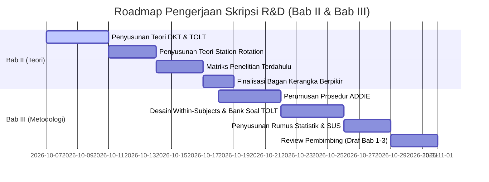

# HANDOFF DOCUMENT: PANDUAN PENYUSUNAN BAB II & BAB III SKRIPSI R&D
**Program Studi Pendidikan Ilmu Komputer — FPMIPA Universitas Pendidikan Indonesia**

> **Judul Skripsi:**  
> **"Pengembangan Web Evaluasi Formatif Adaptif Berbasis Deep Knowledge Tracing (DKT) dalam Pembelajaran Station Rotation untuk Meningkatkan Logical Thinking Siswa SMK"**  
>
> **Topik Utama:** Artificial Intelligence in Education (AIEd), Blended Learning (Station Rotation), Asesmen Formatif Adaptif, *Logical Thinking* (TOLT Tobin & Capie, 1981).  
> **Konteks/Lokus:** Konsentrasi Keahlian Teknik Komputer dan Jaringan (TKJ) Kelas XI SMK (Materi: Perencanaan Pengalamatan & Konfigurasi Jaringan).  
> **Masalah Fasilitas:** Keterbatasan rasio laboratorium komputer (1 PC : 2 Siswa) yang diselesaikan melalui strategi *Device-Purpose Split*.

---

# BAGIAN 1: PANDUAN LENGKAP BAB II (TINJAUAN PUSTAKA)

Bab II berfungsi membangun **fondasi teoretis, keterhubungan variabel, dan kerangka berpikir ilmiah**. Di sinilah seluruh teori yang sebelumnya dipangkas dari Bab I (seperti 5 dimensi TOLT, pemodelan matematis RNN DKT, dan sintaks Station Rotation) dijabarkan secara mendalam, terstruktur, dan komprehensif.

---

## 1.1 Struktur Sistematika Subbab Bab II

```
BAB II TINJAUAN PUSTAKA
  2.1 Evaluasi Formatif Adaptif dalam Pendidikan Kejuruan
      2.1.1 Konsep dan Fungsi Evaluasi Formatif Diagnostik
      2.1.2 Personalisasi Pembelajaran dan Asesmen Adaptif
  2.2 Pemodelan Kognitif Berbasis Deep Knowledge Tracing (DKT)
      2.2.1 Konsep Knowledge Tracing (Dari BKT Menuju DKT)
      2.2.2 Arsitektur Recurrent Neural Network (RNN) dan LSTM pada DKT
      2.2.3 Formulasi Matematis Pembaruan State dan Probabilitas Penguasaan
      2.2.4 Pemetaan Komponen Pengetahuan (Knowledge Components / KC)
  2.3 Model Pembelajaran Blended Learning Tipe Station Rotation
      2.3.1 Konsep Dasar Blended Learning dan Taksonomi Horn & Staker
      2.3.2 Sintaks Pembelajaran Station Rotation 3 Stasiun
      2.3.3 Strategi Device-Purpose Split untuk Mengatasi Rasio Lab (1 PC : 2 Siswa)
  2.4 Kemampuan Logical Thinking dalam Bidang Jaringan Komputer
      2.4.1 Hakikat Logical Thinking dan Perkembangan Kognitif Formal
      2.4.2 Kerangka Kerja Test of Logical Thinking (TOLT) Tobin & Capie (1981)
      2.4.3 Kontekstualisasi 5 Dimensi TOLT pada Materi TKJ
  2.5 Materi Perencanaan dan Konfigurasi Jaringan sebagai Domain Pengetahuan
      2.5.1 Perencanaan Pengalamatan Jaringan (Subnetting, CIDR, VLSM)
      2.5.2 Konfigurasi Perangkat Jaringan (Routing Statis dan Routing Table)
      2.5.3 Analisis Troubleshooting Koneksi Jaringan (ICMP, RTO, DHU)
  2.6 Kajian Penelitian Terdahulu yang Relevan (Matriks Sintesis Literatur)
  2.7 Kerangka Berpikir (Conceptual Framework)
```

---

## 1.2 Rincian Muatan per Subbab Bab II

### 2.1 Evaluasi Formatif Adaptif dalam Pendidikan Kejuruan
* **Fokus Pembahasan:** 
  * Bedakan secara tegas antara evaluasi sumatif (mengukur hasil akhir) dan evaluasi formatif (memperbaiki proses belajar berkelanjutan).
  * Jelaskan kelemahan evaluasi statis konvensional di SMK: memberikan soal yang seragam tanpa peduli siswa sudah paham konsep prasyarat atau belum.
  * Masukkan konsep *Computerized Adaptive Testing* (CAT) dan bagaimana AI memungkinkan evaluasi formatif menyajikan *scaffolding* (bantuan bertahap) sesuai zona perkembangan proksimal (ZPD Vygotsky).

### 2.2 Pemodelan Kognitif Berbasis Deep Knowledge Tracing (DKT)
* **Fokus Pembahasan:**
  * **Evolusi:** Bandingkan secara ringkas kelemahan *Bayesian Knowledge Tracing* (BKT) yang kaku karena butuh graf manual pakar dengan keunggulan DKT (Piech et al., 2015; Abdelrahman et al., 2023) yang mampu menangkap pengetahuan laten dari data sekuensial interaksi siswa.
  * **Matematis & Arsitektur:** Masukkan diagram alir RNN/LSTM DKT. Tuliskan rumus formal:
    $$\text{Input: } x_t = (q_t, a_t) \quad \text{atau vektor one-hot } 2Q$$
    $$\text{Hidden State: } h_t = \tanh(W_{hx} x_t + W_{hh} h_{t-1} + b_h)$$
    $$\text{Luaran Sigmoid: } y_t = \sigma(W_{yh} h_t + b_y)$$
  * **Knowledge Components (KC):** Jelaskan bahwa soal kuis tidak berdiri sendiri, melainkan diikat ke dalam butir-butir KC materi jaringan agar DKT dapat melacak konsep mana yang sudah dikuasai dan mana yang belum.

### 2.3 Model Blended Learning Tipe Station Rotation
* **Fokus Pembahasan:**
  * Rujuk taksonomi resmi Horn & Staker (2014) mengenai model rotasi (*Station Rotation*).
  * Uraikan sintaks 3 stasiun secara operasional:
    1. *Online Adaptive Station:* Siswa mengakses kuis adaptif DKT via HP pribadi (menjawab soal logika & menerima scaffolding mandiri).
    2. *Teacher-Led Station:* Guru memberikan bimbingan remedial pada kelompok kecil berbasis dasbor analitik DKT.
    3. *Collaborative / Hands-on Practice Station:* Siswa mempraktikkan konfigurasi jaringan di PC lab (1 siswa 1 PC karena kelas dirotasi 50:50).
  * **Argumen Kuat:** Tekankan strategi *Device-Purpose Split* sebagai inovasi mengatasi kendala keterbatasan sarana lab di SMK.

### 2.4 Kemampuan Logical Thinking dalam Bidang Jaringan Komputer
* **Fokus Pembahasan:**
  * Paparkan teori Piaget mengenai transisi berpikir operasional konkret ke operasional formal.
  * Jelaskan kerangka kerja baku **Test of Logical Thinking (TOLT) oleh Tobin & Capie (1981)**.
  * Buat tabel dekomposisi 5 dimensi TOLT ke dalam aktivitas kejuruan TKJ:
    1. *Controlling Variables:* Isolasi variabel gangguan jaringan saat troubleshooting.
    2. *Combinatorial Reasoning:* Merancang skema kombinasi partisi blok subnet (VLSM).
    3. *Proportional Reasoning:* Menghitung rasio eksponensial kapasitas host vs prefix CIDR.
    4. *Probabilistic Reasoning:* Evaluasi pemilihan jalur terbaik (*best path*) berbasis metrik/AD.
    5. *Correlational Reasoning:* Korelasi pesan galat (RTO vs DHU) terhadap lapisan TCP/IP.

### 2.5 Materi Perencanaan dan Konfigurasi Jaringan
* **Fokus Pembahasan:** 
  * Tinjau kurikulum SMK Konsentrasi Keahlian TKJ kelas XI (Capaian Pembelajaran Elemen Pengalamatan & Konfigurasi Jaringan).
  * Paparkan materi inti: Perhitungan subnetting (FLSM vs VLSM), konsep default gateway, pengisian tabel routing statis (*destination, netmask, next-hop/gateway*), dan diagnosis kegagalan konektivitas (*ping, traceroute*).

### 2.6 Kajian Penelitian Terdahulu yang Relevan
* **Bentuk Penyajian:** Sajikan tabel komparasi 4–6 penelitian jurnal bereputasi (2020–2025) yang mencakup:
  * Peneliti & Tahun | Judul | Metode | Hasil Utama | Persamaan | Perbedaan / Kebaruan (*Novelty*) Skripsi Anda.
* **Poin Penegasan Kebaruan:** Kebaruan penelitian ini terletak pada integrasi algoritma DKT langsung ke dalam sintaks rotasi fisik kelas kejuruan (*Station Rotation*) untuk melatih 5 dimensi penalaran TOLT pada materi jaringan komputer.

### 2.7 Kerangka Berpikir (Conceptual Framework)
* **Bentuk Penyajian:** Buat narasi logis dari kondisi awal (identifikasi masalah di SMK) $\rightarrow$ tindakan/pengembangan (R&D Web DKT + Station Rotation) $\rightarrow$ kondisi akhir yang diharapkan (peningkatan *Logical Thinking* dan efisiensi lab).
* Lengkapi dengan **Bagan Kerangka Berpikir** kotak-dan-panah yang terstruktur rapi.

---

# BAGIAN 2: PANDUAN LENGKAP BAB III (METODOLOGI PENELITIAN)

Bab III adalah **resep kerja ilmiah**. Karena penelitian ini adalah *Research and Development* (R&D) yang dipadukan dengan pengujian efektivitas kognitif, Bab III harus merinci model pengembangan sistem dan desain eksperimen pengujian secara presisi.

---

## 2.1 Struktur Sistematika Subbab Bab III

```
BAB III METODOLOGI PENELITIAN
  3.1 Model Pengembangan Penelitian (Model ADDIE)
  3.2 Prosedur Pengembangan Sistem dan Pembelajaran
      3.2.1 Tahap Analisis (Analysis)
      3.2.2 Tahap Perancangan (Design)
      3.2.3 Tahap Pengembangan (Development)
      3.2.4 Tahap Implementasi (Implementation)
      3.2.5 Tahap Evaluasi (Evaluation)
  3.3 Desain Uji Coba Produk dan Pembelajaran
      3.3.1 Desain Uji Coba Lapangan (Within-Subjects Repeated Measures Design)
      3.3.2 Subjek dan Tempat Penelitian
  3.4 Instrumen Pengumpulan Data
      3.4.1 Instrumen Validasi Ahli (Materi dan Media)
      3.4.2 Instrumen Tes Kemampuan Logical Thinking (Pre-test & Post-test TOLT)
      3.4.3 Instrumen Angket Kepraktisan dan Usability (SUS / TAM)
      3.4.4 Log Data Interaksi DKT
  3.5 Teknik Analisis Data
      3.5.1 Analisis Kelayakan dan Validitas Produk
      3.5.2 Analisis Peningkatan Kemampuan Logical Thinking (N-Gain Score)
      3.5.3 Analisis Uji Statistik Signifikansi (Uji Normalitas & Paired t-Test / Wilcoxon)
      3.5.4 Analisis Kinerja Model DKT (Akurasi Prediksi & Kurva Tracing)
      3.5.5 Analisis Respons Kepraktisan dan Usability Pengguna
```

---

## 2.2 Rincian Muatan per Subbab Bab III

### 3.1 & 3.2 Model dan Prosedur Pengembangan (ADDIE)
Uraikan langkah nyata pada setiap fase model ADDIE:
1. **Analysis (Analisis):**
   * *Analisis Kebutuhan:* Mengolah hasil studi pendahuluan (angket siswa, wawancara guru, observasi lab 1 PC : 2 siswa).
   * *Analisis Kurikulum & Materi:* Memetakan materi jaringan ke dalam butir-butir *Knowledge Components* (KC).
   * *Analisis Karakteristik Siswa:* Mengidentifikasi kelemahan penalaran logis awal berbasis TOLT.
2. **Design (Perancangan):**
   * *Desain Sistem Web DKT:* Perancangan arsitektur sistem, *database schema*, antarmuka pengguna (*UI/UX mobile responsive*), dan dasbor guru.
   * *Desain Model AI DKT:* Penentuan struktur RNN/LSTM, representasi vektor input $x_t$, dan fungsi *loss* binary cross-entropy.
   * *Desain Pedagogis:* Penyusunan modul ajar / RPP model *Station Rotation* dengan alokasi waktu stasiun (misal: 10 menit kuis awal $\rightarrow$ 25 menit rotasi stasiun 1 & 2 $\rightarrow$ 10 menit kuis akhir refleksi).
3. **Development (Pengembangan):**
   * *Pengkodean Web:* Pembangunan front-end, back-end API, dan modul inferensi DKT.
   * *Penyusunan Bank Soal:* Pembuatan bank soal kuis formatif yang diberi tag dimensi TOLT dan tingkat kesulitan.
   * *Validasi Ahli (Expert Judgment):* Uji validitas isi dan konstruk oleh ahli materi jaringan dan ahli media pembelajaran komputer.
4. **Implementation (Implementasi):**
   * Uji coba pembelajaran di kelas XI TKJ SMK mitra menerapkan sintaks *Station Rotation* dan web DKT.
5. **Evaluation (Evaluasi):**
   * Evaluasi formatif sepanjang siklus ADDIE dan evaluasi sumatif (mengukur N-Gain *Logical Thinking* dan skor *Usability*).

---

### 3.3 Desain Uji Coba Lapangan: *Within-Subjects Repeated Measures Design*

* **Mengapa Desain Ini?**
  * Penelitian ini menggunakan satu kelompok subjek (1 rombel kelas XI TKJ) yang menjadi objek penelitian secara penuh, tanpa kelas kontrol pembanding. Seluruh siswa mendapatkan perlakuan yang sama sehingga tidak ada kelompok yang dirugikan.
  * Desain ini dipilih atas rekomendasi dosen pembimbing dan sesuai dengan karakteristik penelitian R&D di konteks SMK di mana jumlah kelas terbatas.
  * Pengukuran dilakukan berulang kali pada kelompok yang **sama** (*repeated measures*): sebelum perlakuan, dan sesudah perlakuan, sehingga setiap siswa menjadi *control-nya sendiri*. Ini secara statistik lebih sensitif mendeteksi perubahan dibanding desain dua kelompok.
  * **Kunci kevalidan desain ini:** meskipun tanpa kelas kontrol, validitas internal dijaga melalui: (a) *pre-test* sebagai baseline yang ketat, (b) pengujian N-Gain untuk mengukur besar perubahan relatif, dan (c) uji signifikansi statistik (*Paired t-Test* / Wilcoxon) untuk membuktikan bahwa perubahan bukan karena kebetulan.

* **Bagan Desain Penelitian:**

$$\begin{array}{ccccc}
O_1 & \rightarrow & X & \rightarrow & O_2
\end{array}$$

| Notasi | Keterangan |
|--------|-----------|
| $O_1$ | *Pre-test* kemampuan *Logical Thinking* (TOLT Jaringan) sebelum perlakuan |
| $X$ | Perlakuan: Implementasi Web DKT dalam sintaks model *Station Rotation* (serangkaian sesi pembelajaran) |
| $O_2$ | *Post-test* kemampuan *Logical Thinking* (TOLT Jaringan) setelah perlakuan |

* **Alur Pelaksanaan per Sesi Pembelajaran** (Konteks *Station Rotation*):
  ```
  [Sesi Belajar]
  ├── 10 menit : Kuis Formatif Awal via Web DKT (seluruh siswa, HP masing-masing)
  ├── 25 menit : Rotasi Stasiun (Kelompok A ↔ Kelompok B bergantian)
  │              ├── Stasiun 1 – PC Lab (Konfigurasi Jaringan Hands-on)
  │              └── Stasiun 2 – Teacher-Led (Bimbingan diagnostik berbasis dasbor DKT)
  └── 10 menit : Kuis Formatif Akhir / Refleksi via Web DKT (seluruh siswa, HP)
  ```
  *Catatan: Rotasi kelompok (A ↔ B) adalah mekanisme **manajemen stasiun** dalam satu sesi pembelajaran, bukan pengulangan perlakuan untuk mengukur efek eksperimen yang berbeda. Pre-test dan Post-test keseluruhan tetap dilakukan satu kali di awal dan akhir unit pembelajaran.*


---

### 3.4 Instrumen Pengumpulan Data
Rinci 4 instrumen pengumpul data yang digunakan:
1. **Lembar Validasi Ahli:** Skala Likert 1–4 untuk ahli media dan ahli materi (mengukur kelayakan tampilan, navigasi, akurasi materi, dan keselarasan DKT).
2. **Tes Logical Thinking (TOLT Jaringan):** Soal *Pre-test* dan *Post-test* pilihan ganda beralasan (*two-tier*) atau aplikatif yang menguji 5 dimensi penalaran TOLT.
3. **Angket Usability / Respons Siswa:** Menggunakan kuesioner terstandarisasi *System Usability Scale* (SUS) dengan 10 butir pernyataan untuk mengukur tingkat kepuasan dan kemudahan navigasi web DKT.
4. **Log Data DKT:** Rekaman sekuensial interaksi siswa di database web (waktu respons, kebenaran jawaban, probabilitas $y_t$).

---

### 3.5 Teknik Analisis Data
Jabarkan rumus-rumus analisis data secara formal:
1. **Analisis Kelayakan Ahli:**
   $$P = \frac{\sum x}{\sum x_{\text{maks}}} \times 100\%$$
   Disertai tabel kriteria kelayakan (Sangat Layak, Layak, Cukup Layak, Tidak Layak).
2. **Analisis Peningkatan Logical Thinking (N-Gain Hake, 1999):**
   $$g = \frac{S_{\text{post}} - S_{\text{pre}}}{S_{\text{maks}} - S_{\text{pre}}}$$
   Disertai kategori efektivitas ($g \ge 0,7$ Tinggi; $0,3 \le g < 0,7$ Sedang; $g < 0,3$ Rendah).
3. **Uji Hipotesis Statistik:**
   * Uji Normalitas (Shapiro-Wilk karena sampel kelas $\le 50$).
   * Jika data berdistribusi normal $\rightarrow$ gunakan *Paired Sample t-Test*.
   * Jika tidak normal $\rightarrow$ gunakan uji non-parametrik *Wilcoxon Signed-Rank Test*.
4. **Analisis Model DKT:**
   * Metrik evaluasi model AI: *Area Under ROC Curve* (AUC) dan *Root Mean Squared Error* (RMSE) untuk membuktikan akurasi prediksi DKT.
   * Visualisasi *Knowledge Growth Curve* (grafik kenaikan probabilitas pemahaman 5 dimensi TOLT tiap siswa).
5. **Analisis Usability (SUS):**
   * Perhitungan skor SUS (rentang 0–100) dan penentuan kategori *Acceptability Ranges, Grade Scale,* dan *Adjective Ratings* (target skor SUS $> 68$ / kategori *Good*).

---

# BAGIAN 3: CHECKLIST AKSI & TIMELINE PENGERJAAN



---

# BAGIAN 4: RUJUKAN KUNCI SIAP PAKAI (VERIFIED APA 7th)

Simpan rujukan terverifikasi ini untuk dikutip langsung pada Bab II dan Bab III Anda:

```text
Abdelrahman, G., Wang, Q., & Nunes, B. (2023). Knowledge tracing: A survey. ACM Computing Surveys, 55(11), Article 224, 1–37. https://doi.org/10.1145/3569576

Brooke, J. (1996). SUS: A 'quick and dirty' usability scale. Dalam P. W. Jordan, B. Thomas, B. A. Weerdmeester, & I. L. McClelland (Ed.), Usability Evaluation in Industry (hlm. 189–194). Taylor & Francis.

Hake, R. R. (1999). Analyzing change/gain scores. American Educational Research Association's Division D, Newsletter, 1–4.

Horn, M. B., & Staker, H. (2014). Blended: Using disruptive innovation to improve schools. Jossey-Bass.

Piech, C., Bassen, J., Huang, J., Ganguli, S., Sahami, M., Guibas, L. J., & Sohl-Dickstein, J. (2015). Deep knowledge tracing. Advances in Neural Information Processing Systems (NeurIPS 2015), 28, 505–513.

Shute, V. J., Sun, C., & Asbell-Clarke, J. (2017). Demystifying computational thinking. Educational Research Review, 22, 142–158. https://doi.org/10.1016/j.edurev.2017.09.003

Tobin, K. G., & Capie, W. (1981). The development and validation of a group test of logical thinking. Educational and Psychological Measurement, 41(2), 413–423. https://doi.org/10.1177/001316448104100220

Truitt, A. A., & Ku, H. Y. (2018). A case study of third grade students' perceptions of the station rotation blended learning model. Educational Technology Research and Development, 66(5), 1227–1249. https://doi.org/10.1007/s11423-018-9608-3
```

---

Dokumen ini telah disimpan di direktori proyek skripsi Anda:  
📂 **[`c:\kuliah\semester_7\skripsi\handoff_panduan_bab2_bab3.md`](file:///c:/kuliah/semester_7/skripsi/handoff_panduan_bab2_bab3.md)**
